# Fase 2 — Arquitectura y diseño

Universidad Popular del Cesar · Programación de Computadores III (SS462) · Docente: Ing. Esp. Alfredo Bautista 
Integrantes: Kevin Jhosep Mercado · Reinaldo Padilla Pedroza · Dair José Quintero

[README](../README.md) · [Fase 1](FASE1_Especificacion.md) · [Fase 2](FASE2_Arquitectura_y_Diseno.md) · [Fase 3](FASE3_Desarrollo.md) · [Fase 4](FASE4_Documentacion_Tecnica.md) · [Trazabilidad](TRAZABILIDAD.md)

---

## 1. Diagrama de paquetes organizados por capas

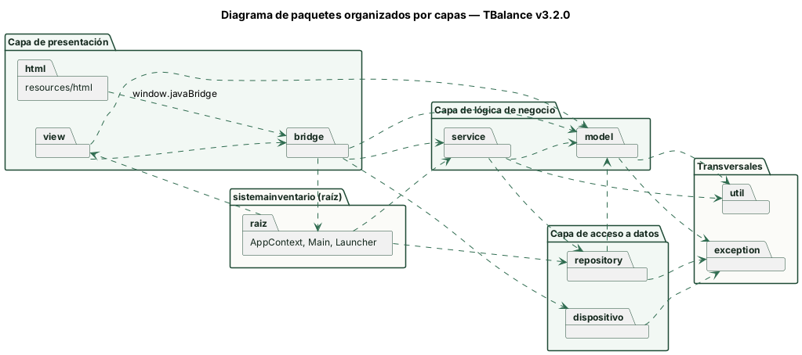

| Capa | Paquetes | Responsabilidad |
|---|---|---|
| Presentación | `resources/html`, `view`, `bridge` | Interfaz web (HTML, CSS y JavaScript), ventana JavaFX con el `WebView` y controladores que reciben los eventos de la vista. |
| Lógica de negocio | `service`, `model` | Casos de uso y reglas de negocio; entidades del dominio con sus propias reglas. |
| Acceso a datos | `repository`, `dispositivo` | Lectura y escritura de archivos JSON, copias `.zip` e imágenes `.png`; acceso a la webcam. |
| Transversal | `util`, `exception` | Utilidades sin estado (fechas, IDs, texto, JSON, QR) y excepciones del proyecto. |
| Raíz | `sistemainventario` | `Launcher` y `Main` arrancan la aplicación; `AppContext` crea y conecta los objetos. |

Las flechas del diagrama son las dependencias reales del código (los `import` de cada paquete). La vista nunca accede a los repositorios: el `bridge` llega a los datos solo a través de los servicios.

## 2. Diagrama de clases

El sistema tiene **69 clases**: 61 concretas (incluye 1 enumeración y 1 record), 4 abstractas y 4 interfaces. Por su tamaño, el diagrama se divide en cuatro vistas. En los diagramas se omiten los getters y setters.

### 2.1 Modelo de dominio (`model`, `exception`)

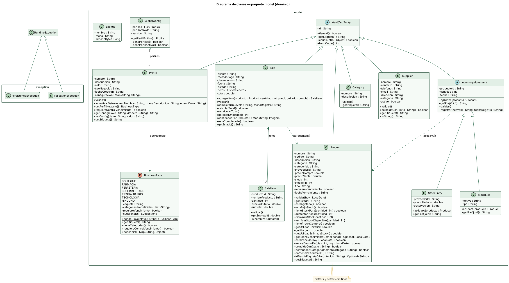

### 2.2 Acceso a datos (`repository`)

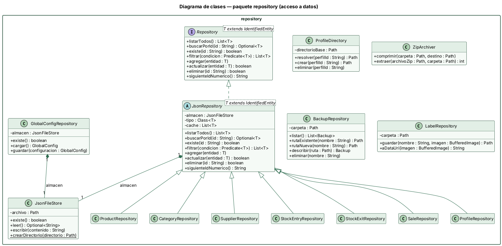

### 2.3 Servicios y raíz de composición (`service`, `AppContext`, `util`)

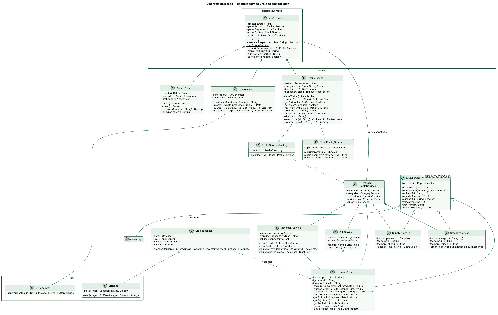

### 2.4 Presentación y dispositivo (`bridge`, `view`, `dispositivo`, `Main`, `Launcher`)

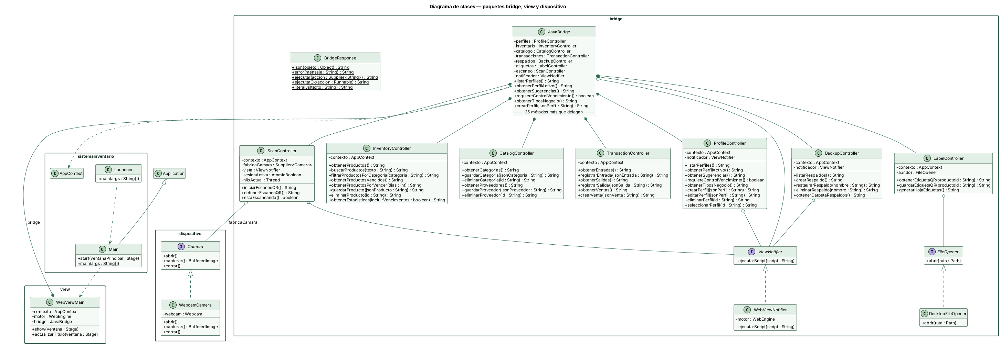

Las fuentes de los diagramas están en [`docs/diagramas`](diagramas) (archivos `.puml` de PlantUML).

### Tabla de identificación de clases

| # | Nombre | Tipo | Descripción y rol |
|---|---|---|---|
| 1 | [`AppContext`](../src/main/java/sistemainventario/AppContext.java) | Concreta | `sistemainventario` — Singleton y raíz de composición: crea los repositorios y servicios, los conecta por constructor y cambia los servicios cuando se activa otro perfil. |
| 2 | [`Launcher`](../src/main/java/sistemainventario/Launcher.java) | Concreta | `sistemainventario` — Punto de entrada que no extiende Application; permite ejecutar la aplicación desde IntelliJ sin configurar módulos de JavaFX. |
| 3 | [`Main`](../src/main/java/sistemainventario/Main.java) | Concreta | `sistemainventario` — Aplicación JavaFX: obtiene el AppContext y abre la ventana principal. |
| 4 | [`Backup`](../src/main/java/sistemainventario/model/Backup.java) | Concreta | `model` — Datos de solo lectura de una copia de seguridad: nombre, fecha y tamaño. |
| 5 | [`BusinessType`](../src/main/java/sistemainventario/model/BusinessType.java) | Enumeración (concreta) | `model` — Enumeración de tipos de negocio con sus categorías predefinidas y sugerencias para los formularios. |
| 6 | [`Category`](../src/main/java/sistemainventario/model/Category.java) | Concreta | `model` — Agrupa los productos de un perfil (por ejemplo “Bebidas”) y valida sus propios datos. |
| 7 | [`GlobalConfig`](../src/main/java/sistemainventario/model/GlobalConfig.java) | Concreta | `model` — Guarda la lista de perfiles y cuál es el perfil activo. |
| 8 | [`IdentifiedEntity`](../src/main/java/sistemainventario/model/IdentifiedEntity.java) | Abstracta | `model` — Superclase abstracta de las entidades persistidas: encapsula el ID y define la igualdad por ID. |
| 9 | [`InventoryMovement`](../src/main/java/sistemainventario/model/InventoryMovement.java) | Abstracta | `model` — Superclase abstracta de los movimientos que cambian el stock; define aplicarA(Product) para que cada subclase lo implemente. |
| 10 | [`Product`](../src/main/java/sistemainventario/model/Product.java) | Concreta | `model` — Artículo del inventario; controla su stock, estado, vencimiento y el texto de su etiqueta QR. |
| 11 | [`Profile`](../src/main/java/sistemainventario/model/Profile.java) | Concreta | `model` — Negocio independiente con sus propios datos, tipo de negocio y configuración. |
| 12 | [`Sale`](../src/main/java/sistemainventario/model/Sale.java) | Concreta | `model` — Sale con uno o varios ítems; crea sus ítems, calcula el total y agrupa cantidades por producto. |
| 13 | [`SaleItem`](../src/main/java/sistemainventario/model/SaleItem.java) | Concreta | `model` — Línea de una venta: producto, cantidad, precio unitario y subtotal. |
| 14 | [`StockEntry`](../src/main/java/sistemainventario/model/StockEntry.java) | Concreta | `model` — Ingreso de mercancía: al aplicarse aumenta el stock del producto. |
| 15 | [`StockExit`](../src/main/java/sistemainventario/model/StockExit.java) | Concreta | `model` — Retiro de mercancía que no es venta (daño, merma, uso interno): al aplicarse disminuye el stock. |
| 16 | [`Supplier`](../src/main/java/sistemainventario/model/Supplier.java) | Concreta | `model` — Distribuidor que abastece productos; valida sus datos y responde búsquedas. |
| 17 | [`PersistenceException`](../src/main/java/sistemainventario/exception/PersistenceException.java) | Concreta | `exception` — Excepción no comprobada para errores al leer o escribir archivos de datos. |
| 18 | [`ValidationException`](../src/main/java/sistemainventario/exception/ValidationException.java) | Concreta | `exception` — Excepción no comprobada para reglas de negocio o datos de entrada inválidos. |
| 19 | [`BackupRepository`](../src/main/java/sistemainventario/repository/BackupRepository.java) | Concreta | `repository` — Lista, ubica y elimina los archivos .zip de la carpeta de respaldos, validando sus nombres. |
| 20 | [`CategoryRepository`](../src/main/java/sistemainventario/repository/CategoryRepository.java) | Concreta | `repository` — Repositorio de categorías de un perfil en categorias.json. |
| 21 | [`GlobalConfigRepository`](../src/main/java/sistemainventario/repository/GlobalConfigRepository.java) | Concreta | `repository` — Lee y escribe configuracion-global.json mediante JsonFileStore. |
| 22 | [`JsonFileStore`](../src/main/java/sistemainventario/repository/JsonFileStore.java) | Concreta | `repository` — Lee y escribe un archivo de texto; escribe primero un archivo temporal y luego reemplaza el original. |
| 23 | [`JsonRepository`](../src/main/java/sistemainventario/repository/JsonRepository.java) | Abstracta | `repository` — Implementación genérica de Repository: mantiene la lista en memoria y la guarda en un archivo JSON. |
| 24 | [`LabelRepository`](../src/main/java/sistemainventario/repository/LabelRepository.java) | Concreta | `repository` — Guarda las etiquetas como imágenes PNG y las convierte a data URI para la vista. |
| 25 | [`ProductRepository`](../src/main/java/sistemainventario/repository/ProductRepository.java) | Concreta | `repository` — Repositorio de productos de un perfil en productos.json. |
| 26 | [`ProfileDirectory`](../src/main/java/sistemainventario/repository/ProfileDirectory.java) | Concreta | `repository` — Crea, ubica y elimina las carpetas de datos de cada perfil. |
| 27 | [`ProfileRepository`](../src/main/java/sistemainventario/repository/ProfileRepository.java) | Concreta | `repository` — Repositorio de la lista de perfiles en perfiles.json. |
| 28 | [`Repository`](../src/main/java/sistemainventario/repository/Repository.java) | Interfaz | `repository` — Contrato genérico de acceso a datos (listar, buscar, agregar, actualizar, eliminar) que usan los servicios. |
| 29 | [`SaleRepository`](../src/main/java/sistemainventario/repository/SaleRepository.java) | Concreta | `repository` — Repositorio de ventas de un perfil en ventas.json. |
| 30 | [`StockEntryRepository`](../src/main/java/sistemainventario/repository/StockEntryRepository.java) | Concreta | `repository` — Repositorio de entradas de inventario de un perfil en entradas.json. |
| 31 | [`StockExitRepository`](../src/main/java/sistemainventario/repository/StockExitRepository.java) | Concreta | `repository` — Repositorio de salidas de inventario de un perfil en salidas.json. |
| 32 | [`SupplierRepository`](../src/main/java/sistemainventario/repository/SupplierRepository.java) | Concreta | `repository` — Repositorio de proveedores de un perfil en proveedores.json. |
| 33 | [`ZipArchiver`](../src/main/java/sistemainventario/repository/ZipArchiver.java) | Concreta | `repository` — Comprime una carpeta en un .zip y lo extrae, rechazando rutas que salgan de la carpeta destino. |
| 34 | [`BackupService`](../src/main/java/sistemainventario/service/BackupService.java) | Concreta | `service` — Crea, lista, restaura (con copia automática previa) y elimina copias de seguridad. |
| 35 | [`CategoryService`](../src/main/java/sistemainventario/service/CategoryService.java) | Concreta | `service` — Reglas de las categorías; crea las categorías predefinidas del tipo de negocio y asigna ID a las que no tienen. |
| 36 | [`EntityService`](../src/main/java/sistemainventario/service/EntityService.java) | Abstracta | `service` — Servicio base abstracto con el CRUD común; guardar() es un método plantilla (Template Method). |
| 37 | [`GlobalConfigService`](../src/main/java/sistemainventario/service/GlobalConfigService.java) | Concreta | `service` — Lee y actualiza la configuración global (perfil activo y lista de perfiles). |
| 38 | [`InventoryService`](../src/main/java/sistemainventario/service/InventoryService.java) | Concreta | `service` — Reglas del catálogo de productos: validación, búsqueda, filtros y alertas de stock y vencimiento. |
| 39 | [`LabelService`](../src/main/java/sistemainventario/service/LabelService.java) | Concreta | `service` — Dibuja la etiqueta QR de un producto y arma hojas tamaño carta de 18 etiquetas. |
| 40 | [`MovementService`](../src/main/java/sistemainventario/service/MovementService.java) | Concreta | `service` — Registra entradas y salidas aplicando cada movimiento sobre el producto. |
| 41 | [`ProfileService`](../src/main/java/sistemainventario/service/ProfileService.java) | Concreta | `service` — Ciclo de vida de los perfiles: crear, editar, eliminar y seleccionar. |
| 42 | [`ProfileServices`](../src/main/java/sistemainventario/service/ProfileServices.java) | Record (concreta) | `service` — Record que agrupa los cinco gestores que trabajan sobre los datos de un perfil. |
| 43 | [`ProfileServicesFactory`](../src/main/java/sistemainventario/service/ProfileServicesFactory.java) | Concreta | `service` — Crea los repositorios y servicios de un perfil a partir de su carpeta. |
| 44 | [`QrSaleScanner`](../src/main/java/sistemainventario/service/QrSaleScanner.java) | Concreta | `service` — Convierte un cuadro de la cámara en el producto de la etiqueta y evita contar dos veces la misma etiqueta quieta. |
| 45 | [`SaleService`](../src/main/java/sistemainventario/service/SaleService.java) | Concreta | `service` — Registra ventas verificando el stock de todos los productos antes de descontarlo. |
| 46 | [`SupplierService`](../src/main/java/sistemainventario/service/SupplierService.java) | Concreta | `service` — Reglas y búsqueda de proveedores. |
| 47 | [`BackupController`](../src/main/java/sistemainventario/bridge/BackupController.java) | Concreta | `bridge` — Controlador de los casos de uso de copias de seguridad. |
| 48 | [`BridgeResponse`](../src/main/java/sistemainventario/bridge/BridgeResponse.java) | Concreta | `bridge` — Da formato a las respuestas para JavaScript (OK, JSON o “ERROR: …”) y centraliza el manejo de excepciones del bridge. |
| 49 | [`CatalogController`](../src/main/java/sistemainventario/bridge/CatalogController.java) | Concreta | `bridge` — Controlador de los casos de uso de categorías y proveedores: convierte el JSON de la vista y delega en los gestores. |
| 50 | [`DesktopFileOpener`](../src/main/java/sistemainventario/bridge/DesktopFileOpener.java) | Concreta | `bridge` — Implementación de FileOpener con java.awt.Desktop. |
| 51 | [`FileOpener`](../src/main/java/sistemainventario/bridge/FileOpener.java) | Interfaz | `bridge` — Contrato para abrir un archivo o carpeta con el programa predeterminado del sistema operativo. |
| 52 | [`InventoryController`](../src/main/java/sistemainventario/bridge/InventoryController.java) | Concreta | `bridge` — Controlador de los casos de uso de productos y de las estadísticas del dashboard. |
| 53 | [`JavaBridge`](../src/main/java/sistemainventario/bridge/JavaBridge.java) | Concreta | `bridge` — Fachada que la vista web usa como window.javaBridge; no tiene lógica, delega cada método en su controlador. |
| 54 | [`LabelController`](../src/main/java/sistemainventario/bridge/LabelController.java) | Concreta | `bridge` — Controlador de los casos de uso de etiquetas QR: vista previa, guardar una etiqueta y generar la hoja de todos los productos. |
| 55 | [`ProfileController`](../src/main/java/sistemainventario/bridge/ProfileController.java) | Concreta | `bridge` — Controlador de los casos de uso de perfiles: crear, editar, eliminar, seleccionar y describir los tipos de negocio. |
| 56 | [`ScanController`](../src/main/java/sistemainventario/bridge/ScanController.java) | Concreta | `bridge` — Controlador del caso de uso “venta por QR”: enciende la cámara en un hilo propio, envía la vista previa y avisa a la vista cada producto leído. |
| 57 | [`TransactionController`](../src/main/java/sistemainventario/bridge/TransactionController.java) | Concreta | `bridge` — Controlador de los casos de uso que mueven stock: entradas, salidas y ventas. |
| 58 | [`ViewNotifier`](../src/main/java/sistemainventario/bridge/ViewNotifier.java) | Interfaz | `bridge` — Contrato para que Java avise a la vista web ejecutando una función de JavaScript. |
| 59 | [`WebViewNotifier`](../src/main/java/sistemainventario/bridge/WebViewNotifier.java) | Concreta | `bridge` — Implementación de ViewNotifier que ejecuta el script en el WebEngine de JavaFX, en el hilo de la interfaz. |
| 60 | [`WebViewMain`](../src/main/java/sistemainventario/view/WebViewMain.java) | Concreta | `view` — Construye la ventana con el WebView, carga la interfaz HTML, registra el JavaBridge y apaga la cámara al cerrar. |
| 61 | [`Camera`](../src/main/java/sistemainventario/dispositivo/Camera.java) | Interfaz | `dispositivo` — Contrato de una cámara de la que se toman cuadros para leer códigos QR. |
| 62 | [`WebcamCamera`](../src/main/java/sistemainventario/dispositivo/WebcamCamera.java) | Concreta | `dispositivo` — Implementación de Camera con la webcam del computador (librería webcam-capture). |
| 63 | [`DateUtil`](../src/main/java/sistemainventario/util/DateUtil.java) | Concreta | `util` — Utilidades de fecha: fecha actual, conversión y formato. |
| 64 | [`IdGenerator`](../src/main/java/sistemainventario/util/IdGenerator.java) | Concreta | `util` — Genera identificadores con prefijo o numéricos consecutivos. |
| 65 | [`ImageEncoder`](../src/main/java/sistemainventario/util/ImageEncoder.java) | Concreta | `util` — Convierte una imagen en JPEG codificado en Base64 para mostrarla en la vista. |
| 66 | [`JsonUtil`](../src/main/java/sistemainventario/util/JsonUtil.java) | Concreta | `util` — Configuración única de Gson para convertir objetos a JSON y viceversa. |
| 67 | [`QrGenerator`](../src/main/java/sistemainventario/util/QrGenerator.java) | Concreta | `util` — Genera la imagen de un código QR a partir de un texto (ZXing). |
| 68 | [`QrReader`](../src/main/java/sistemainventario/util/QrReader.java) | Concreta | `util` — Lee el texto de un código QR que aparece en una imagen (ZXing). |
| 69 | [`TextUtil`](../src/main/java/sistemainventario/util/TextUtil.java) | Concreta | `util` — Utilidades de texto: vacío, búsqueda sin mayúsculas, normalizar y recortar. |

### Descripción de cada clase

#### Paquete raíz `sistemainventario`

##### AppContext

| Campo | Valor |
|---|---|
| Clase | `AppContext` |
| Paquete | `sistemainventario` |
| Tipo | Concreta |
| Hereda de / implementa | — |
| Responsabilidad principal | Singleton y raíz de composición: crea los repositorios y servicios, los conecta por constructor y cambia los servicios cuando se activa otro perfil. |
| Archivo | [AppContext.java](../src/main/java/sistemainventario/AppContext.java) |

**Atributos**

| Atributo | Tipo | Descripción |
|---|---|---|
| `directorioDatos` | `Path` | Carpeta raíz de los datos (~/.inventariopro/data) |
| `gestorRespaldo` | `BackupService` | Servicio de copias de seguridad |
| `gestorEtiquetas` | `LabelService` | Servicio de etiquetas QR |
| `gestorPerfiles` | `ProfileService` | Servicio de perfiles (se reconstruye al recargar) |
| `serviciosActivos` | `ProfileServices` | Servicios del perfil activo |
| `instancia` (static) | `AppContext` | Única instancia (Singleton) |
| Constantes (`static final`) | — | `DIRECTORIO_DATOS`, `CARPETA_RESPALDOS`, `CARPETA_ETIQUETAS` |

**Métodos**

| Método | Tipo de retorno | Descripción |
|---|---|---|
| `recargar()` | `void` | Vuelve a leer los JSON y reconstruye los servicios |
| `restaurarRespaldo(String nombre)` | `Backup` | Restaura una copia y recarga los datos |
| `get()` *(static)* | `AppContext` | Devuelve la única instancia (Singleton) |
| `requerirServiciosActivos()` | `ProfileServices` | Servicios del perfil activo; error si no hay perfil |
| `activarPerfil(String perfilId)` | `void` | Activa un perfil y reconstruye sus servicios |
| `eliminarPerfil(String perfilId)` | `void` | Elimina un perfil y libera sus servicios |
| `esPrimerArranque()` | `boolean` | Indica si aún no existe ningún perfil |
| Getters | — | `getGestorRespaldo()`, `getGestorEtiquetas()`, `getGestorPerfiles()`, `getServiciosActivos()` |

##### Launcher

| Campo | Valor |
|---|---|
| Clase | `Launcher` |
| Paquete | `sistemainventario` |
| Tipo | Concreta |
| Hereda de / implementa | — |
| Responsabilidad principal | Punto de entrada que no extiende Application; permite ejecutar la aplicación desde IntelliJ sin configurar módulos de JavaFX. |
| Archivo | [Launcher.java](../src/main/java/sistemainventario/Launcher.java) |

**Atributos**

No tiene atributos.

**Métodos**

| Método | Tipo de retorno | Descripción |
|---|---|---|
| `main(String[] args)` *(static)* | `void` | Arranca la aplicación llamando a Main |

##### Main

| Campo | Valor |
|---|---|
| Clase | `Main` |
| Paquete | `sistemainventario` |
| Tipo | Concreta |
| Hereda de / implementa | `Application` |
| Responsabilidad principal | Aplicación JavaFX: obtiene el AppContext y abre la ventana principal. |
| Archivo | [Main.java](../src/main/java/sistemainventario/Main.java) |

**Atributos**

No tiene atributos.

**Métodos**

| Método | Tipo de retorno | Descripción |
|---|---|---|
| `start(Stage ventanaPrincipal)` | `void` | Crea la ventana principal (sobrescribe Application.start) `@Override` |
| `main(String[] args)` *(static)* | `void` | Lanza la aplicación JavaFX |

#### Paquete `model`

##### Backup

| Campo | Valor |
|---|---|
| Clase | `Backup` |
| Paquete | `sistemainventario.model` |
| Tipo | Concreta |
| Hereda de / implementa | — |
| Responsabilidad principal | Datos de solo lectura de una copia de seguridad: nombre, fecha y tamaño. |
| Archivo | [Backup.java](../src/main/java/sistemainventario/model/Backup.java) |

**Atributos**

| Atributo | Tipo | Descripción |
|---|---|---|
| `nombre` | `String` | Nombre del archivo .zip |
| `fecha` | `String` | Fecha de modificación del archivo |
| `tamanoBytes` | `long` | Tamaño en bytes |

**Métodos**

| Método | Tipo de retorno | Descripción |
|---|---|---|
| `Backup(String nombre, String fecha, long tamanoBytes)` | — (constructor) | Constructor |
| Getters | — | `getNombre()`, `getFecha()`, `getTamanoBytes()` |

##### BusinessType

| Campo | Valor |
|---|---|
| Clase | `BusinessType` |
| Paquete | `sistemainventario.model` |
| Tipo | Enumeración (concreta) |
| Hereda de / implementa | — |
| Responsabilidad principal | Enumeración de tipos de negocio con sus categorías predefinidas y sugerencias para los formularios. |
| Archivo | [BusinessType.java](../src/main/java/sistemainventario/model/BusinessType.java) |

**Atributos**

| Atributo | Tipo | Descripción |
|---|---|---|
| Constantes del enum | — | `BOUTIQUE`, `FARMACIA`, `FERRETERIA`, `SUPERMERCADO`, `TIENDA_BARRIO`, `TECNOLOGIA`, `NINGUNO` |
| `etiqueta` | `String` | Nombre legible del tipo |
| `categoriasPredefinidas` | `List<String>` | Categorías que se crean con el perfil |
| `requiereVencimiento` | `boolean` | Si el tipo controla vencimientos |
| `sugerencias` | `Suggestions` | Textos de ejemplo para los formularios |

**Métodos**

| Método | Tipo de retorno | Descripción |
|---|---|---|
| `BusinessType(String etiqueta, List<String> categorias, boolean requiereVencimiento, Suggestions sugerencias)` | — (constructor) | Constructor |
| `desdeClave(String clave)` *(static)* | `BusinessType` | Busca un tipo por clave o etiqueta |
| `tieneCategorias()` | `boolean` | Si trae categorías predefinidas |
| `requiereControlVencimiento()` | `boolean` | Si controla vencimientos |
| `getSugerencias()` | `Map<String, String>` | Textos de ejemplo |
| `describir()` | `Map<String, Object>` | Datos del tipo para la vista |
| Getters | — | `getEtiqueta()`, `getCategoriasPredefinidas()` |

##### Category

| Campo | Valor |
|---|---|
| Clase | `Category` |
| Paquete | `sistemainventario.model` |
| Tipo | Concreta |
| Hereda de / implementa | `IdentifiedEntity` |
| Responsabilidad principal | Agrupa los productos de un perfil (por ejemplo “Bebidas”) y valida sus propios datos. |
| Archivo | [Category.java](../src/main/java/sistemainventario/model/Category.java) |

**Atributos**

| Atributo | Tipo | Descripción |
|---|---|---|
| `nombre` | `String` | Nombre de la categoría |
| `descripcion` | `String` | Descripción opcional |

**Métodos**

| Método | Tipo de retorno | Descripción |
|---|---|---|
| `Category()` | — (constructor) | Constructor sin parámetros (requerido por Gson) |
| `Category(String id, String nombre, String descripcion)` | — (constructor) | Constructor |
| `validar()` | `void` | Exige el nombre |
| `getEtiqueta()` | `String` | Devuelve el nombre (sobrescribe) `@Override` |
| Getters | — | `getNombre()`, `getDescripcion()` |
| Setters | `void` | `setNombre()`, `setDescripcion()` |

##### GlobalConfig

| Campo | Valor |
|---|---|
| Clase | `GlobalConfig` |
| Paquete | `sistemainventario.model` |
| Tipo | Concreta |
| Hereda de / implementa | — |
| Responsabilidad principal | Guarda la lista de perfiles y cuál es el perfil activo. |
| Archivo | [GlobalConfig.java](../src/main/java/sistemainventario/model/GlobalConfig.java) |

**Atributos**

| Atributo | Tipo | Descripción |
|---|---|---|
| `perfiles` | `List<Profile>` | Perfiles registrados |
| `perfilActivoId` | `String` | ID del perfil activo |
| `version` | `String` | Versión del formato de configuración |
| Constantes (`static final`) | — | `VERSION_ACTUAL` |

**Métodos**

| Método | Tipo de retorno | Descripción |
|---|---|---|
| `getPerfilActivo()` | `Profile` | Busca el perfil activo en la lista |
| `tienePerfiles()` | `boolean` | Indica si hay perfiles |
| `tienePerfilActivo()` | `boolean` | Indica si hay perfil activo |
| Getters | — | `getPerfiles()`, `getPerfilActivoId()`, `getVersion()` |
| Setters | `void` | `setPerfiles()`, `setPerfilActivoId()`, `setVersion()` |

##### IdentifiedEntity

| Campo | Valor |
|---|---|
| Clase | `IdentifiedEntity` |
| Paquete | `sistemainventario.model` |
| Tipo | Abstracta |
| Hereda de / implementa | — |
| Responsabilidad principal | Superclase abstracta de las entidades persistidas: encapsula el ID y define la igualdad por ID. |
| Archivo | [IdentifiedEntity.java](../src/main/java/sistemainventario/model/IdentifiedEntity.java) |

**Atributos**

| Atributo | Tipo | Descripción |
|---|---|---|
| `id` | `String` | Identificador único de la entidad |

**Métodos**

| Método | Tipo de retorno | Descripción |
|---|---|---|
| `IdentifiedEntity()` | — (constructor) | Constructor sin parámetros (requerido por Gson) |
| `IdentifiedEntity(String id)` | — (constructor) | Constructor |
| `tieneId()` | `boolean` | Indica si la entidad ya tiene ID |
| `getEtiqueta()` | `String` | Texto legible (las subclases lo sobrescriben) |
| `equals(Object otro)` | `boolean` | Igualdad por tipo e ID (sobrescribe) `@Override` |
| `hashCode()` | `int` | Hash por ID (sobrescribe) `@Override` |
| Getters | — | `getId()` |
| Setters | `void` | `setId()` |

##### InventoryMovement

| Campo | Valor |
|---|---|
| Clase | `InventoryMovement` |
| Paquete | `sistemainventario.model` |
| Tipo | Abstracta |
| Hereda de / implementa | `IdentifiedEntity` |
| Responsabilidad principal | Superclase abstracta de los movimientos que cambian el stock; define aplicarA(Product) para que cada subclase lo implemente. |
| Archivo | [InventoryMovement.java](../src/main/java/sistemainventario/model/InventoryMovement.java) |

**Atributos**

| Atributo | Tipo | Descripción |
|---|---|---|
| `productoId` | `String` | Product afectado |
| `cantidad` | `int` | Unidades del movimiento |
| `fecha` | `String` | Fecha y hora del registro |

**Métodos**

| Método | Tipo de retorno | Descripción |
|---|---|---|
| `InventoryMovement()` | — (constructor) | Constructor sin parámetros (requerido por Gson) |
| `InventoryMovement(String id, String productoId, int cantidad, String fecha)` | — (constructor) | Constructor |
| `aplicarA(Product producto)` *(abstract)* | `void` | Efecto del movimiento sobre el stock (abstracto) |
| `getPrefijoId()` *(abstract)* | `String` | Prefijo del ID (abstracto) |
| `validar()` | `void` | Exige producto y cantidad positiva |
| `registrar(String nuevoId, String fechaRegistro)` | `void` | Asigna ID y fecha |
| Getters | — | `getProductoId()`, `getCantidad()`, `getFecha()` |
| Setters | `void` | `setProductoId()`, `setCantidad()`, `setFecha()` |

##### Product

| Campo | Valor |
|---|---|
| Clase | `Product` |
| Paquete | `sistemainventario.model` |
| Tipo | Concreta |
| Hereda de / implementa | `IdentifiedEntity` |
| Responsabilidad principal | Artículo del inventario; controla su stock, estado, vencimiento y el texto de su etiqueta QR. |
| Archivo | [Product.java](../src/main/java/sistemainventario/model/Product.java) |

**Atributos**

| Atributo | Tipo | Descripción |
|---|---|---|
| `nombre` | `String` | Nombre del producto |
| `codigo` | `String` | Código interno o de barras |
| `descripcion` | `String` | Descripción opcional |
| `categoria` | `String` | Nombre de la categoría |
| `categoriaId` | `String` | ID de la categoría |
| `proveedorId` | `String` | ID del proveedor |
| `precioCompra` | `double` | Precio de compra |
| `precioVenta` | `double` | Precio de venta |
| `stock` | `int` | Unidades disponibles |
| `stockMin` | `int` | Límite para alerta de bajo stock |
| `tipo` | `String` | Tipo de producto |
| `requiereVencimiento` | `boolean` | Si controla fecha de vencimiento |
| `fechaVencimiento` | `String` | Fecha de vencimiento (ISO) |
| Constantes (`static final`) | — | `ESTADO_AGOTADO`, `ESTADO_BAJO_STOCK`, `ESTADO_DISPONIBLE`, `ENCABEZADO_QR`, `PREFIJO_ID_QR` |

**Métodos**

| Método | Tipo de retorno | Descripción |
|---|---|---|
| `Product()` | — (constructor) | Constructor sin parámetros (requerido por Gson) |
| `Product(String id, String nombre, String descripcion, String categoria, String categoriaId, String proveedorId, double precioCompra, double precioVenta, int stock, int stockMin, String tipo)` | — (constructor) | Constructor |
| `validar(LocalDate hoy)` | `void` | Exige nombre, precios y stock no negativos y fecha de vencimiento válida |
| `getEstado()` | `String` | Agotado, Bajo Stock o Disponible |
| `estaAgotado()` | `boolean` | Stock en 0 |
| `estaBajoStock()` | `boolean` | Stock ≤ stock mínimo |
| `tieneStockPara(int cantidad)` | `boolean` | Si alcanza para una cantidad |
| `aumentarStock(int cantidad)` | `void` | Suma unidades |
| `disminuirStock(int cantidad)` | `void` | Resta unidades; error si no alcanza |
| `verificarStockDisponible(int cantidad)` | `void` | Error si no alcanza el stock |
| `tienePrecioCompra()` | `boolean` | Si tiene precio de compra registrado |
| `getUtilidadUnitaria()` | `double` | Precio de venta menos precio de compra |
| `getMargen()` | `double` | Porcentaje de la venta que es ganancia |
| `getUtilidadEstimadaStock()` | `double` | Utilidad de vender todo el stock actual |
| `getFechaVencimientoComoFecha()` | `Optional<LocalDate>` | Fecha de vencimiento como LocalDate |
| `estaVencido(LocalDate hoy)` | `boolean` | Si ya venció |
| `venceDentroDe(int dias, LocalDate hoy)` | `boolean` | Si vence en los próximos N días |
| `coincideCon(String texto)` | `boolean` | Búsqueda por nombre, descripción, código o ID |
| `perteneceACategoria(String nombreCategoria)` | `boolean` | Si es de una categoría |
| `contenidoEtiquetaQR()` | `String` | Texto del QR: TBalance, ID y precio |
| `idDesdeEtiquetaQR(String contenido)` *(static)* | `Optional<String>` | Saca el ID del texto leído (estático) |
| `getPrecioVentaFormateado()` | `String` | Precio con separador de miles |
| `getEtiqueta()` | `String` | Devuelve el nombre (sobrescribe) `@Override` |
| Getters | — | `getNombre()`, `getCodigo()`, `getDescripcion()`, `getCategoria()`, `getCategoriaId()`, `getProveedorId()`, `getPrecioCompra()`, `getPrecioVenta()`, `getStock()`, `getStockMin()`, `getTipo()`, `isRequiereVencimiento()`, `getFechaVencimiento()` |
| Setters | `void` | `setNombre()`, `setCodigo()`, `setDescripcion()`, `setCategoria()`, `setCategoriaId()`, `setProveedorId()`, `setPrecioCompra()`, `setPrecioVenta()`, `setStock()`, `setStockMin()`, `setTipo()`, `setRequiereVencimiento()`, `setFechaVencimiento()` |

##### Profile

| Campo | Valor |
|---|---|
| Clase | `Profile` |
| Paquete | `sistemainventario.model` |
| Tipo | Concreta |
| Hereda de / implementa | `IdentifiedEntity` |
| Responsabilidad principal | Negocio independiente con sus propios datos, tipo de negocio y configuración. |
| Archivo | [Profile.java](../src/main/java/sistemainventario/model/Profile.java) |

**Atributos**

| Atributo | Tipo | Descripción |
|---|---|---|
| `nombre` | `String` | Nombre del negocio |
| `descripcion` | `String` | Descripción opcional |
| `color` | `String` | Color identificador (hex) |
| `tipoNegocio` | `String` | Clave del tipo de negocio (BusinessType) |
| `fechaCreacion` | `String` | Fecha de creación |
| `configuracion` | `Map<String, String>` | Ajustes clave-valor del perfil |
| Constantes (`static final`) | — | `COLOR_POR_DEFECTO` |

**Métodos**

| Método | Tipo de retorno | Descripción |
|---|---|---|
| `Profile()` | — (constructor) | Constructor sin parámetros (requerido por Gson) |
| `Profile(String id, String nombre, String descripcion, String color, String tipoNegocio)` | — (constructor) | Constructor |
| `validar()` | `void` | Exige el nombre |
| `actualizarDatos(String nuevoNombre, String nuevaDescripcion, String nuevoColor)` | `void` | Cambia nombre, descripción y color |
| `getPerfilNegocio()` | `BusinessType` | Tipo de negocio como enum |
| `requiereControlVencimiento()` | `boolean` | Si su tipo controla vencimientos |
| `getConfig(String clave, String defecto)` | `String` | Lee un ajuste |
| `setConfig(String clave, String valor)` | `void` | Guarda un ajuste |
| `getEtiqueta()` | `String` | Devuelve el nombre (sobrescribe) `@Override` |
| Getters | — | `getNombre()`, `getDescripcion()`, `getColor()`, `getTipoNegocio()`, `getFechaCreacion()`, `getConfiguracion()` |
| Setters | `void` | `setNombre()`, `setDescripcion()`, `setColor()`, `setTipoNegocio()`, `setFechaCreacion()`, `setConfiguracion()` |

##### Sale

| Campo | Valor |
|---|---|
| Clase | `Sale` |
| Paquete | `sistemainventario.model` |
| Tipo | Concreta |
| Hereda de / implementa | `IdentifiedEntity` |
| Responsabilidad principal | Sale con uno o varios ítems; crea sus ítems, calcula el total y agrupa cantidades por producto. |
| Archivo | [Sale.java](../src/main/java/sistemainventario/model/Sale.java) |

**Atributos**

| Atributo | Tipo | Descripción |
|---|---|---|
| `cliente` | `String` | Cliente |
| `metodoPago` | `String` | Método de pago |
| `observacion` | `String` | Nota opcional |
| `fecha` | `String` | Fecha y hora de la venta |
| `estado` | `String` | Estado (COMPLETADA) |
| `items` | `List<SaleItem>` | Ítems de la venta |
| `total` | `double` | Total (se guarda en el JSON) |
| Constantes (`static final`) | — | `PREFIJO_ID`, `ESTADO_COMPLETADA` |

**Métodos**

| Método | Tipo de retorno | Descripción |
|---|---|---|
| `Sale()` | — (constructor) | Constructor sin parámetros (requerido por Gson) |
| `Sale(String id, String cliente, String metodoPago, String observacion, String fecha)` | — (constructor) | Constructor |
| `agregarItem(Product producto, int cantidad, double precioUnitario)` | `SaleItem` | Crea y agrega un ítem (Creador) |
| `validar()` | `void` | Exige al menos un ítem y valida cada uno |
| `completar(String nuevoId, String fechaRegistro)` | `void` | Asigna ID, fecha y estado COMPLETADA |
| `calcularTotal()` | `double` | Suma los subtotales |
| `recalcularTotal()` | `void` | Actualiza total y subtotales guardados |
| `getTotalUnidades()` | `int` | Suma de unidades |
| `cantidadesPorProducto()` | `Map<String, Integer>` | Unidades agrupadas por producto |
| `estaCompletada()` | `boolean` | Si está COMPLETADA |
| Getters | — | `getTotal()`, `getCliente()`, `getMetodoPago()`, `getObservacion()`, `getFecha()`, `getEstado()`, `getItems()` |
| Setters | `void` | `setCliente()`, `setMetodoPago()`, `setObservacion()`, `setFecha()`, `setEstado()`, `setItems()` |

##### SaleItem

| Campo | Valor |
|---|---|
| Clase | `SaleItem` |
| Paquete | `sistemainventario.model` |
| Tipo | Concreta |
| Hereda de / implementa | — |
| Responsabilidad principal | Línea de una venta: producto, cantidad, precio unitario y subtotal. |
| Archivo | [SaleItem.java](../src/main/java/sistemainventario/model/SaleItem.java) |

**Atributos**

| Atributo | Tipo | Descripción |
|---|---|---|
| `productoId` | `String` | Product vendido |
| `nombreProducto` | `String` | Nombre del producto al momento de la venta |
| `cantidad` | `int` | Unidades vendidas |
| `precioUnitario` | `double` | Precio por unidad |
| `subtotal` | `double` | Cantidad × precio (se guarda en el JSON) |

**Métodos**

| Método | Tipo de retorno | Descripción |
|---|---|---|
| `SaleItem()` | — (constructor) | Constructor sin parámetros (requerido por Gson) |
| `SaleItem(String productoId, String nombreProducto, int cantidad, double precioUnitario)` | — (constructor) | Constructor |
| `validar()` | `void` | Exige producto, cantidad mayor que 0 y precio no negativo |
| `getSubtotal()` | `double` | Cantidad × precio |
| `sincronizarSubtotal()` | `void` | Actualiza el subtotal guardado |
| Getters | — | `getProductoId()`, `getNombreProducto()`, `getCantidad()`, `getPrecioUnitario()` |
| Setters | `void` | `setProductoId()`, `setNombreProducto()`, `setCantidad()`, `setPrecioUnitario()` |

##### StockEntry

| Campo | Valor |
|---|---|
| Clase | `StockEntry` |
| Paquete | `sistemainventario.model` |
| Tipo | Concreta |
| Hereda de / implementa | `InventoryMovement` |
| Responsabilidad principal | Ingreso de mercancía: al aplicarse aumenta el stock del producto. |
| Archivo | [StockEntry.java](../src/main/java/sistemainventario/model/StockEntry.java) |

**Atributos**

| Atributo | Tipo | Descripción |
|---|---|---|
| `proveedorId` | `String` | Supplier de la mercancía |
| `precioUnitario` | `double` | Precio de compra por unidad |
| `observacion` | `String` | Nota opcional |
| Constantes (`static final`) | — | `PREFIJO_ID` |

**Métodos**

| Método | Tipo de retorno | Descripción |
|---|---|---|
| `StockEntry()` | — (constructor) | Constructor sin parámetros (requerido por Gson) |
| `StockEntry(String id, String productoId, String proveedorId, int cantidad, double precioUnitario, String fecha, String observacion)` | — (constructor) | Constructor |
| `aplicarA(Product producto)` | `void` | Aumenta el stock del producto (sobrescribe) `@Override` |
| `getPrefijoId()` | `String` | Devuelve “ENT” (sobrescribe) `@Override` |
| Getters | — | `getProveedorId()`, `getPrecioUnitario()`, `getObservacion()` |
| Setters | `void` | `setProveedorId()`, `setPrecioUnitario()`, `setObservacion()` |

##### StockExit

| Campo | Valor |
|---|---|
| Clase | `StockExit` |
| Paquete | `sistemainventario.model` |
| Tipo | Concreta |
| Hereda de / implementa | `InventoryMovement` |
| Responsabilidad principal | Retiro de mercancía que no es venta (daño, merma, uso interno): al aplicarse disminuye el stock. |
| Archivo | [StockExit.java](../src/main/java/sistemainventario/model/StockExit.java) |

**Atributos**

| Atributo | Tipo | Descripción |
|---|---|---|
| `motivo` | `String` | Razón del retiro |
| `tipo` | `String` | Tipo de salida |
| Constantes (`static final`) | — | `PREFIJO_ID` |

**Métodos**

| Método | Tipo de retorno | Descripción |
|---|---|---|
| `StockExit()` | — (constructor) | Constructor sin parámetros (requerido por Gson) |
| `StockExit(String id, String productoId, int cantidad, String motivo, String fecha, String tipo)` | — (constructor) | Constructor |
| `aplicarA(Product producto)` | `void` | Disminuye el stock validando disponibilidad (sobrescribe) `@Override` |
| `getPrefijoId()` | `String` | Devuelve “SAL” (sobrescribe) `@Override` |
| Getters | — | `getMotivo()`, `getTipo()` |
| Setters | `void` | `setMotivo()`, `setTipo()` |

##### Supplier

| Campo | Valor |
|---|---|
| Clase | `Supplier` |
| Paquete | `sistemainventario.model` |
| Tipo | Concreta |
| Hereda de / implementa | `IdentifiedEntity` |
| Responsabilidad principal | Distribuidor que abastece productos; valida sus datos y responde búsquedas. |
| Archivo | [Supplier.java](../src/main/java/sistemainventario/model/Supplier.java) |

**Atributos**

| Atributo | Tipo | Descripción |
|---|---|---|
| `nombre` | `String` | Nombre del proveedor |
| `contacto` | `String` | Persona de contacto |
| `telefono` | `String` | Teléfono |
| `email` | `String` | Correo electrónico |
| `direccion` | `String` | Dirección |
| `categoria` | `String` | Rubro que abastece |
| `activo` | `boolean` | Si el proveedor está activo |

**Métodos**

| Método | Tipo de retorno | Descripción |
|---|---|---|
| `Supplier()` | — (constructor) | Constructor sin parámetros (requerido por Gson) |
| `Supplier(String id, String nombre, String contacto, String telefono, String email, String direccion, String categoria)` | — (constructor) | Constructor |
| `validar()` | `void` | Exige el nombre |
| `coincideCon(String texto)` | `boolean` | Búsqueda por nombre o contacto |
| `getEtiqueta()` | `String` | Devuelve el nombre (sobrescribe) `@Override` |
| `toString()` | `String` | Texto del proveedor (sobrescribe) `@Override` |
| Getters | — | `getNombre()`, `getContacto()`, `getTelefono()`, `getEmail()`, `getDireccion()`, `getCategoria()`, `isActivo()` |
| Setters | `void` | `setNombre()`, `setContacto()`, `setTelefono()`, `setEmail()`, `setDireccion()`, `setCategoria()`, `setActivo()` |

#### Paquete `exception`

##### PersistenceException

| Campo | Valor |
|---|---|
| Clase | `PersistenceException` |
| Paquete | `sistemainventario.exception` |
| Tipo | Concreta |
| Hereda de / implementa | `RuntimeException` |
| Responsabilidad principal | Excepción no comprobada para errores al leer o escribir archivos de datos. |
| Archivo | [PersistenceException.java](../src/main/java/sistemainventario/exception/PersistenceException.java) |

**Atributos**

No tiene atributos.

**Métodos**

| Método | Tipo de retorno | Descripción |
|---|---|---|
| `PersistenceException(String mensaje, Throwable causa)` | — (constructor) | Constructor |

##### ValidationException

| Campo | Valor |
|---|---|
| Clase | `ValidationException` |
| Paquete | `sistemainventario.exception` |
| Tipo | Concreta |
| Hereda de / implementa | `RuntimeException` |
| Responsabilidad principal | Excepción no comprobada para reglas de negocio o datos de entrada inválidos. |
| Archivo | [ValidationException.java](../src/main/java/sistemainventario/exception/ValidationException.java) |

**Atributos**

No tiene atributos.

**Métodos**

| Método | Tipo de retorno | Descripción |
|---|---|---|
| `ValidationException(String mensaje)` | — (constructor) | Constructor |

#### Paquete `repository`

##### BackupRepository

| Campo | Valor |
|---|---|
| Clase | `BackupRepository` |
| Paquete | `sistemainventario.repository` |
| Tipo | Concreta |
| Hereda de / implementa | — |
| Responsabilidad principal | Lista, ubica y elimina los archivos .zip de la carpeta de respaldos, validando sus nombres. |
| Archivo | [BackupRepository.java](../src/main/java/sistemainventario/repository/BackupRepository.java) |

**Atributos**

| Atributo | Tipo | Descripción |
|---|---|---|
| `carpeta` | `Path` | Carpeta de respaldos |
| Constantes (`static final`) | — | `NOMBRE_VALIDO`, `FORMATO_FECHA` |

**Métodos**

| Método | Tipo de retorno | Descripción |
|---|---|---|
| `BackupRepository(Path carpeta)` | — (constructor) | Constructor |
| `listar()` | `List<Backup>` | Copias ordenadas de la más reciente a la más antigua |
| `rutaExistente(String nombre)` | `Path` | Ruta de una copia existente |
| `rutaNueva(String nombre)` | `Path` | Ruta para una copia nueva |
| `describir(Path ruta)` | `Backup` | Crea el Backup de un archivo |
| `eliminar(String nombre)` | `void` | Borra una copia |
| Getters | — | `getCarpeta()` |

##### CategoryRepository

| Campo | Valor |
|---|---|
| Clase | `CategoryRepository` |
| Paquete | `sistemainventario.repository` |
| Tipo | Concreta |
| Hereda de / implementa | `JsonRepository<Category>` |
| Responsabilidad principal | Repositorio de categorías de un perfil en categorias.json. |
| Archivo | [CategoryRepository.java](../src/main/java/sistemainventario/repository/CategoryRepository.java) |

**Atributos**

| Atributo | Tipo | Descripción |
|---|---|---|
| Constantes (`static final`) | — | `ARCHIVO` |

**Métodos**

| Método | Tipo de retorno | Descripción |
|---|---|---|
| `CategoryRepository(Path directorio)` | — (constructor) | Constructor |

##### GlobalConfigRepository

| Campo | Valor |
|---|---|
| Clase | `GlobalConfigRepository` |
| Paquete | `sistemainventario.repository` |
| Tipo | Concreta |
| Hereda de / implementa | — |
| Responsabilidad principal | Lee y escribe configuracion-global.json mediante JsonFileStore. |
| Archivo | [GlobalConfigRepository.java](../src/main/java/sistemainventario/repository/GlobalConfigRepository.java) |

**Atributos**

| Atributo | Tipo | Descripción |
|---|---|---|
| `almacen` | `JsonFileStore` | Archivo configuracion-global.json |
| Constantes (`static final`) | — | `ARCHIVO` |

**Métodos**

| Método | Tipo de retorno | Descripción |
|---|---|---|
| `GlobalConfigRepository(Path directorioBase)` | — (constructor) | Constructor |
| `existe()` | `boolean` | Si existe el archivo |
| `cargar()` | `GlobalConfig` | Lee la configuración |
| `guardar(GlobalConfig configuracion)` | `void` | Escribe la configuración |

##### JsonFileStore

| Campo | Valor |
|---|---|
| Clase | `JsonFileStore` |
| Paquete | `sistemainventario.repository` |
| Tipo | Concreta |
| Hereda de / implementa | — |
| Responsabilidad principal | Lee y escribe un archivo de texto; escribe primero un archivo temporal y luego reemplaza el original. |
| Archivo | [JsonFileStore.java](../src/main/java/sistemainventario/repository/JsonFileStore.java) |

**Atributos**

| Atributo | Tipo | Descripción |
|---|---|---|
| `archivo` | `Path` | Ruta del archivo |

**Métodos**

| Método | Tipo de retorno | Descripción |
|---|---|---|
| `JsonFileStore(Path archivo)` | — (constructor) | Constructor |
| `existe()` | `boolean` | Si existe el archivo |
| `leer()` | `Optional<String>` | Lee el contenido |
| `escribir(String contenido)` | `void` | Escribe de forma segura (.tmp y reemplazo) |
| `crearDirectorio(Path directorio)` *(static)* | `void` | Crea una carpeta si no existe |
| Getters | — | `getArchivo()` |

##### JsonRepository

| Campo | Valor |
|---|---|
| Clase | `JsonRepository<T extends IdentifiedEntity>` |
| Paquete | `sistemainventario.repository` |
| Tipo | Abstracta |
| Hereda de / implementa | `Repository<T>` |
| Responsabilidad principal | Implementación genérica de Repository: mantiene la lista en memoria y la guarda en un archivo JSON. |
| Archivo | [JsonRepository.java](../src/main/java/sistemainventario/repository/JsonRepository.java) |

**Atributos**

| Atributo | Tipo | Descripción |
|---|---|---|
| `almacen` | `JsonFileStore` | Archivo JSON de la entidad |
| `tipo` | `Class<T>` | Clase de la entidad (para Gson) |
| `cache` | `List<T>` | Lista de entidades en memoria |

**Métodos**

| Método | Tipo de retorno | Descripción |
|---|---|---|
| `JsonRepository(Path directorio, String nombreArchivo, Class<T> tipo)` | — (constructor) | Constructor |
| `listarTodos()` | `List<T>` | Todas las entidades (implementa Repository) `@Override` |
| `buscarPorId(String id)` | `Optional<T>` | Busca por ID (implementa Repository) `@Override` |
| `existe(String id)` | `boolean` | Si existe un ID (implementa Repository) `@Override` |
| `filtrar(Predicate<T> condicion)` | `List<T>` | Entidades que cumplen una condición (implementa Repository) `@Override` |
| `agregar(T entidad)` | `void` | Agrega y persiste (implementa Repository) `@Override` |
| `actualizar(T entidad)` | `boolean` | Reemplaza y persiste (implementa Repository) `@Override` |
| `eliminar(String id)` | `boolean` | Elimina y persiste (implementa Repository) `@Override` |
| `siguienteIdNumerico()` | `String` | Siguiente ID numérico libre (implementa Repository) `@Override` |
| Getters | — | `getArchivo()` |

##### LabelRepository

| Campo | Valor |
|---|---|
| Clase | `LabelRepository` |
| Paquete | `sistemainventario.repository` |
| Tipo | Concreta |
| Hereda de / implementa | — |
| Responsabilidad principal | Guarda las etiquetas como imágenes PNG y las convierte a data URI para la vista. |
| Archivo | [LabelRepository.java](../src/main/java/sistemainventario/repository/LabelRepository.java) |

**Atributos**

| Atributo | Tipo | Descripción |
|---|---|---|
| `carpeta` | `Path` | Carpeta de etiquetas |
| Constantes (`static final`) | — | `NOMBRE_VALIDO`, `FORMATO` |

**Métodos**

| Método | Tipo de retorno | Descripción |
|---|---|---|
| `LabelRepository(Path carpeta)` | — (constructor) | Constructor |
| `guardar(String nombre, BufferedImage imagen)` | `Path` | Guarda una imagen PNG validando el nombre |
| `aDataUri(BufferedImage imagen)` | `String` | Imagen como data:image/png;base64 |
| Getters | — | `getCarpeta()` |

##### ProductRepository

| Campo | Valor |
|---|---|
| Clase | `ProductRepository` |
| Paquete | `sistemainventario.repository` |
| Tipo | Concreta |
| Hereda de / implementa | `JsonRepository<Product>` |
| Responsabilidad principal | Repositorio de productos de un perfil en productos.json. |
| Archivo | [ProductRepository.java](../src/main/java/sistemainventario/repository/ProductRepository.java) |

**Atributos**

| Atributo | Tipo | Descripción |
|---|---|---|
| Constantes (`static final`) | — | `ARCHIVO` |

**Métodos**

| Método | Tipo de retorno | Descripción |
|---|---|---|
| `ProductRepository(Path directorio)` | — (constructor) | Constructor |

##### ProfileDirectory

| Campo | Valor |
|---|---|
| Clase | `ProfileDirectory` |
| Paquete | `sistemainventario.repository` |
| Tipo | Concreta |
| Hereda de / implementa | — |
| Responsabilidad principal | Crea, ubica y elimina las carpetas de datos de cada perfil. |
| Archivo | [ProfileDirectory.java](../src/main/java/sistemainventario/repository/ProfileDirectory.java) |

**Atributos**

| Atributo | Tipo | Descripción |
|---|---|---|
| `directorioBase` | `Path` | Carpeta data |
| Constantes (`static final`) | — | `CARPETA_PERFILES` |

**Métodos**

| Método | Tipo de retorno | Descripción |
|---|---|---|
| `ProfileDirectory(Path directorioBase)` | — (constructor) | Constructor |
| `resolver(String perfilId)` | `Path` | Ruta de la carpeta de un perfil |
| `crear(String perfilId)` | `Path` | Crea la carpeta de un perfil |
| `eliminar(String perfilId)` | `void` | Borra la carpeta y sus archivos |
| Getters | — | `getDirectorioBase()` |

##### ProfileRepository

| Campo | Valor |
|---|---|
| Clase | `ProfileRepository` |
| Paquete | `sistemainventario.repository` |
| Tipo | Concreta |
| Hereda de / implementa | `JsonRepository<Profile>` |
| Responsabilidad principal | Repositorio de la lista de perfiles en perfiles.json. |
| Archivo | [ProfileRepository.java](../src/main/java/sistemainventario/repository/ProfileRepository.java) |

**Atributos**

| Atributo | Tipo | Descripción |
|---|---|---|
| Constantes (`static final`) | — | `ARCHIVO` |

**Métodos**

| Método | Tipo de retorno | Descripción |
|---|---|---|
| `ProfileRepository(Path directorio)` | — (constructor) | Constructor |

##### Repository

| Campo | Valor |
|---|---|
| Clase | `Repository<T extends IdentifiedEntity>` |
| Paquete | `sistemainventario.repository` |
| Tipo | Interfaz |
| Hereda de / implementa | — |
| Responsabilidad principal | Contrato genérico de acceso a datos (listar, buscar, agregar, actualizar, eliminar) que usan los servicios. |
| Archivo | [Repository.java](../src/main/java/sistemainventario/repository/Repository.java) |

**Atributos**

No tiene atributos.

**Métodos**

| Método | Tipo de retorno | Descripción |
|---|---|---|
| `listarTodos()` | `List<T>` | Todas las entidades |
| `buscarPorId(String id)` | `Optional<T>` | Busca por ID |
| `existe(String id)` | `boolean` | Si existe un ID |
| `filtrar(Predicate<T> condicion)` | `List<T>` | Entidades que cumplen una condición |
| `agregar(T entidad)` | `void` | Agrega y persiste |
| `actualizar(T entidad)` | `boolean` | Reemplaza y persiste |
| `eliminar(String id)` | `boolean` | Elimina y persiste |
| `siguienteIdNumerico()` | `String` | Siguiente ID numérico libre |

##### SaleRepository

| Campo | Valor |
|---|---|
| Clase | `SaleRepository` |
| Paquete | `sistemainventario.repository` |
| Tipo | Concreta |
| Hereda de / implementa | `JsonRepository<Sale>` |
| Responsabilidad principal | Repositorio de ventas de un perfil en ventas.json. |
| Archivo | [SaleRepository.java](../src/main/java/sistemainventario/repository/SaleRepository.java) |

**Atributos**

| Atributo | Tipo | Descripción |
|---|---|---|
| Constantes (`static final`) | — | `ARCHIVO` |

**Métodos**

| Método | Tipo de retorno | Descripción |
|---|---|---|
| `SaleRepository(Path directorio)` | — (constructor) | Constructor |

##### StockEntryRepository

| Campo | Valor |
|---|---|
| Clase | `StockEntryRepository` |
| Paquete | `sistemainventario.repository` |
| Tipo | Concreta |
| Hereda de / implementa | `JsonRepository<StockEntry>` |
| Responsabilidad principal | Repositorio de entradas de inventario de un perfil en entradas.json. |
| Archivo | [StockEntryRepository.java](../src/main/java/sistemainventario/repository/StockEntryRepository.java) |

**Atributos**

| Atributo | Tipo | Descripción |
|---|---|---|
| Constantes (`static final`) | — | `ARCHIVO` |

**Métodos**

| Método | Tipo de retorno | Descripción |
|---|---|---|
| `StockEntryRepository(Path directorio)` | — (constructor) | Constructor |

##### StockExitRepository

| Campo | Valor |
|---|---|
| Clase | `StockExitRepository` |
| Paquete | `sistemainventario.repository` |
| Tipo | Concreta |
| Hereda de / implementa | `JsonRepository<StockExit>` |
| Responsabilidad principal | Repositorio de salidas de inventario de un perfil en salidas.json. |
| Archivo | [StockExitRepository.java](../src/main/java/sistemainventario/repository/StockExitRepository.java) |

**Atributos**

| Atributo | Tipo | Descripción |
|---|---|---|
| Constantes (`static final`) | — | `ARCHIVO` |

**Métodos**

| Método | Tipo de retorno | Descripción |
|---|---|---|
| `StockExitRepository(Path directorio)` | — (constructor) | Constructor |

##### SupplierRepository

| Campo | Valor |
|---|---|
| Clase | `SupplierRepository` |
| Paquete | `sistemainventario.repository` |
| Tipo | Concreta |
| Hereda de / implementa | `JsonRepository<Supplier>` |
| Responsabilidad principal | Repositorio de proveedores de un perfil en proveedores.json. |
| Archivo | [SupplierRepository.java](../src/main/java/sistemainventario/repository/SupplierRepository.java) |

**Atributos**

| Atributo | Tipo | Descripción |
|---|---|---|
| Constantes (`static final`) | — | `ARCHIVO` |

**Métodos**

| Método | Tipo de retorno | Descripción |
|---|---|---|
| `SupplierRepository(Path directorio)` | — (constructor) | Constructor |

##### ZipArchiver

| Campo | Valor |
|---|---|
| Clase | `ZipArchiver` |
| Paquete | `sistemainventario.repository` |
| Tipo | Concreta |
| Hereda de / implementa | — |
| Responsabilidad principal | Comprime una carpeta en un .zip y lo extrae, rechazando rutas que salgan de la carpeta destino. |
| Archivo | [ZipArchiver.java](../src/main/java/sistemainventario/repository/ZipArchiver.java) |

**Atributos**

No tiene atributos.

**Métodos**

| Método | Tipo de retorno | Descripción |
|---|---|---|
| `comprimir(Path carpeta, Path destino)` | `void` | Comprime una carpeta en un .zip |
| `extraer(Path archivoZip, Path carpeta)` | `int` | Extrae un .zip validando las rutas |

#### Paquete `service`

##### BackupService

| Campo | Valor |
|---|---|
| Clase | `BackupService` |
| Paquete | `sistemainventario.service` |
| Tipo | Concreta |
| Hereda de / implementa | — |
| Responsabilidad principal | Crea, lista, restaura (con copia automática previa) y elimina copias de seguridad. |
| Archivo | [BackupService.java](../src/main/java/sistemainventario/service/BackupService.java) |

**Atributos**

| Atributo | Tipo | Descripción |
|---|---|---|
| `directorioDatos` | `Path` | Carpeta data que se respalda |
| `respaldos` | `BackupRepository` | Repositorio de respaldos |
| `archivador` | `ZipArchiver` | Compresor .zip |
| Constantes (`static final`) | — | `PREFIJO`, `PREFIJO_SEGURIDAD`, `FORMATO_NOMBRE` |

**Métodos**

| Método | Tipo de retorno | Descripción |
|---|---|---|
| `BackupService(Path directorioDatos, BackupRepository respaldos, ZipArchiver archivador)` | — (constructor) | Constructor |
| `listar()` | `List<Backup>` | Copias disponibles |
| `crear()` | `Backup` | Comprime la carpeta data |
| `restaurar(String nombre)` | `Backup` | Valida la copia, guarda una copia previa y reemplaza los datos |
| `eliminar(String nombre)` | `void` | Borra una copia |
| `getCarpetaRespaldos()` | `Path` | Ruta de la carpeta de respaldos |

##### CategoryService

| Campo | Valor |
|---|---|
| Clase | `CategoryService` |
| Paquete | `sistemainventario.service` |
| Tipo | Concreta |
| Hereda de / implementa | `EntityService<Category>` |
| Responsabilidad principal | Reglas de las categorías; crea las categorías predefinidas del tipo de negocio y asigna ID a las que no tienen. |
| Archivo | [CategoryService.java](../src/main/java/sistemainventario/service/CategoryService.java) |

**Atributos**

| Atributo | Tipo | Descripción |
|---|---|---|
| Constantes (`static final`) | — | `PREFIJO_ID` |

**Métodos**

| Método | Tipo de retorno | Descripción |
|---|---|---|
| `CategoryService(Repository<Category> repositorio)` | — (constructor) | Constructor |
| `validar(Category categoria)` *(protected)* | `void` | Valida la categoría (sobrescribe) `@Override` |
| `generarId()` *(protected)* | `String` | ID con prefijo CAT (sobrescribe) `@Override` |
| `nombreEntidad()` *(protected)* | `String` | Devuelve “categoría” (sobrescribe) `@Override` |
| `crearPredefinidas(BusinessType tipoNegocio)` | `void` | Crea las categorías del tipo de negocio |

##### EntityService

| Campo | Valor |
|---|---|
| Clase | `EntityService<T extends IdentifiedEntity>` |
| Paquete | `sistemainventario.service` |
| Tipo | Abstracta |
| Hereda de / implementa | — |
| Responsabilidad principal | Servicio base abstracto con el CRUD común; guardar() es un método plantilla (Template Method). |
| Archivo | [EntityService.java](../src/main/java/sistemainventario/service/EntityService.java) |

**Atributos**

| Atributo | Tipo | Descripción |
|---|---|---|
| `repositorio` | `Repository<T>` | Repositorio de la entidad (inyectado) |

**Métodos**

| Método | Tipo de retorno | Descripción |
|---|---|---|
| `EntityService(Repository<T> repositorio)` | — (constructor) | Constructor |
| `listarTodos()` | `List<T>` | Todas las entidades |
| `buscarPorId(String id)` | `Optional<T>` | Busca por ID |
| `obtener(String id)` | `T` | Busca por ID o lanza error |
| `guardar(T entidad)` *(final)* | `T` | Plantilla: validar → generar ID → agregar o actualizar (final) |
| `eliminar(String id)` | `boolean` | Elimina por ID |
| `validar(T entidad)` *(abstract, protected)* | `void` | Reglas de la entidad (abstracto) |
| `generarId()` *(abstract, protected)* | `String` | Genera el ID (abstracto) |
| `nombreEntidad()` *(abstract, protected)* | `String` | Nombre para los mensajes (abstracto) |

##### GlobalConfigService

| Campo | Valor |
|---|---|
| Clase | `GlobalConfigService` |
| Paquete | `sistemainventario.service` |
| Tipo | Concreta |
| Hereda de / implementa | — |
| Responsabilidad principal | Lee y actualiza la configuración global (perfil activo y lista de perfiles). |
| Archivo | [GlobalConfigService.java](../src/main/java/sistemainventario/service/GlobalConfigService.java) |

**Atributos**

| Atributo | Tipo | Descripción |
|---|---|---|
| `repositorio` | `GlobalConfigRepository` | Repositorio de la configuración |

**Métodos**

| Método | Tipo de retorno | Descripción |
|---|---|---|
| `GlobalConfigService(GlobalConfigRepository repositorio)` | — (constructor) | Constructor |
| `esPrimerArranque()` | `boolean` | Si no hay configuración |
| `getPerfilActivoId()` | `Optional<String>` | ID del perfil activo |
| `establecerPerfilActivo(String perfilId)` | `void` | Guarda el perfil activo |
| `sincronizarPerfiles(List<Profile> perfiles)` | `void` | Copia la lista de perfiles al archivo |

##### InventoryService

| Campo | Valor |
|---|---|
| Clase | `InventoryService` |
| Paquete | `sistemainventario.service` |
| Tipo | Concreta |
| Hereda de / implementa | `EntityService<Product>` |
| Responsabilidad principal | Reglas del catálogo de productos: validación, búsqueda, filtros y alertas de stock y vencimiento. |
| Archivo | [InventoryService.java](../src/main/java/sistemainventario/service/InventoryService.java) |

**Atributos**

No tiene atributos.

**Métodos**

| Método | Tipo de retorno | Descripción |
|---|---|---|
| `InventoryService(Repository<Product> repositorio)` | — (constructor) | Constructor |
| `validar(Product producto)` *(protected)* | `void` | Valida el producto (sobrescribe) `@Override` |
| `generarId()` *(protected)* | `String` | Siguiente ID numérico (sobrescribe) `@Override` |
| `nombreEntidad()` *(protected)* | `String` | Devuelve “producto” (sobrescribe) `@Override` |
| `registrarCambioDeStock(Product producto)` | `void` | Guarda un cambio de stock |
| `buscarPorTexto(String texto)` | `List<Product>` | Busca productos |
| `filtrarPorCategoria(String categoria)` | `List<Product>` | Filtra por categoría |
| `getUtilidadEstimadaInventario()` | `double` | Suma la utilidad del stock de los productos con precio de compra |
| `getSinPrecioCompra()` | `List<Product>` | Productos sin precio de compra |
| `getBajoStock()` | `List<Product>` | Productos en bajo stock |
| `getAgotados()` | `List<Product>` | Productos agotados |
| `getVencidos()` | `List<Product>` | Productos vencidos |
| `getPorVencer(int dias)` | `List<Product>` | Productos que vencen en N días |
| `getCategorias()` | `Set<String>` | Nombres de categorías usadas |

##### LabelService

| Campo | Valor |
|---|---|
| Clase | `LabelService` |
| Paquete | `sistemainventario.service` |
| Tipo | Concreta |
| Hereda de / implementa | — |
| Responsabilidad principal | Dibuja la etiqueta QR de un producto y arma hojas tamaño carta de 18 etiquetas. |
| Archivo | [LabelService.java](../src/main/java/sistemainventario/service/LabelService.java) |

**Atributos**

| Atributo | Tipo | Descripción |
|---|---|---|
| `generadorQR` | `QrGenerator` | Genera el código QR |
| `etiquetas` | `LabelRepository` | Guarda las imágenes |
| Constantes (`static final`) | — | `ANCHO_ETIQUETA`, `ALTO_ETIQUETA`, `ANCHO_HOJA`, `ALTO_HOJA`, `COLUMNAS`, `FILAS`, `MARGEN_HOJA`, `TAMANO_QR`, `COLOR_MARCA`, `COLOR_TEXTO`, `COLOR_SECUNDARIO`, `COLOR_BORDE`, `FORMATO_NOMBRE` |

**Métodos**

| Método | Tipo de retorno | Descripción |
|---|---|---|
| `LabelService(QrGenerator generadorQR, LabelRepository etiquetas)` | — (constructor) | Constructor |
| `vistaPrevia(Product producto)` | `String` | Etiqueta como data URI para la vista |
| `guardarEtiqueta(Product producto)` | `Path` | Guarda la etiqueta en PNG |
| `guardarHojas(List<Product> productos)` | `List<Path>` | Guarda hojas carta de 18 etiquetas |
| `dibujarEtiqueta(Product producto)` | `BufferedImage` | Dibuja QR, nombre, precio, ID y categoría |
| Getters | — | `getCarpeta()` |

##### MovementService

| Campo | Valor |
|---|---|
| Clase | `MovementService` |
| Paquete | `sistemainventario.service` |
| Tipo | Concreta |
| Hereda de / implementa | — |
| Responsabilidad principal | Registra entradas y salidas aplicando cada movimiento sobre el producto. |
| Archivo | [MovementService.java](../src/main/java/sistemainventario/service/MovementService.java) |

**Atributos**

| Atributo | Tipo | Descripción |
|---|---|---|
| `inventario` | `InventoryService` | Gestor de productos compartido |
| `entradas` | `Repository<StockEntry>` | Repositorio de entradas |
| `salidas` | `Repository<StockExit>` | Repositorio de salidas |

**Métodos**

| Método | Tipo de retorno | Descripción |
|---|---|---|
| `MovementService(InventoryService inventario, Repository<StockEntry> entradas, Repository<StockExit> salidas)` | — (constructor) | Constructor |
| `listarEntradas()` | `List<StockEntry>` | Todas las entradas |
| `listarSalidas()` | `List<StockExit>` | Todas las salidas |
| `registrarEntrada(StockEntry entrada)` | `StockEntry` | Valida, aplica y guarda una entrada |
| `registrarSalida(StockExit salida)` | `StockExit` | Valida, aplica y guarda una salida |

##### ProfileService

| Campo | Valor |
|---|---|
| Clase | `ProfileService` |
| Paquete | `sistemainventario.service` |
| Tipo | Concreta |
| Hereda de / implementa | — |
| Responsabilidad principal | Ciclo de vida de los perfiles: crear, editar, eliminar y seleccionar. |
| Archivo | [ProfileService.java](../src/main/java/sistemainventario/service/ProfileService.java) |

**Atributos**

| Atributo | Tipo | Descripción |
|---|---|---|
| `perfiles` | `Repository<Profile>` | Repositorio de perfiles |
| `configuracion` | `GlobalConfigService` | Configuración global |
| `directorios` | `ProfileDirectory` | Carpetas de perfiles |
| `fabricaServicios` | `ProfileServicesFactory` | Crea los servicios de un perfil |

**Métodos**

| Método | Tipo de retorno | Descripción |
|---|---|---|
| `ProfileService(Repository<Profile> perfiles, GlobalConfigService configuracion, ProfileDirectory directorios, ProfileServicesFactory fabricaServicios)` | — (constructor) | Constructor |
| `listarTodos()` | `List<Profile>` | Todos los perfiles |
| `buscarPorId(String id)` | `Optional<Profile>` | Busca un perfil |
| `getPerfilActivo()` | `Optional<Profile>` | Profile activo |
| `esPrimerArranque()` | `boolean` | Si no hay perfiles |
| `resolverPerfilInicial()` | `Optional<String>` | Profile a cargar al iniciar |
| `crear(Profile datos)` | `Profile` | Crea perfil, carpeta y categorías |
| `actualizar(Profile cambios)` | `Profile` | Cambia nombre, descripción y color |
| `eliminar(String id)` | `void` | Elimina el perfil y sus datos |
| `seleccionar(String id)` | `Optional<ProfileServices>` | Activa un perfil y crea sus servicios |
| `crearServicios(String id)` | `ProfileServices` | Servicios de un perfil |

##### ProfileServices

| Campo | Valor |
|---|---|
| Clase | `ProfileServices` |
| Paquete | `sistemainventario.service` |
| Tipo | Record (concreta) |
| Hereda de / implementa | — |
| Responsabilidad principal | Record que agrupa los cinco gestores que trabajan sobre los datos de un perfil. |
| Archivo | [ProfileServices.java](../src/main/java/sistemainventario/service/ProfileServices.java) |

**Atributos**

| Atributo | Tipo | Descripción |
|---|---|---|
| `inventario` | `InventoryService` | Componente del record |
| `categorias` | `CategoryService` | Componente del record |
| `proveedores` | `SupplierService` | Componente del record |
| `movimientos` | `MovementService` | Componente del record |
| `ventas` | `SaleService` | Componente del record |

**Métodos**

No declara métodos propios.

##### ProfileServicesFactory

| Campo | Valor |
|---|---|
| Clase | `ProfileServicesFactory` |
| Paquete | `sistemainventario.service` |
| Tipo | Concreta |
| Hereda de / implementa | — |
| Responsabilidad principal | Crea los repositorios y servicios de un perfil a partir de su carpeta. |
| Archivo | [ProfileServicesFactory.java](../src/main/java/sistemainventario/service/ProfileServicesFactory.java) |

**Atributos**

| Atributo | Tipo | Descripción |
|---|---|---|
| `directorios` | `ProfileDirectory` | Ubica la carpeta de cada perfil |

**Métodos**

| Método | Tipo de retorno | Descripción |
|---|---|---|
| `ProfileServicesFactory(ProfileDirectory directorios)` | — (constructor) | Constructor |
| `crear(String perfilId)` | `ProfileServices` | Crea los repositorios y los cinco gestores del perfil |

##### QrSaleScanner

| Campo | Valor |
|---|---|
| Clase | `QrSaleScanner` |
| Paquete | `sistemainventario.service` |
| Tipo | Concreta |
| Hereda de / implementa | — |
| Responsabilidad principal | Convierte un cuadro de la cámara en el producto de la etiqueta y evita contar dos veces la misma etiqueta quieta. |
| Archivo | [QrSaleScanner.java](../src/main/java/sistemainventario/service/QrSaleScanner.java) |

**Atributos**

| Atributo | Tipo | Descripción |
|---|---|---|
| `lector` | `QrReader` | Lector de códigos QR |
| `reloj` | `LongSupplier` | Fuente de la hora en milisegundos |
| `ultimoContenido` | `String` | Último texto leído |
| `ultimaLectura` | `long` | Momento de la última lectura |
| Constantes (`static final`) | — | `ESPERA_REPETIDO_MS` |

**Métodos**

| Método | Tipo de retorno | Descripción |
|---|---|---|
| `QrSaleScanner(QrReader lector)` | — (constructor) | Constructor |
| `QrSaleScanner(QrReader lector, LongSupplier reloj)` | — (constructor) | Constructor |
| `procesar(BufferedImage cuadro, InventoryService inventario)` | `Optional<Product>` | Devuelve el producto si hay una etiqueta nueva en el cuadro |

##### SaleService

| Campo | Valor |
|---|---|
| Clase | `SaleService` |
| Paquete | `sistemainventario.service` |
| Tipo | Concreta |
| Hereda de / implementa | — |
| Responsabilidad principal | Registra ventas verificando el stock de todos los productos antes de descontarlo. |
| Archivo | [SaleService.java](../src/main/java/sistemainventario/service/SaleService.java) |

**Atributos**

| Atributo | Tipo | Descripción |
|---|---|---|
| `inventario` | `InventoryService` | Gestor de productos compartido |
| `ventas` | `Repository<Sale>` | Repositorio de ventas |

**Métodos**

| Método | Tipo de retorno | Descripción |
|---|---|---|
| `SaleService(InventoryService inventario, Repository<Sale> ventas)` | — (constructor) | Constructor |
| `registrar(Sale venta)` | `Sale` | Valida, verifica stock de todo, descuenta y guarda |
| `listarTodas()` | `List<Sale>` | Todas las ventas |
| `getTotalVentas()` | `double` | Suma de los totales |
| `getTotalTransacciones()` | `int` | Número de ventas |

##### SupplierService

| Campo | Valor |
|---|---|
| Clase | `SupplierService` |
| Paquete | `sistemainventario.service` |
| Tipo | Concreta |
| Hereda de / implementa | `EntityService<Supplier>` |
| Responsabilidad principal | Reglas y búsqueda de proveedores. |
| Archivo | [SupplierService.java](../src/main/java/sistemainventario/service/SupplierService.java) |

**Atributos**

No tiene atributos.

**Métodos**

| Método | Tipo de retorno | Descripción |
|---|---|---|
| `SupplierService(Repository<Supplier> repositorio)` | — (constructor) | Constructor |
| `validar(Supplier proveedor)` *(protected)* | `void` | Valida el proveedor (sobrescribe) `@Override` |
| `generarId()` *(protected)* | `String` | Siguiente ID numérico (sobrescribe) `@Override` |
| `nombreEntidad()` *(protected)* | `String` | Devuelve “proveedor” (sobrescribe) `@Override` |
| `buscar(String texto)` | `List<Supplier>` | Busca proveedores |

#### Paquete `bridge`

##### BackupController

| Campo | Valor |
|---|---|
| Clase | `BackupController` |
| Paquete | `sistemainventario.bridge` |
| Tipo | Concreta |
| Hereda de / implementa | — |
| Responsabilidad principal | Controlador de los casos de uso de copias de seguridad. |
| Archivo | [BackupController.java](../src/main/java/sistemainventario/bridge/BackupController.java) |

**Atributos**

| Atributo | Tipo | Descripción |
|---|---|---|
| `contexto` | `AppContext` | Acceso al servicio de respaldos |
| `notificador` | `ViewNotifier` | Avisa a la vista que recargue tras restaurar |

**Métodos**

| Método | Tipo de retorno | Descripción |
|---|---|---|
| `BackupController(AppContext contexto, ViewNotifier notificador)` | — (constructor) | Constructor |
| `listarRespaldos()` | `String` | Devuelve las copias en JSON |
| `crearRespaldo()` | `String` | Crea una copia nueva |
| `restaurarRespaldo(String nombre)` | `String` | Restaura una copia y pide a la vista recargar |
| `eliminarRespaldo(String nombre)` | `String` | Elimina una copia |
| `obtenerCarpetaRespaldos()` | `String` | Ruta de la carpeta de respaldos |

##### BridgeResponse

| Campo | Valor |
|---|---|
| Clase | `BridgeResponse` |
| Paquete | `sistemainventario.bridge` |
| Tipo | Concreta |
| Hereda de / implementa | — |
| Responsabilidad principal | Da formato a las respuestas para JavaScript (OK, JSON o “ERROR: …”) y centraliza el manejo de excepciones del bridge. |
| Archivo | [BridgeResponse.java](../src/main/java/sistemainventario/bridge/BridgeResponse.java) |

**Atributos**

| Atributo | Tipo | Descripción |
|---|---|---|
| Constantes (`static final`) | — | `OK`, `PREFIJO_ERROR` |

**Métodos**

| Método | Tipo de retorno | Descripción |
|---|---|---|
| `json(Object objeto)` *(static)* | `String` | Convierte un objeto a JSON |
| `error(String mensaje)` *(static)* | `String` | Arma el texto “ERROR: mensaje” |
| `ejecutar(Supplier<String> accion)` *(static)* | `String` | Ejecuta una acción y traduce las excepciones a ERROR |
| `ejecutarOk(Runnable accion)` *(static)* | `String` | Ejecuta una acción sin resultado y responde OK |
| `literalJs(String texto)` *(static)* | `String` | Escapa un texto para usarlo en JavaScript |

##### CatalogController

| Campo | Valor |
|---|---|
| Clase | `CatalogController` |
| Paquete | `sistemainventario.bridge` |
| Tipo | Concreta |
| Hereda de / implementa | — |
| Responsabilidad principal | Controlador de los casos de uso de categorías y proveedores: convierte el JSON de la vista y delega en los gestores. |
| Archivo | [CatalogController.java](../src/main/java/sistemainventario/bridge/CatalogController.java) |

**Atributos**

| Atributo | Tipo | Descripción |
|---|---|---|
| `contexto` | `AppContext` | Acceso a los servicios del perfil activo |
| Constantes (`static final`) | — | `LISTA_VACIA` |

**Métodos**

| Método | Tipo de retorno | Descripción |
|---|---|---|
| `CatalogController(AppContext contexto)` | — (constructor) | Constructor |
| `obtenerCategorias()` | `String` | Devuelve en JSON: categorias |
| `guardarCategoria(String jsonCategoria)` | `String` | Convierte el JSON y guarda (crea o actualiza): categoria |
| `eliminarCategoria(String id)` | `String` | Elimina por ID: categoria |
| `obtenerProveedores()` | `String` | Devuelve en JSON: proveedores |
| `guardarProveedor(String jsonProveedor)` | `String` | Convierte el JSON y guarda (crea o actualiza): proveedor |
| `eliminarProveedor(String id)` | `String` | Elimina por ID: proveedor |

##### DesktopFileOpener

| Campo | Valor |
|---|---|
| Clase | `DesktopFileOpener` |
| Paquete | `sistemainventario.bridge` |
| Tipo | Concreta |
| Hereda de / implementa | `FileOpener` |
| Responsabilidad principal | Implementación de FileOpener con java.awt.Desktop. |
| Archivo | [DesktopFileOpener.java](../src/main/java/sistemainventario/bridge/DesktopFileOpener.java) |

**Atributos**

No tiene atributos.

**Métodos**

| Método | Tipo de retorno | Descripción |
|---|---|---|
| `abrir(Path ruta)` | `void` | Abre la ruta con Desktop en un hilo aparte `@Override` |

##### FileOpener

| Campo | Valor |
|---|---|
| Clase | `FileOpener` |
| Paquete | `sistemainventario.bridge` |
| Tipo | Interfaz |
| Hereda de / implementa | — |
| Responsabilidad principal | Contrato para abrir un archivo o carpeta con el programa predeterminado del sistema operativo. |
| Archivo | [FileOpener.java](../src/main/java/sistemainventario/bridge/FileOpener.java) |

**Atributos**

No tiene atributos.

**Métodos**

| Método | Tipo de retorno | Descripción |
|---|---|---|
| `abrir(Path ruta)` | `void` | Abre la ruta con el programa del sistema |

##### InventoryController

| Campo | Valor |
|---|---|
| Clase | `InventoryController` |
| Paquete | `sistemainventario.bridge` |
| Tipo | Concreta |
| Hereda de / implementa | — |
| Responsabilidad principal | Controlador de los casos de uso de productos y de las estadísticas del dashboard. |
| Archivo | [InventoryController.java](../src/main/java/sistemainventario/bridge/InventoryController.java) |

**Atributos**

| Atributo | Tipo | Descripción |
|---|---|---|
| `contexto` | `AppContext` | Acceso a los servicios del perfil activo |
| Constantes (`static final`) | — | `LISTA_VACIA` |

**Métodos**

| Método | Tipo de retorno | Descripción |
|---|---|---|
| `InventoryController(AppContext contexto)` | — (constructor) | Constructor |
| `obtenerProductos()` | `String` | Devuelve en JSON: productos |
| `buscarProductos(String texto)` | `String` | Busca y devuelve en JSON: productos |
| `filtrarProductosPorCategoria(String categoria)` | `String` | Filtra y devuelve en JSON: productos por categoria |
| `obtenerProductosVencidos()` | `String` | Devuelve en JSON: productos vencidos |
| `obtenerProductosPorVencer(int dias)` | `String` | Devuelve en JSON: productos por vencer |
| `guardarProducto(String jsonProducto)` | `String` | Convierte el JSON y guarda (crea o actualiza): producto |
| `eliminarProducto(String id)` | `String` | Elimina por ID: producto |
| `obtenerEstadisticas(boolean incluirVencimientos)` | `String` | Devuelve en JSON: estadisticas |

##### JavaBridge

| Campo | Valor |
|---|---|
| Clase | `JavaBridge` |
| Paquete | `sistemainventario.bridge` |
| Tipo | Concreta |
| Hereda de / implementa | — |
| Responsabilidad principal | Fachada que la vista web usa como window.javaBridge; no tiene lógica, delega cada método en su controlador. |
| Archivo | [JavaBridge.java](../src/main/java/sistemainventario/bridge/JavaBridge.java) |

**Atributos**

| Atributo | Tipo | Descripción |
|---|---|---|
| `perfiles` | `ProfileController` | Controlador de perfiles |
| `inventario` | `InventoryController` | Controlador de productos y dashboard |
| `catalogo` | `CatalogController` | Controlador de categorías y proveedores |
| `transacciones` | `TransactionController` | Controlador de entradas, salidas y ventas |
| `respaldos` | `BackupController` | Controlador de copias de seguridad |
| `etiquetas` | `LabelController` | Controlador de etiquetas QR |
| `escaneo` | `ScanController` | Controlador de la venta por QR |
| `notificador` | `ViewNotifier` | Canal para avisar a la vista |

**Métodos**

| Método | Tipo de retorno | Descripción |
|---|---|---|
| `JavaBridge(AppContext contexto, ViewNotifier notificador)` | — (constructor) | Constructor |
| `listarPerfiles()` | `String` | Delega en `ProfileController` |
| `obtenerPerfilActivo()` | `String` | Delega en `ProfileController` |
| `obtenerSugerencias()` | `String` | Delega en `ProfileController` |
| `requiereControlVencimiento()` | `boolean` | Delega en `ProfileController` |
| `obtenerTiposNegocio()` | `String` | Delega en `ProfileController` |
| `crearPerfil(String jsonPerfil)` | `String` | Delega en `ProfileController` |
| `editarPerfil(String jsonPerfil)` | `String` | Delega en `ProfileController` |
| `eliminarPerfil(String id)` | `String` | Delega en `ProfileController` |
| `seleccionarPerfil(String id)` | `String` | Delega en `ProfileController` |
| `obtenerEstadisticas()` | `String` | Delega en `InventoryController` |
| `obtenerProductosVencidos()` | `String` | Delega en `InventoryController` |
| `obtenerProductosPorVencer(int dias)` | `String` | Delega en `InventoryController` |
| `obtenerProductos()` | `String` | Delega en `InventoryController` |
| `buscarProductos(String texto)` | `String` | Delega en `InventoryController` |
| `filtrarProductosPorCategoria(String categoria)` | `String` | Delega en `InventoryController` |
| `guardarProducto(String jsonProducto)` | `String` | Delega en `InventoryController` |
| `eliminarProducto(String id)` | `String` | Delega en `InventoryController` |
| `obtenerCategorias()` | `String` | Delega en `CatalogController` |
| `guardarCategoria(String jsonCategoria)` | `String` | Delega en `CatalogController` |
| `eliminarCategoria(String id)` | `String` | Delega en `CatalogController` |
| `obtenerProveedores()` | `String` | Delega en `CatalogController` |
| `guardarProveedor(String jsonProveedor)` | `String` | Delega en `CatalogController` |
| `eliminarProveedor(String id)` | `String` | Delega en `CatalogController` |
| `obtenerEntradas()` | `String` | Delega en `TransactionController` |
| `registrarEntrada(String jsonEntrada)` | `String` | Delega en `TransactionController` |
| `obtenerSalidas()` | `String` | Delega en `TransactionController` |
| `registrarSalida(String jsonSalida)` | `String` | Delega en `TransactionController` |
| `obtenerVentas()` | `String` | Delega en `TransactionController` |
| `crearVenta(String jsonVenta)` | `String` | Delega en `TransactionController` |
| `listarRespaldos()` | `String` | Delega en `BackupController` |
| `crearRespaldo()` | `String` | Delega en `BackupController` |
| `restaurarRespaldo(String nombre)` | `String` | Delega en `BackupController` |
| `eliminarRespaldo(String nombre)` | `String` | Delega en `BackupController` |
| `obtenerCarpetaRespaldos()` | `String` | Delega en `BackupController` |
| `obtenerEtiquetaQR(String productoId)` | `String` | Delega en `LabelController` |
| `guardarEtiquetaQR(String productoId)` | `String` | Delega en `LabelController` |
| `generarHojaEtiquetas()` | `String` | Delega en `LabelController` |
| `iniciarEscaneoQR()` | `String` | Delega en `ScanController` |
| `detenerEscaneoQR()` | `String` | Delega en `ScanController` |
| `recargarEstado()` | `void` | Pide a la vista recargar el estado (`cargarEstadoDesdeJava()`) |
| `mostrarToast(String mensaje, String tipo)` | `void` | Muestra una notificación en la vista (`showToast`) |

##### LabelController

| Campo | Valor |
|---|---|
| Clase | `LabelController` |
| Paquete | `sistemainventario.bridge` |
| Tipo | Concreta |
| Hereda de / implementa | — |
| Responsabilidad principal | Controlador de los casos de uso de etiquetas QR: vista previa, guardar una etiqueta y generar la hoja de todos los productos. |
| Archivo | [LabelController.java](../src/main/java/sistemainventario/bridge/LabelController.java) |

**Atributos**

| Atributo | Tipo | Descripción |
|---|---|---|
| `contexto` | `AppContext` | Acceso a los servicios |
| `abridor` | `FileOpener` | Abre la imagen o la carpeta generada |

**Métodos**

| Método | Tipo de retorno | Descripción |
|---|---|---|
| `LabelController(AppContext contexto, FileOpener abridor)` | — (constructor) | Constructor |
| `obtenerEtiquetaQR(String productoId)` | `String` | Devuelve la imagen y el texto de la etiqueta de un producto |
| `guardarEtiquetaQR(String productoId)` | `String` | Guarda la etiqueta en PNG y la abre |
| `generarHojaEtiquetas()` | `String` | Genera las hojas de todos los productos y abre la carpeta |

##### ProfileController

| Campo | Valor |
|---|---|
| Clase | `ProfileController` |
| Paquete | `sistemainventario.bridge` |
| Tipo | Concreta |
| Hereda de / implementa | — |
| Responsabilidad principal | Controlador de los casos de uso de perfiles: crear, editar, eliminar, seleccionar y describir los tipos de negocio. |
| Archivo | [ProfileController.java](../src/main/java/sistemainventario/bridge/ProfileController.java) |

**Atributos**

| Atributo | Tipo | Descripción |
|---|---|---|
| `contexto` | `AppContext` | Acceso a los servicios |
| `notificador` | `ViewNotifier` | Avisa a la vista que recargue al cambiar de perfil |

**Métodos**

| Método | Tipo de retorno | Descripción |
|---|---|---|
| `ProfileController(AppContext contexto, ViewNotifier notificador)` | — (constructor) | Constructor |
| `listarPerfiles()` | `String` | Devuelve en JSON: perfiles |
| `obtenerPerfilActivo()` | `String` | Devuelve en JSON: perfil activo |
| `obtenerSugerencias()` | `String` | Devuelve en JSON: sugerencias |
| `requiereControlVencimiento()` | `boolean` | Si el perfil activo controla vencimientos: control vencimiento |
| `obtenerTiposNegocio()` | `String` | Devuelve en JSON: tipos negocio |
| `crearPerfil(String jsonPerfil)` | `String` | Convierte el JSON y crea: perfil |
| `editarPerfil(String jsonPerfil)` | `String` | Convierte el JSON y actualiza: perfil |
| `eliminarPerfil(String id)` | `String` | Elimina por ID: perfil |
| `seleccionarPerfil(String id)` | `String` | Activa el perfil y avisa a la vista: perfil |

##### ScanController

| Campo | Valor |
|---|---|
| Clase | `ScanController` |
| Paquete | `sistemainventario.bridge` |
| Tipo | Concreta |
| Hereda de / implementa | — |
| Responsabilidad principal | Controlador del caso de uso “venta por QR”: enciende la cámara en un hilo propio, envía la vista previa y avisa a la vista cada producto leído. |
| Archivo | [ScanController.java](../src/main/java/sistemainventario/bridge/ScanController.java) |

**Atributos**

| Atributo | Tipo | Descripción |
|---|---|---|
| `contexto` | `AppContext` | Acceso a los servicios del perfil activo |
| `fabricaCamara` | `Supplier<Camera>` | Crea la cámara de cada sesión de escaneo |
| `vista` | `ViewNotifier` | Canal para avisar a la vista |
| `sesionActiva` | `AtomicBoolean` | Indica si la sesión actual sigue encendida |
| `hiloActual` | `Thread` | Hilo que lee la cámara |
| Constantes (`static final`) | — | `PAUSA_ENTRE_CUADROS_MS`, `ANCHO_VISTA_PREVIA`, `ESPERA_SESION_ANTERIOR_MS` |

**Métodos**

| Método | Tipo de retorno | Descripción |
|---|---|---|
| `ScanController(AppContext contexto, Supplier<Camera> fabricaCamara, ViewNotifier vista)` | — (constructor) | Constructor |
| `iniciarEscaneoQR()` | `String` | Enciende la cámara y empieza a buscar etiquetas |
| `detenerEscaneoQR()` | `String` | Apaga la cámara |
| `estaEscaneando()` | `boolean` | Indica si la cámara está encendida |

##### TransactionController

| Campo | Valor |
|---|---|
| Clase | `TransactionController` |
| Paquete | `sistemainventario.bridge` |
| Tipo | Concreta |
| Hereda de / implementa | — |
| Responsabilidad principal | Controlador de los casos de uso que mueven stock: entradas, salidas y ventas. |
| Archivo | [TransactionController.java](../src/main/java/sistemainventario/bridge/TransactionController.java) |

**Atributos**

| Atributo | Tipo | Descripción |
|---|---|---|
| `contexto` | `AppContext` | Acceso a los servicios del perfil activo |
| Constantes (`static final`) | — | `LISTA_VACIA` |

**Métodos**

| Método | Tipo de retorno | Descripción |
|---|---|---|
| `TransactionController(AppContext contexto)` | — (constructor) | Constructor |
| `obtenerEntradas()` | `String` | Devuelve en JSON: entradas |
| `registrarEntrada(String jsonEntrada)` | `String` | Convierte el JSON y registra: entrada |
| `obtenerSalidas()` | `String` | Devuelve en JSON: salidas |
| `registrarSalida(String jsonSalida)` | `String` | Convierte el JSON y registra: salida |
| `obtenerVentas()` | `String` | Devuelve en JSON: ventas |
| `crearVenta(String jsonVenta)` | `String` | Convierte el JSON y crea: venta |

##### ViewNotifier

| Campo | Valor |
|---|---|
| Clase | `ViewNotifier` |
| Paquete | `sistemainventario.bridge` |
| Tipo | Interfaz |
| Hereda de / implementa | — |
| Responsabilidad principal | Contrato para que Java avise a la vista web ejecutando una función de JavaScript. |
| Archivo | [ViewNotifier.java](../src/main/java/sistemainventario/bridge/ViewNotifier.java) |

**Atributos**

No tiene atributos.

**Métodos**

| Método | Tipo de retorno | Descripción |
|---|---|---|
| `ejecutarScript(String script)` | `void` | Ejecuta un script en la vista |

##### WebViewNotifier

| Campo | Valor |
|---|---|
| Clase | `WebViewNotifier` |
| Paquete | `sistemainventario.bridge` |
| Tipo | Concreta |
| Hereda de / implementa | `ViewNotifier` |
| Responsabilidad principal | Implementación de ViewNotifier que ejecuta el script en el WebEngine de JavaFX, en el hilo de la interfaz. |
| Archivo | [WebViewNotifier.java](../src/main/java/sistemainventario/bridge/WebViewNotifier.java) |

**Atributos**

| Atributo | Tipo | Descripción |
|---|---|---|
| `motor` | `WebEngine` | Motor web de JavaFX donde se ejecuta el script |

**Métodos**

| Método | Tipo de retorno | Descripción |
|---|---|---|
| `WebViewNotifier(WebEngine motor)` | — (constructor) | Constructor |
| `ejecutarScript(String script)` | `void` | Ejecuta el script con Platform.runLater `@Override` |

#### Paquete `view`

##### WebViewMain

| Campo | Valor |
|---|---|
| Clase | `WebViewMain` |
| Paquete | `sistemainventario.view` |
| Tipo | Concreta |
| Hereda de / implementa | — |
| Responsabilidad principal | Construye la ventana con el WebView, carga la interfaz HTML, registra el JavaBridge y apaga la cámara al cerrar. |
| Archivo | [WebViewMain.java](../src/main/java/sistemainventario/view/WebViewMain.java) |

**Atributos**

| Atributo | Tipo | Descripción |
|---|---|---|
| `contexto` | `AppContext` | Contexto de la aplicación |
| `motor` | `WebEngine` | Motor web del WebView |
| `bridge` | `JavaBridge` | Puente expuesto a JavaScript |
| Constantes (`static final`) | — | `RECURSO_HTML`, `ANCHO_INICIAL`, `ALTO_INICIAL`, `ANCHO_MINIMO`, `ALTO_MINIMO` |

**Métodos**

| Método | Tipo de retorno | Descripción |
|---|---|---|
| `WebViewMain(AppContext contexto)` | — (constructor) | Constructor |
| `show(Stage ventana)` | `void` | Construye y muestra la ventana |
| `actualizarTitulo(Stage ventana)` | `void` | Pone el perfil activo en el título |

#### Paquete `dispositivo`

##### Camera

| Campo | Valor |
|---|---|
| Clase | `Camera` |
| Paquete | `sistemainventario.dispositivo` |
| Tipo | Interfaz |
| Hereda de / implementa | — |
| Responsabilidad principal | Contrato de una cámara de la que se toman cuadros para leer códigos QR. |
| Archivo | [Camera.java](../src/main/java/sistemainventario/dispositivo/Camera.java) |

**Atributos**

No tiene atributos.

**Métodos**

| Método | Tipo de retorno | Descripción |
|---|---|---|
| `abrir()` | `void` | Enciende la cámara |
| `capturar()` | `BufferedImage` | Devuelve el cuadro actual |
| `cerrar()` | `void` | Apaga la cámara |

##### WebcamCamera

| Campo | Valor |
|---|---|
| Clase | `WebcamCamera` |
| Paquete | `sistemainventario.dispositivo` |
| Tipo | Concreta |
| Hereda de / implementa | `Camera` |
| Responsabilidad principal | Implementación de Camera con la webcam del computador (librería webcam-capture). |
| Archivo | [WebcamCamera.java](../src/main/java/sistemainventario/dispositivo/WebcamCamera.java) |

**Atributos**

| Atributo | Tipo | Descripción |
|---|---|---|
| `webcam` | `Webcam` | Cámara de la librería webcam-capture |
| Constantes (`static final`) | — | `ESPERA_DETECCION_MS`, `ANCHO_MAXIMO` |

**Métodos**

| Método | Tipo de retorno | Descripción |
|---|---|---|
| `abrir()` | `void` | Detecta la webcam, elige resolución y la enciende `@Override` |
| `capturar()` | `BufferedImage` | Devuelve el cuadro actual de la webcam `@Override` |
| `cerrar()` | `void` | Apaga la webcam si está abierta `@Override` |

#### Paquete `util`

##### DateUtil

| Campo | Valor |
|---|---|
| Clase | `DateUtil` |
| Paquete | `sistemainventario.util` |
| Tipo | Concreta |
| Hereda de / implementa | — |
| Responsabilidad principal | Utilidades de fecha: fecha actual, conversión y formato. |
| Archivo | [DateUtil.java](../src/main/java/sistemainventario/util/DateUtil.java) |

**Atributos**

| Atributo | Tipo | Descripción |
|---|---|---|
| Constantes (`static final`) | — | `FORMATO_FECHA`, `FORMATO_FECHA_HORA`, `FORMATO_VISUAL` |

**Métodos**

| Método | Tipo de retorno | Descripción |
|---|---|---|
| `hoy()` *(static)* | `String` | Fecha actual (ISO) |
| `ahora()` *(static)* | `String` | Fecha y hora actual |
| `parsear(String fechaIso)` *(static)* | `Optional<LocalDate>` | Texto ISO a LocalDate sin excepciones |
| `formatearFecha(String fechaIso)` *(static)* | `String` | Fecha en formato dd/MM/yyyy |

##### IdGenerator

| Campo | Valor |
|---|---|
| Clase | `IdGenerator` |
| Paquete | `sistemainventario.util` |
| Tipo | Concreta |
| Hereda de / implementa | — |
| Responsabilidad principal | Genera identificadores con prefijo o numéricos consecutivos. |
| Archivo | [IdGenerator.java](../src/main/java/sistemainventario/util/IdGenerator.java) |

**Atributos**

| Atributo | Tipo | Descripción |
|---|---|---|
| Constantes (`static final`) | — | `BASE_NUMERICA`, `ULTIMA_MARCA` |

**Métodos**

| Método | Tipo de retorno | Descripción |
|---|---|---|
| `conPrefijo(String prefijo)` *(static)* | `String` | ID PREFIJO-marcaDeTiempo |
| `siguienteNumerico(Collection<String> idsExistentes)` *(static)* | `String` | Siguiente ID numérico (desde 1001) |

##### ImageEncoder

| Campo | Valor |
|---|---|
| Clase | `ImageEncoder` |
| Paquete | `sistemainventario.util` |
| Tipo | Concreta |
| Hereda de / implementa | — |
| Responsabilidad principal | Convierte una imagen en JPEG codificado en Base64 para mostrarla en la vista. |
| Archivo | [ImageEncoder.java](../src/main/java/sistemainventario/util/ImageEncoder.java) |

**Atributos**

No tiene atributos.

**Métodos**

| Método | Tipo de retorno | Descripción |
|---|---|---|
| `aJpegDataUri(BufferedImage imagen, int anchoMaximo)` *(static)* | `String` | Reduce la imagen y la devuelve como JPEG Base64 |

##### JsonUtil

| Campo | Valor |
|---|---|
| Clase | `JsonUtil` |
| Paquete | `sistemainventario.util` |
| Tipo | Concreta |
| Hereda de / implementa | — |
| Responsabilidad principal | Configuración única de Gson para convertir objetos a JSON y viceversa. |
| Archivo | [JsonUtil.java](../src/main/java/sistemainventario/util/JsonUtil.java) |

**Atributos**

| Atributo | Tipo | Descripción |
|---|---|---|
| Constantes (`static final`) | — | `GSON` |

**Métodos**

| Método | Tipo de retorno | Descripción |
|---|---|---|
| `toJson(Object objeto)` *(static)* | `String` | Objeto a JSON |
| `fromJson(String json, Class<T> clase)` *(static)* | `T` | JSON a objeto |
| `fromJsonList(String json, Class<T> clase)` *(static)* | `List<T>` | JSON a lista |
| `getGson()` *(static)* | `Gson` | Instancia de Gson configurada |

##### QrGenerator

| Campo | Valor |
|---|---|
| Clase | `QrGenerator` |
| Paquete | `sistemainventario.util` |
| Tipo | Concreta |
| Hereda de / implementa | — |
| Responsabilidad principal | Genera la imagen de un código QR a partir de un texto (ZXing). |
| Archivo | [QrGenerator.java](../src/main/java/sistemainventario/util/QrGenerator.java) |

**Atributos**

| Atributo | Tipo | Descripción |
|---|---|---|
| Constantes (`static final`) | — | `NEGRO`, `BLANCO` |

**Métodos**

| Método | Tipo de retorno | Descripción |
|---|---|---|
| `generar(String contenido, int tamanoPx)` | `BufferedImage` | Imagen del QR (UTF-8, corrección L) |

##### QrReader

| Campo | Valor |
|---|---|
| Clase | `QrReader` |
| Paquete | `sistemainventario.util` |
| Tipo | Concreta |
| Hereda de / implementa | — |
| Responsabilidad principal | Lee el texto de un código QR que aparece en una imagen (ZXing). |
| Archivo | [QrReader.java](../src/main/java/sistemainventario/util/QrReader.java) |

**Atributos**

| Atributo | Tipo | Descripción |
|---|---|---|
| `pistas` | `Map<DecodeHintType, Object>` | Opciones de lectura de ZXing (solo QR, UTF-8, búsqueda intensiva) |

**Métodos**

| Método | Tipo de retorno | Descripción |
|---|---|---|
| `QrReader()` | — (constructor) | Constructor sin parámetros (requerido por Gson) |
| `leer(BufferedImage imagen)` | `Optional<String>` | Texto del QR o vacío si no hay |

##### TextUtil

| Campo | Valor |
|---|---|
| Clase | `TextUtil` |
| Paquete | `sistemainventario.util` |
| Tipo | Concreta |
| Hereda de / implementa | — |
| Responsabilidad principal | Utilidades de texto: vacío, búsqueda sin mayúsculas, normalizar y recortar. |
| Archivo | [TextUtil.java](../src/main/java/sistemainventario/util/TextUtil.java) |

**Atributos**

No tiene atributos.

**Métodos**

| Método | Tipo de retorno | Descripción |
|---|---|---|
| `esVacio(String texto)` *(static)* | `boolean` | Si es nulo o solo espacios |
| `contieneIgnorandoMayusculas(String campo, String consulta)` *(static)* | `boolean` | Búsqueda sin distinguir mayúsculas |
| `normalizar(String texto)` *(static)* | `String` | Quita espacios extremos y pasa a minúsculas |
| `recortar(String texto)` *(static)* | `String` | Quita espacios extremos |

## 3. Relaciones entre clases

| Relación | Clase origen / todo | Clase destino / parte | Explicación |
|---|---|---|---|
| Herencia | `IdentifiedEntity` | `Product`, `Category`, `Supplier`, `Profile`, `Sale`, `InventoryMovement` | Todas las entidades guardadas tienen ID; heredan su encapsulamiento y la igualdad por ID. |
| Herencia | `InventoryMovement` | `StockEntry`, `StockExit` | Cada movimiento sobrescribe `aplicarA(Product)` y `getPrefijoId()`. |
| Herencia | `JsonRepository<T>` | `ProductRepository`, `CategoryRepository`, `SupplierRepository`, `StockEntryRepository`, `StockExitRepository`, `SaleRepository`, `ProfileRepository` | Cada subclase solo indica el archivo y el tipo de entidad. |
| Herencia | `EntityService<T>` | `InventoryService`, `CategoryService`, `SupplierService` | Implementan `validar`, `generarId` y `nombreEntidad` del Template Method. |
| Herencia | `RuntimeException` | `ValidationException`, `PersistenceException` | Excepciones no comprobadas del proyecto. |
| Herencia | `javafx.application.Application` | `Main` | Aplicación JavaFX. |
| Realización (interfaz) | `Repository<T>` | `JsonRepository<T>` | Contrato de acceso a datos. |
| Realización (interfaz) | `Camera` | `WebcamCamera` | Contrato de la cámara. |
| Realización (interfaz) | `ViewNotifier` | `WebViewNotifier` | Contrato para avisar a la vista. |
| Realización (interfaz) | `FileOpener` | `DesktopFileOpener` | Contrato para abrir archivos con el sistema. |
| Composición | `Sale` | `SaleItem (1..*)` | `Sale.agregarItem` crea los ítems; no existen sin la venta. |
| Composición | `JavaBridge` | `ProfileController`, `InventoryController`, `CatalogController`, `TransactionController`, `BackupController`, `LabelController`, `ScanController` | El bridge crea sus siete controladores en su constructor. |
| Composición | `AppContext` | `ProfileService`, `BackupService`, `LabelService` | El contexto crea estos servicios y los mantiene durante toda la ejecución. |
| Composición | `JsonRepository<T>`, `GlobalConfigRepository` | `JsonFileStore` | Cada repositorio crea su propio almacén de archivo. |
| Composición | `ProfileServices` | `InventoryService`, `CategoryService`, `SupplierService`, `MovementService`, `SaleService` | Los cinco gestores de un perfil se crean juntos en `ProfileServicesFactory.crear` y se reemplazan juntos al cambiar de perfil. |
| Composición | `WebViewMain` | `JavaBridge` | La ventana crea el bridge y lo registra en JavaScript. |
| Agregación | `EntityService<T>` | `Repository<T>` | Recibe el repositorio por constructor. |
| Agregación | `MovementService`, `SaleService` | `InventoryService y sus repositorios` | Reciben por constructor el gestor de inventario y los repositorios de entradas, salidas o ventas. |
| Agregación | `ProfileService` | `ProfileServicesFactory`, `GlobalConfigService`, `ProfileDirectory`, `Repository<Profile>` | Recibe sus colaboradores por constructor. |
| Agregación | `BackupService` | `BackupRepository`, `ZipArchiver` | Recibe sus colaboradores por constructor. |
| Agregación | `LabelService` | `QrGenerator`, `LabelRepository` | Recibe sus colaboradores por constructor. |
| Agregación | `QrSaleScanner` | `QrReader` | Recibe el lector por constructor. |
| Agregación | `ScanController` | `Camera (Supplier<Camera>)`, `ViewNotifier` | La cámara se obtiene de una fábrica recibida por constructor. |
| Agregación | `ProfileController`, `BackupController`, `LabelController` | `ViewNotifier`, `FileOpener` | Reciben las interfaces por constructor. |
| Agregación | `GlobalConfig` | `Profile (*)` | Guarda la lista de perfiles; los perfiles también se guardan en `perfiles.json`. |
| Agregación | `AppContext` | `ProfileServices` | Servicios del perfil activo; se reemplazan al activar otro perfil. |
| Dependencia (uso) | `InventoryMovement` | `Product` | `aplicarA(Product)` modifica el stock del producto recibido. |
| Dependencia (uso) | `Sale` | `Product` | `agregarItem(Product, int, double)` toma los datos del producto. |
| Dependencia (uso) | `Profile` | `BusinessType` | `getPerfilNegocio()` convierte el tipo guardado en el enum. |
| Dependencia (uso) | `QrSaleScanner` | `InventoryService`, `Product` | `procesar` busca el producto cuyo ID sale del QR. |

## 4. Herencia, interfaces y clases abstractas

### 4.1 Clases abstractas

| Clase | Métodos abstractos | Subclases | Para qué sirve |
|---|---|---|---|
| `IdentifiedEntity` | ninguno (solo comparte el `id`, `equals` y `hashCode`) | Product, Category, Supplier, Profile, Sale, InventoryMovement | Evita repetir el manejo del ID y permite que `Repository<T extends IdentifiedEntity>` funcione con cualquier entidad. |
| `InventoryMovement` | `aplicarA(Product)`, `getPrefijoId()` | StockEntry, StockExit | Cada movimiento define cómo cambia el stock; el servicio no pregunta de qué tipo es (polimorfismo). |
| `JsonRepository<T>` | ninguno (las subclases solo pasan el archivo y el tipo) | 7 repositorios de entidades | Implementa una sola vez el CRUD sobre JSON. |
| `EntityService<T>` | `validar(T)`, `generarId()`, `nombreEntidad()` | InventoryService, CategoryService, SupplierService | Template Method: `guardar(T)` es `final` y cada gestor completa los pasos propios. |

### 4.2 Interfaces

| Interfaz | Métodos | Implementación | Quién la usa |
|---|---|---|---|
| `Repository<T>` | listarTodos, buscarPorId, existe, filtrar, agregar, actualizar, eliminar, siguienteIdNumerico | `JsonRepository<T>` | Los gestores del paquete `service`. |
| `Camera` | abrir, capturar, cerrar | WebcamCamera | `ScanController`. |
| `ViewNotifier` | ejecutarScript | WebViewNotifier | `JavaBridge`, `ProfileController`, `BackupController`, `ScanController`. |
| `FileOpener` | abrir | DesktopFileOpener | `LabelController`. |

## 5. Diseño de la interfaz (mockups)

Las pantallas siguientes son capturas de la interfaz real del proyecto (v3.3.0) con datos de ejemplo.

| Pantalla | Imagen |
|---|---|
| Dashboard | 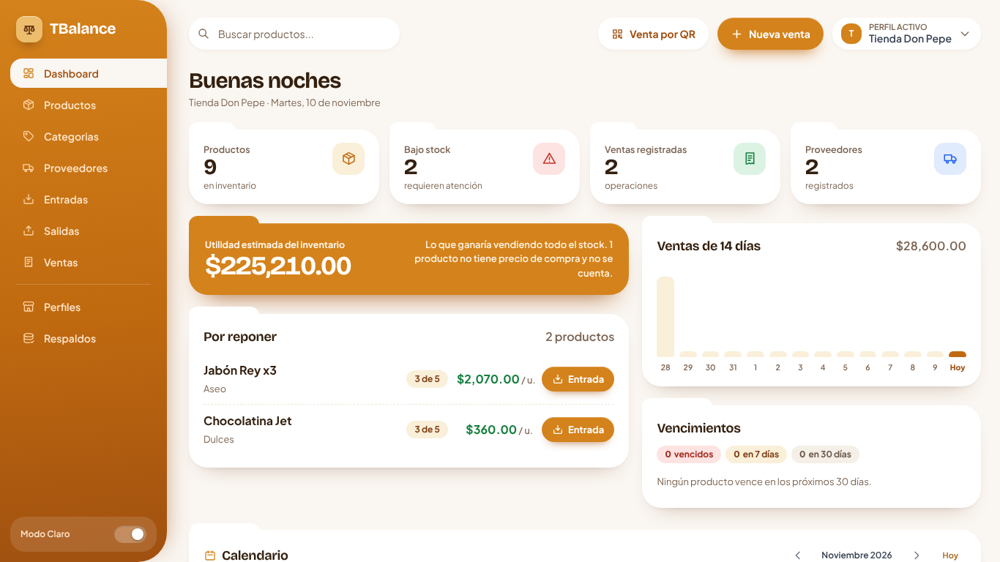 |
| Perfiles | 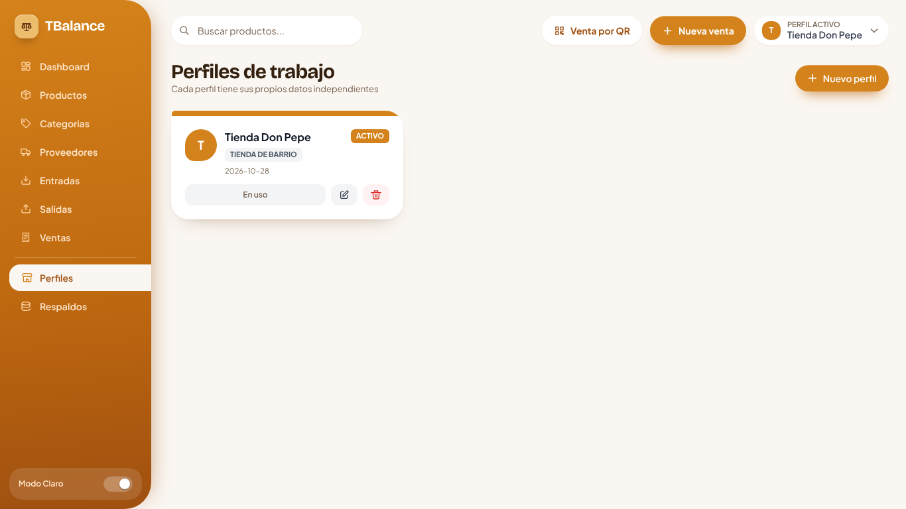 |
| Productos | 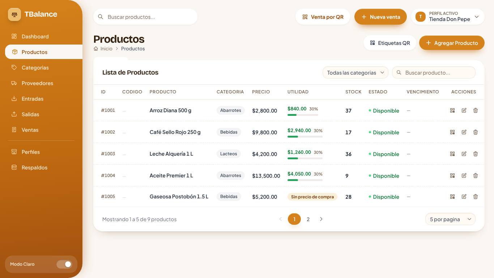 |
| Formulario de producto (precio de compra, de venta y utilidad) | 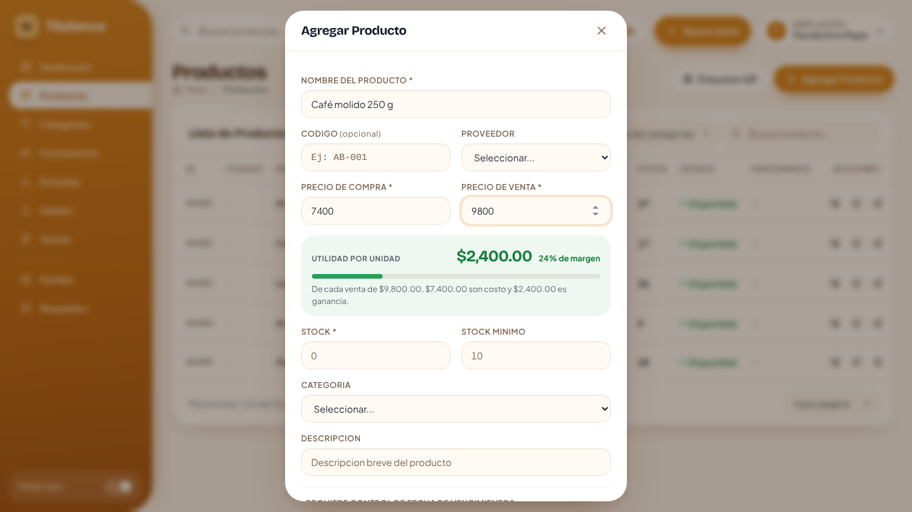 |
| Etiqueta QR de un producto | 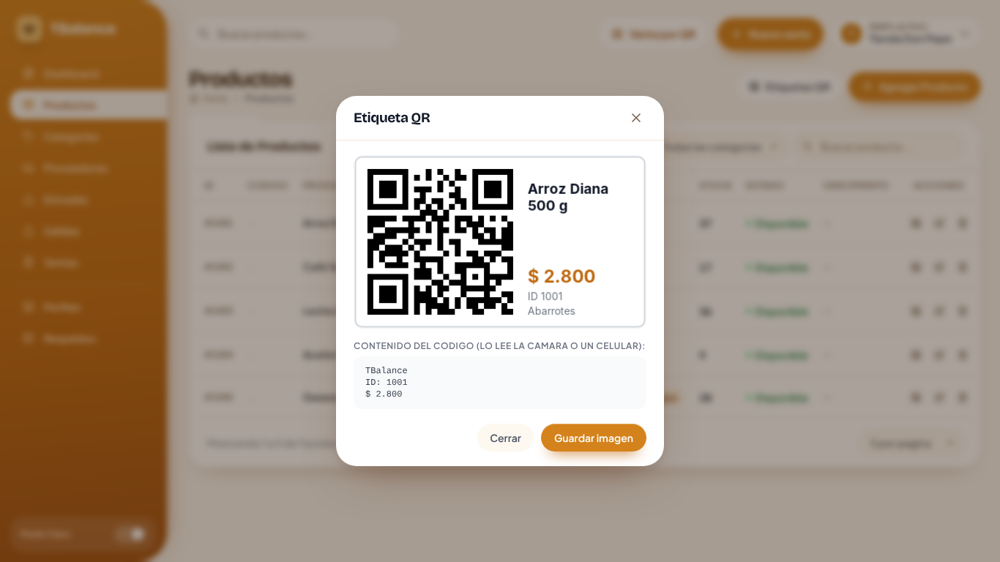 |
| Entradas | 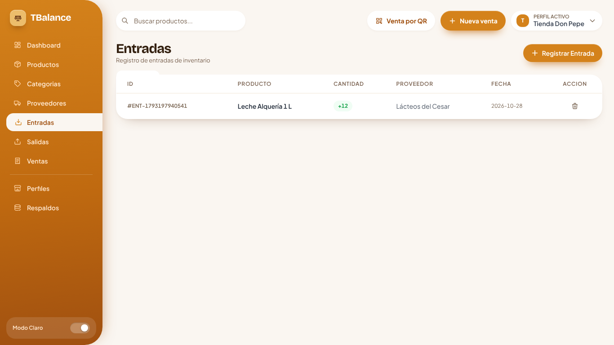 |
| Ventas | 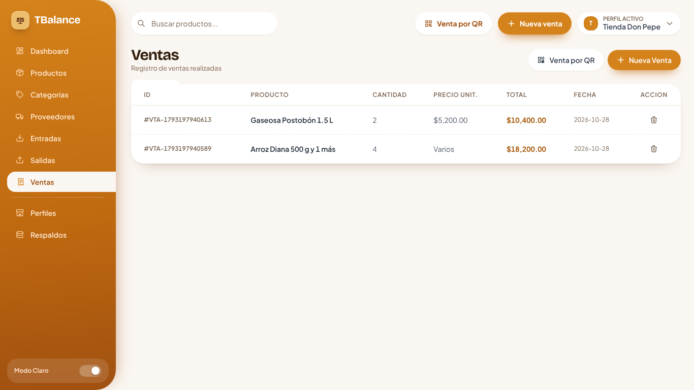 |
| Venta por QR | 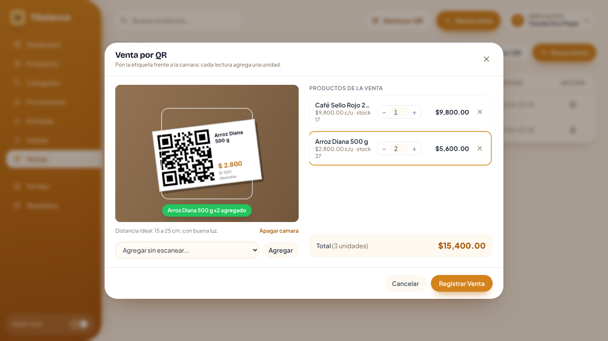 |
| Respaldos | 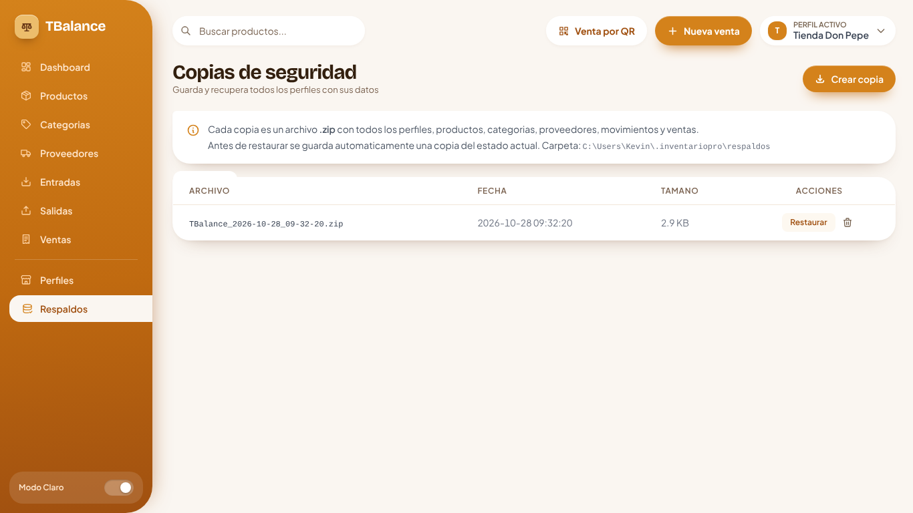 |

Distribución común: menú lateral naranja con las secciones (Dashboard, Productos, Categorías, Proveedores, Entradas, Salidas, Ventas, Perfiles y Respaldos) y el interruptor de modo claro u oscuro; la sección activa se ve como una pestaña blanca unida a la página. Arriba van la búsqueda, los botones Venta por QR y Nueva venta y el perfil activo. El contenido se organiza en tarjetas en forma de carpeta, tablas y formularios en ventanas modales. El dashboard muestra un saludo con la fecha, cuatro indicadores, la utilidad estimada del inventario, los productos por reponer con un botón para registrar su entrada, las ventas de los últimos 14 días, los vencimientos y el calendario.

## 6. Patrones GRASP aplicados

| Patrón | Clase / método | Razón |
|---|---|---|
| **Creador** | `Sale.agregarItem(Product`, `int`, `double)` | La venta contiene sus `SaleItem`, por eso es quien los crea. El constructor con datos de `SaleItem` tiene visibilidad de paquete. |
| **Creador** | `ProfileServicesFactory.crear(String)` | Tiene el dato para inicializarlos (la carpeta del perfil) y crea los repositorios y los cinco gestores del perfil. |
| **Creador** | `CategoryService.crearPredefinidas(BusinessType)` | Administra las categorías del perfil y crea las predefinidas del tipo de negocio. |
| **Creador** | `AppContext (constructor)` | Raíz de composición: crea los repositorios y servicios globales y los conecta por constructor. |
| **Controlador** | `JavaBridge` | Controlador fachada: es el único objeto que recibe los eventos de la interfaz (`window.javaBridge`) y delega cada uno. |
| **Controlador** | `ProfileController`, `InventoryController`, `CatalogController`, `TransactionController`, `BackupController`, `LabelController`, `ScanController` | Controladores de caso de uso: cada uno atiende un grupo de operaciones y delega en los servicios. |
| **Experto en información** | `Product.getUtilidadUnitaria`, `getMargen`, `getUtilidadEstimadaStock` | El producto tiene el precio de compra, el de venta y el stock; por eso calcula su propia utilidad. `InventoryService.getUtilidadEstimadaInventario` solo suma lo que cada producto responde. |
| **Experto en información** | `Product.disminuirStock`, `aumentarStock`, `verificarStockDisponible`, `getEstado`, `estaVencido`, `venceDentroDe` | El producto tiene el stock, el stock mínimo y la fecha de vencimiento; él decide su estado y si puede descontar unidades. |
| **Experto en información** | `Sale.calcularTotal`, `cantidadesPorProducto / SaleItem.getSubtotal` | La venta conoce sus ítems y cada ítem su cantidad y precio. |
| **Experto en información** | `Product.contenidoEtiquetaQR`, `idDesdeEtiquetaQR` | El producto define el texto de su QR y, como conoce el formato, también lo interpreta. |
| **Experto en información** | `GlobalConfig.getPerfilActivo`, `BackupRepository.listar` | Cada clase responde con la información que ella misma tiene. |
| **Bajo acoplamiento** | `EntityService(Repository<T>)`, `MovementService`, `SaleService` | Los servicios dependen de la interfaz `Repository<T>` y reciben sus dependencias por constructor. |
| **Bajo acoplamiento** | `ViewNotifier`, `Camera`, `FileOpener` | Los controladores no dependen de `WebEngine`, de la librería de la cámara ni de `java.awt.Desktop`. |
| **Bajo acoplamiento** | `QrGenerator`, `QrReader`, `WebcamCamera` | Solo estas clases importan ZXing o webcam-capture. |
| **Alta cohesión** | `Controladores del paquete bridge` | Cada controlador atiende un único grupo de casos de uso (en P2 un solo `JavaBridge` hacía todo). |
| **Alta cohesión** | `JsonFileStore`, `ProfileDirectory`, `BridgeResponse`, `ZipArchiver` | Clases pequeñas con un solo propósito. |
| **Alta cohesión** | `QrSaleScanner` | Solo coordina leer el QR, interpretar el texto y buscar el producto. |

## 7. Principios SOLID aplicados

| Principio | Clase / relación | Argumento |
|---|---|---|
| **SRP** | `JsonFileStore / JsonRepository<T> / Gestor*` | Tres razones de cambio separadas: cómo se escribe en disco, cómo se maneja la colección en memoria y qué reglas de negocio aplican. |
| **SRP** | `GlobalConfigService, ProfileDirectory` | Salieron de `ProfileService`: uno maneja `configuracion-global.json` y el otro las carpetas de los perfiles. |
| **SRP** | `ZipArchiver / BackupRepository / BackupService` | Comprimir, administrar la carpeta de copias y coordinar el caso de uso están separados. |
| **SRP** | `QrGenerator / LabelService / LabelRepository` | Generar el código, dibujar la etiqueta y guardar la imagen están separados. |
| **SRP** | `BridgeResponse.ejecutar(Supplier<String>)` | Un solo lugar traduce las excepciones a `ERROR: …`. |
| **OCP** | `JsonRepository<T> y sus subclases` | Una entidad nueva se guarda creando una subclase corta, sin modificar la clase base. |
| **OCP** | `EntityService<T>.guardar(T) (final)` | El algoritmo de guardar está cerrado; cada gestor lo extiende con `validar()` y `generarId()`. |
| **OCP** | `InventoryMovement.aplicarA(Product)` | `MovementService` trabaja con el tipo abstracto; un movimiento nuevo sería otra subclase. |
| **OCP** | `Repository<T>` | Una implementación con base de datos relacional se podrá agregar sin cambiar los servicios. |
| **LSP** | `StockEntry / StockExit` | Se pueden usar donde se espera `InventoryMovement`; ambas cumplen el contrato de `aplicarA`. |
| **ISP** | `Camera, ViewNotifier, FileOpener` | Interfaces pequeñas: cada una tiene solo los métodos que su cliente necesita. |
| **DIP** | `service → Repository<T>; bridge → ViewNotifier, Camera, FileOpener` | Los módulos de alto nivel dependen de abstracciones; `AppContext` y `ProfileServicesFactory` eligen las implementaciones. |

La trazabilidad completa con enlaces al código está en [TRAZABILIDAD.md](TRAZABILIDAD.md).
