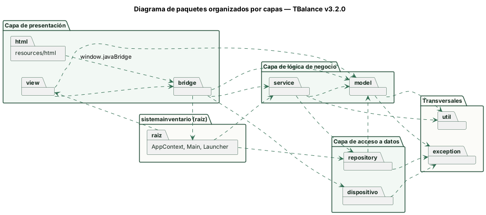
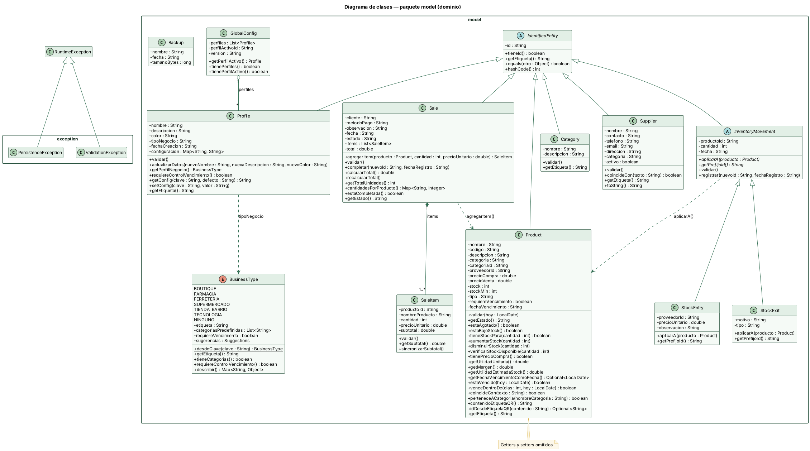
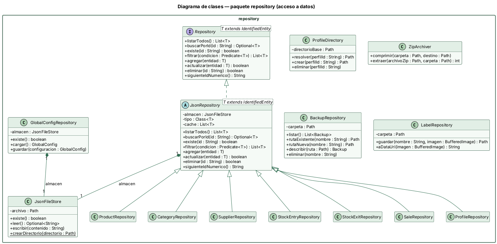
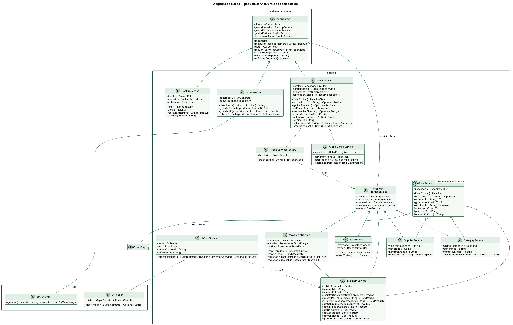
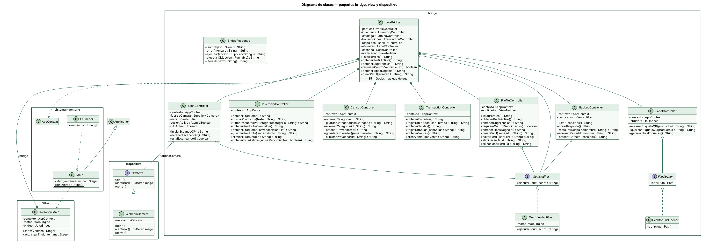
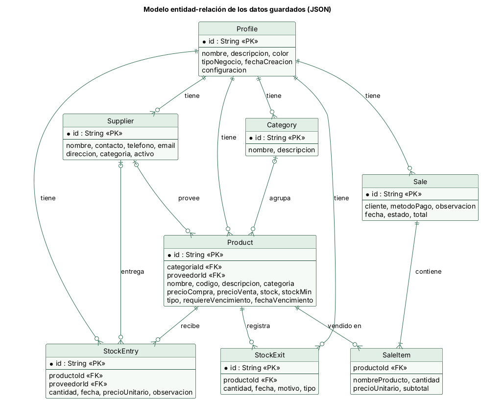

# Fase 4 — Documentación técnica

Universidad Popular del Cesar · Programación de Computadores III (SS462) · Docente: Ing. Esp. Alfredo Bautista 
Integrantes: Kevin Jhosep Mercado · Reinaldo Padilla Pedroza · Dair José Quintero

[README](../README.md) · [Fase 1](FASE1_Especificacion.md) · [Fase 2](FASE2_Arquitectura_y_Diseno.md) · [Fase 3](FASE3_Desarrollo.md) · [Fase 4](FASE4_Documentacion_Tecnica.md) · [Trazabilidad](TRAZABILIDAD.md)

---

## 1. Arquitectura y capas

TBalance usa una arquitectura en tres capas más una capa transversal:

| Capa | Paquetes | Depende de |
|---|---|---|
| Presentación | `resources/html`, `view`, `bridge` | Lógica de negocio (`service`, `model`), `dispositivo`, `util`, `exception` y la raíz (`AppContext`) |
| Lógica de negocio | `service`, `model` | Acceso a datos (`repository`), `util`, `exception` |
| Acceso a datos | `repository`, `dispositivo` | `model`, `util`, `exception` |
| Transversal | `util`, `exception` | — |

`AppContext` (Singleton) es la raíz de composición: crea los repositorios concretos, los pasa por constructor a los servicios y reemplaza los servicios del perfil activo cuando el usuario cambia de perfil o restaura una copia.

## 2. Diagrama de paquetes final

## 3. Diagrama de clases final y descripción de cada clase

Las cuatro vistas del diagrama de clases final (69 clases):

La descripción de cada clase (tipo, responsabilidad, atributos y métodos) está en la [Fase 2, sección Descripción de cada clase](FASE2_Arquitectura_y_Diseno.md#descripción-de-cada-clase); se generó a partir del código final de la versión v3.3.0.

## 4. Modelo de datos

### 4.1 Modelo entidad-relación

El proyecto guarda los datos en archivos JSON (no hay base de datos relacional todavía). El diagrama muestra las entidades guardadas y cómo se relacionan por sus identificadores:

- Un **perfil** tiene sus propios productos, categorías, proveedores, entradas, salidas y ventas (cada perfil tiene su carpeta `perfiles/<ID>/`).
- Un **producto** pertenece a una categoría (`categoriaId`) y puede tener un proveedor (`proveedorId`).
- Cada **entrada** y **salida** se refiere a un producto (`productoId`); la entrada puede indicar el proveedor.
- Una **venta** tiene uno o más **ítems** y cada ítem se refiere a un producto.

Cuando se implemente la base de datos relacional (pendiente, ver [Fase 3](FASE3_Desarrollo.md#32-base-de-datos-relacional-y-dao)) estas entidades serán las tablas y los campos `...Id` las claves foráneas.

### 4.2 Diccionario de datos

Los campos son los atributos de las clases del modelo que Gson guarda en cada archivo (incluye los heredados de `IdentifiedEntity` y `InventoryMovement`). Las fechas se guardan como texto ISO (`yyyy-MM-dd` o `yyyy-MM-ddTHH:mm:ss`).

#### `perfiles.json` — Profile

| Campo | Tipo | Descripción | Regla / restricción |
|---|---|---|---|
| `id` | `String` | Identificador único de la entidad | Clave |
| `nombre` | `String` | Nombre del negocio | Obligatorio |
| `descripcion` | `String` | Descripción opcional | — |
| `color` | `String` | Color identificador (hex) | — |
| `tipoNegocio` | `String` | Clave del tipo de negocio (BusinessType) | — |
| `fechaCreacion` | `String` | Fecha de creación | — |
| `configuracion` | `Map<String, String>` | Ajustes clave-valor del perfil | — |

#### `configuracion-global.json` — GlobalConfig

| Campo | Tipo | Descripción | Regla / restricción |
|---|---|---|---|
| `perfiles` | `List<Profile>` | Perfiles registrados | — |
| `perfilActivoId` | `String` | ID del perfil activo | Referencia a Profile.id |
| `version` | `String` | Versión del formato de configuración | — |

#### `perfiles/<ID>/productos.json` — Product

| Campo | Tipo | Descripción | Regla / restricción |
|---|---|---|---|
| `id` | `String` | Identificador único de la entidad | Clave |
| `nombre` | `String` | Nombre del producto | Obligatorio |
| `codigo` | `String` | Código interno o de barras | — |
| `descripcion` | `String` | Descripción opcional | — |
| `categoria` | `String` | Nombre de la categoría | — |
| `categoriaId` | `String` | ID de la categoría | Referencia a Category.id |
| `proveedorId` | `String` | ID del proveedor | Referencia a Supplier.id |
| `precioCompra` | `double` | Precio de compra | ≥ 0 |
| `precioVenta` | `double` | Precio de venta | ≥ 0 |
| `stock` | `int` | Unidades disponibles | ≥ 0 |
| `stockMin` | `int` | Límite para alerta de bajo stock | ≥ 0 |
| `tipo` | `String` | Tipo de producto | — |
| `requiereVencimiento` | `boolean` | Si controla fecha de vencimiento | — |
| `fechaVencimiento` | `String` | Fecha de vencimiento (ISO) | Fecha ISO válida cuando se controla vencimiento |

#### `perfiles/<ID>/categorias.json` — Category

| Campo | Tipo | Descripción | Regla / restricción |
|---|---|---|---|
| `id` | `String` | Identificador único de la entidad | Clave |
| `nombre` | `String` | Nombre de la categoría | Obligatorio |
| `descripcion` | `String` | Descripción opcional | — |

#### `perfiles/<ID>/proveedores.json` — Supplier

| Campo | Tipo | Descripción | Regla / restricción |
|---|---|---|---|
| `id` | `String` | Identificador único de la entidad | Clave |
| `nombre` | `String` | Nombre del proveedor | Obligatorio |
| `contacto` | `String` | Persona de contacto | — |
| `telefono` | `String` | Teléfono | — |
| `email` | `String` | Correo electrónico | — |
| `direccion` | `String` | Dirección | — |
| `categoria` | `String` | Rubro que abastece | — |
| `activo` | `boolean` | Si el proveedor está activo | — |

#### `perfiles/<ID>/entradas.json` — StockEntry

| Campo | Tipo | Descripción | Regla / restricción |
|---|---|---|---|
| `id` | `String` | Identificador único de la entidad | Clave |
| `productoId` | `String` | Product afectado | Obligatorio; referencia a Product.id |
| `cantidad` | `int` | Unidades del movimiento | > 0 |
| `fecha` | `String` | Fecha y hora del registro | — |
| `proveedorId` | `String` | Supplier de la mercancía | Referencia a Supplier.id |
| `precioUnitario` | `double` | Precio de compra por unidad | — |
| `observacion` | `String` | Nota opcional | — |

#### `perfiles/<ID>/salidas.json` — StockExit

| Campo | Tipo | Descripción | Regla / restricción |
|---|---|---|---|
| `id` | `String` | Identificador único de la entidad | Clave |
| `productoId` | `String` | Product afectado | Obligatorio; referencia a Product.id |
| `cantidad` | `int` | Unidades del movimiento | > 0 |
| `fecha` | `String` | Fecha y hora del registro | — |
| `motivo` | `String` | Razón del retiro | — |
| `tipo` | `String` | Tipo de salida | — |

#### `perfiles/<ID>/ventas.json` — Sale

| Campo | Tipo | Descripción | Regla / restricción |
|---|---|---|---|
| `id` | `String` | Identificador único de la entidad | Clave |
| `cliente` | `String` | Cliente | — |
| `metodoPago` | `String` | Método de pago | — |
| `observacion` | `String` | Nota opcional | — |
| `fecha` | `String` | Fecha y hora de la venta | — |
| `estado` | `String` | Estado (COMPLETADA) | — |
| `items` | `List<SaleItem>` | Ítems de la venta | Al menos 1 ítem |
| `total` | `double` | Total (se guarda en el JSON) | — |

#### `(dentro de cada venta, en `items`)` — SaleItem

| Campo | Tipo | Descripción | Regla / restricción |
|---|---|---|---|
| `productoId` | `String` | Product vendido | Obligatorio; referencia a Product.id |
| `nombreProducto` | `String` | Nombre del producto al momento de la venta | — |
| `cantidad` | `int` | Unidades vendidas | > 0 |
| `precioUnitario` | `double` | Precio por unidad | ≥ 0 |
| `subtotal` | `double` | Cantidad × precio (se guarda en el JSON) | — |

Otros archivos que genera el programa (no son tablas de datos): copias de seguridad `~/.inventariopro/respaldos/TBalance_<fecha>_<hora>.zip` y etiquetas `~/.inventariopro/etiquetas/*.png`.

## 5. Tabla consolidada de principios aplicados

| Principio | Dónde | Justificación | Código |
|---|---|---|---|
| GRASP — Creador | `Sale.agregarItem(Product, int, double)` | La venta contiene sus `SaleItem`, por eso es quien los crea. El constructor con datos de `SaleItem` tiene visibilidad de paquete. | [`Sale`](../src/main/java/sistemainventario/model/Sale.java), [`Product`](../src/main/java/sistemainventario/model/Product.java) |
| GRASP — Creador | `ProfileServicesFactory.crear(String)` | Tiene el dato para inicializarlos (la carpeta del perfil) y crea los repositorios y los cinco gestores del perfil. | [`ProfileServicesFactory`](../src/main/java/sistemainventario/service/ProfileServicesFactory.java) |
| GRASP — Creador | `CategoryService.crearPredefinidas(BusinessType)` | Administra las categorías del perfil y crea las predefinidas del tipo de negocio. | [`CategoryService`](../src/main/java/sistemainventario/service/CategoryService.java), [`BusinessType`](../src/main/java/sistemainventario/model/BusinessType.java) |
| GRASP — Creador | `AppContext (constructor)` | Raíz de composición: crea los repositorios y servicios globales y los conecta por constructor. | [`AppContext`](../src/main/java/sistemainventario/AppContext.java) |
| GRASP — Controlador | `JavaBridge` | Controlador fachada: es el único objeto que recibe los eventos de la interfaz (`window.javaBridge`) y delega cada uno. | [`JavaBridge`](../src/main/java/sistemainventario/bridge/JavaBridge.java) |
| GRASP — Controlador | `ProfileController, InventoryController, CatalogController, TransactionController, BackupController, LabelController, ScanController` | Controladores de caso de uso: cada uno atiende un grupo de operaciones y delega en los servicios. | [`ProfileController`](../src/main/java/sistemainventario/bridge/ProfileController.java), [`InventoryController`](../src/main/java/sistemainventario/bridge/InventoryController.java), [`CatalogController`](../src/main/java/sistemainventario/bridge/CatalogController.java), [`TransactionController`](../src/main/java/sistemainventario/bridge/TransactionController.java) |
| GRASP — Experto en información | `Product.getUtilidadUnitaria, getMargen, getUtilidadEstimadaStock` | El producto tiene el precio de compra, el de venta y el stock; por eso calcula su propia utilidad. `InventoryService.getUtilidadEstimadaInventario` solo suma lo que cada producto responde. | [`Product`](../src/main/java/sistemainventario/model/Product.java) |
| GRASP — Experto en información | `Product.disminuirStock, aumentarStock, verificarStockDisponible, getEstado, estaVencido, venceDentroDe` | El producto tiene el stock, el stock mínimo y la fecha de vencimiento; él decide su estado y si puede descontar unidades. | [`Product`](../src/main/java/sistemainventario/model/Product.java) |
| GRASP — Experto en información | `Sale.calcularTotal, cantidadesPorProducto / SaleItem.getSubtotal` | La venta conoce sus ítems y cada ítem su cantidad y precio. | [`Sale`](../src/main/java/sistemainventario/model/Sale.java), [`SaleItem`](../src/main/java/sistemainventario/model/SaleItem.java) |
| GRASP — Experto en información | `Product.contenidoEtiquetaQR, idDesdeEtiquetaQR` | El producto define el texto de su QR y, como conoce el formato, también lo interpreta. | [`Product`](../src/main/java/sistemainventario/model/Product.java) |
| GRASP — Experto en información | `GlobalConfig.getPerfilActivo, BackupRepository.listar` | Cada clase responde con la información que ella misma tiene. | [`GlobalConfig`](../src/main/java/sistemainventario/model/GlobalConfig.java), [`BackupRepository`](../src/main/java/sistemainventario/repository/BackupRepository.java) |
| GRASP — Bajo acoplamiento | `EntityService(Repository<T>), MovementService, SaleService` | Los servicios dependen de la interfaz `Repository<T>` y reciben sus dependencias por constructor. | [`EntityService`](../src/main/java/sistemainventario/service/EntityService.java), [`Repository`](../src/main/java/sistemainventario/repository/Repository.java), [`MovementService`](../src/main/java/sistemainventario/service/MovementService.java), [`SaleService`](../src/main/java/sistemainventario/service/SaleService.java) |
| GRASP — Bajo acoplamiento | `ViewNotifier, Camera, FileOpener` | Los controladores no dependen de `WebEngine`, de la librería de la cámara ni de `java.awt.Desktop`. | [`ViewNotifier`](../src/main/java/sistemainventario/bridge/ViewNotifier.java), [`Camera`](../src/main/java/sistemainventario/dispositivo/Camera.java), [`FileOpener`](../src/main/java/sistemainventario/bridge/FileOpener.java) |
| GRASP — Bajo acoplamiento | `QrGenerator, QrReader, WebcamCamera` | Solo estas clases importan ZXing o webcam-capture. | [`QrGenerator`](../src/main/java/sistemainventario/util/QrGenerator.java), [`QrReader`](../src/main/java/sistemainventario/util/QrReader.java), [`WebcamCamera`](../src/main/java/sistemainventario/dispositivo/WebcamCamera.java) |
| GRASP — Alta cohesión | `Controladores del paquete bridge` | Cada controlador atiende un único grupo de casos de uso (en P2 un solo `JavaBridge` hacía todo). |  |
| GRASP — Alta cohesión | `JsonFileStore, ProfileDirectory, BridgeResponse, ZipArchiver` | Clases pequeñas con un solo propósito. | [`JsonFileStore`](../src/main/java/sistemainventario/repository/JsonFileStore.java), [`ProfileDirectory`](../src/main/java/sistemainventario/repository/ProfileDirectory.java), [`BridgeResponse`](../src/main/java/sistemainventario/bridge/BridgeResponse.java), [`ZipArchiver`](../src/main/java/sistemainventario/repository/ZipArchiver.java) |
| GRASP — Alta cohesión | `QrSaleScanner` | Solo coordina leer el QR, interpretar el texto y buscar el producto. | [`QrSaleScanner`](../src/main/java/sistemainventario/service/QrSaleScanner.java) |
| SOLID — SRP | `JsonFileStore / JsonRepository<T> / Gestor*` | Tres razones de cambio separadas: cómo se escribe en disco, cómo se maneja la colección en memoria y qué reglas de negocio aplican. | [`JsonFileStore`](../src/main/java/sistemainventario/repository/JsonFileStore.java), [`JsonRepository`](../src/main/java/sistemainventario/repository/JsonRepository.java) |
| SOLID — SRP | `GlobalConfigService, ProfileDirectory` | Salieron de `ProfileService`: uno maneja `configuracion-global.json` y el otro las carpetas de los perfiles. | [`GlobalConfigService`](../src/main/java/sistemainventario/service/GlobalConfigService.java), [`ProfileDirectory`](../src/main/java/sistemainventario/repository/ProfileDirectory.java) |
| SOLID — SRP | `ZipArchiver / BackupRepository / BackupService` | Comprimir, administrar la carpeta de copias y coordinar el caso de uso están separados. | [`ZipArchiver`](../src/main/java/sistemainventario/repository/ZipArchiver.java), [`BackupRepository`](../src/main/java/sistemainventario/repository/BackupRepository.java), [`BackupService`](../src/main/java/sistemainventario/service/BackupService.java) |
| SOLID — SRP | `QrGenerator / LabelService / LabelRepository` | Generar el código, dibujar la etiqueta y guardar la imagen están separados. | [`QrGenerator`](../src/main/java/sistemainventario/util/QrGenerator.java), [`LabelService`](../src/main/java/sistemainventario/service/LabelService.java), [`LabelRepository`](../src/main/java/sistemainventario/repository/LabelRepository.java) |
| SOLID — SRP | `BridgeResponse.ejecutar(Supplier<String>)` | Un solo lugar traduce las excepciones a `ERROR: …`. | [`BridgeResponse`](../src/main/java/sistemainventario/bridge/BridgeResponse.java), [`Supplier`](../src/main/java/sistemainventario/model/Supplier.java) |
| SOLID — OCP | `JsonRepository<T> y sus subclases` | Una entidad nueva se guarda creando una subclase corta, sin modificar la clase base. | [`JsonRepository`](../src/main/java/sistemainventario/repository/JsonRepository.java) |
| SOLID — OCP | `EntityService<T>.guardar(T) (final)` | El algoritmo de guardar está cerrado; cada gestor lo extiende con `validar()` y `generarId()`. | [`EntityService`](../src/main/java/sistemainventario/service/EntityService.java) |
| SOLID — OCP | `InventoryMovement.aplicarA(Product)` | `MovementService` trabaja con el tipo abstracto; un movimiento nuevo sería otra subclase. | [`InventoryMovement`](../src/main/java/sistemainventario/model/InventoryMovement.java), [`Product`](../src/main/java/sistemainventario/model/Product.java) |
| SOLID — OCP | `Repository<T>` | Una implementación con base de datos relacional se podrá agregar sin cambiar los servicios. | [`Repository`](../src/main/java/sistemainventario/repository/Repository.java) |
| SOLID — LSP | `StockEntry / StockExit` | Se pueden usar donde se espera `InventoryMovement`; ambas cumplen el contrato de `aplicarA`. | [`StockEntry`](../src/main/java/sistemainventario/model/StockEntry.java), [`StockExit`](../src/main/java/sistemainventario/model/StockExit.java) |
| SOLID — ISP | `Camera, ViewNotifier, FileOpener` | Interfaces pequeñas: cada una tiene solo los métodos que su cliente necesita. | [`Camera`](../src/main/java/sistemainventario/dispositivo/Camera.java), [`ViewNotifier`](../src/main/java/sistemainventario/bridge/ViewNotifier.java), [`FileOpener`](../src/main/java/sistemainventario/bridge/FileOpener.java) |
| SOLID — DIP | `service → Repository<T>; bridge → ViewNotifier, Camera, FileOpener` | Los módulos de alto nivel dependen de abstracciones; `AppContext` y `ProfileServicesFactory` eligen las implementaciones. | [`Repository`](../src/main/java/sistemainventario/repository/Repository.java), [`ViewNotifier`](../src/main/java/sistemainventario/bridge/ViewNotifier.java), [`Camera`](../src/main/java/sistemainventario/dispositivo/Camera.java), [`FileOpener`](../src/main/java/sistemainventario/bridge/FileOpener.java) |
| Código limpio — Nombres significativos | disminuirStock, cantidadesPorProducto, registrarCambioDeStock, resolverPerfilInicial |  | [`Product`](../src/main/java/sistemainventario/model/Product.java), [`Sale`](../src/main/java/sistemainventario/model/Sale.java), [`InventoryService`](../src/main/java/sistemainventario/service/InventoryService.java), [`ProfileService`](../src/main/java/sistemainventario/service/ProfileService.java) |
| Código limpio — Métodos pequeños | SaleService.registrar delega en métodos privados para verificar y descontar el stock |  | [`SaleService`](../src/main/java/sistemainventario/service/SaleService.java) |
| Código limpio — Sin código muerto | Se eliminaron Usuario, UsuarioRepository y GestorUsuarios (sin uso) y métodos sin uso de P2 |  | [`IdGenerator`](../src/main/java/sistemainventario/util/IdGenerator.java) |
| Código limpio — Constantes | Sale.ESTADO_COMPLETADA, StockEntry.PREFIJO_ID, Profile.COLOR_POR_DEFECTO |  | [`Sale`](../src/main/java/sistemainventario/model/Sale.java), [`StockEntry`](../src/main/java/sistemainventario/model/StockEntry.java), [`Profile`](../src/main/java/sistemainventario/model/Profile.java) |
| Código limpio — Excepciones propias | ValidationException y PersistenceException; traducción única en BridgeResponse |  | [`ValidationException`](../src/main/java/sistemainventario/exception/ValidationException.java), [`PersistenceException`](../src/main/java/sistemainventario/exception/PersistenceException.java), [`BridgeResponse`](../src/main/java/sistemainventario/bridge/BridgeResponse.java) |
| Código limpio — Validación de entradas | Nombres .zip y .png válidos; protección zip slip; QR ajeno o de producto borrado muestra un aviso |  | [`BackupRepository`](../src/main/java/sistemainventario/repository/BackupRepository.java), [`LabelRepository`](../src/main/java/sistemainventario/repository/LabelRepository.java), [`ZipArchiver`](../src/main/java/sistemainventario/repository/ZipArchiver.java), [`QrSaleScanner`](../src/main/java/sistemainventario/service/QrSaleScanner.java) |
| Código limpio — Javadoc y convenciones | Javadoc en clases y métodos públicos; PascalCase, camelCase y UPPER_SNAKE_CASE |  |  |

## 6. Reporte final de Git

Historial hasta la etiqueta `v3.2.0`.

### 6.1 Commits por integrante

| Integrante | Commits | PR aprobados y fusionados |
|---|---|---|
| Kevin Jhosep Mercado (@kjhosepmercadom) | 15 | 4 |
| Reinaldo Padilla Pedroza (@rjpadillap) | 14 | 5 |
| Dair José Quintero (@djosequintero) | 13 | 4 |
| **Total** | **43** (+1 `Initial commit`) | **13** |

### 6.2 Versiones

| Etiqueta | Fecha | Commits acumulados | Contenido |
|---|---|---|---|
| `v3.0.0-avance1` | 2026-10-27 | 22 | Reestructuración en capas con GRASP y SOLID (avance 1) |
| `v3.1.0` | 2026-10-27 | 32 | Copias de seguridad |
| `v3.2.0` | 2026-10-28 | 43 | Etiquetas QR y venta por QR |

### 6.3 Ramas creadas y fusionadas

| Rama | Autor | PR | Fusionada en |
|---|---|---|---|
| `feature/dair-modelo-dominio` | Dair Quintero | #1 | `dev` |
| `feature/reinaldo-persistencia-json` | Reinaldo Padilla | #2 | `dev` |
| `feature/kevin-servicios-bridge` | Kevin Mercado | #3 | `dev` |
| `dev` | Kevin Mercado (integración) | #4 | `main` |
| `feature/reinaldo-backup-storage` | Reinaldo Padilla | #5 | `dev` |
| `feature/kevin-backup-service` | Kevin Mercado | #6 | `dev` |
| `feature/dair-backup-ui` | Dair Quintero | #7 | `dev` |
| `feature/reinaldo-architecture-docs` | Reinaldo Padilla | #8 | `dev` |
| `dev` | Kevin Mercado (integración) | #9 | `main` |
| `feature/reinaldo-qr-reader-camera` | Reinaldo Padilla | #10 | `dev` |
| `feature/kevin-qr-sale-service` | Kevin Mercado | #11 | `dev` |
| `feature/dair-qr-sale-ui` | Dair Quintero | #12 | `dev` |
| `dev` | Kevin Mercado (integración) | #13 | `main` |

Se crearon y fusionaron **10 ramas `feature/*`** (borradas después de fusionarse) y la rama `dev` se fusionó en `main` en cada versión (3 veces). El detalle de cada commit está en la [Fase 3](FASE3_Desarrollo.md#62-evidencia-de-commits).
