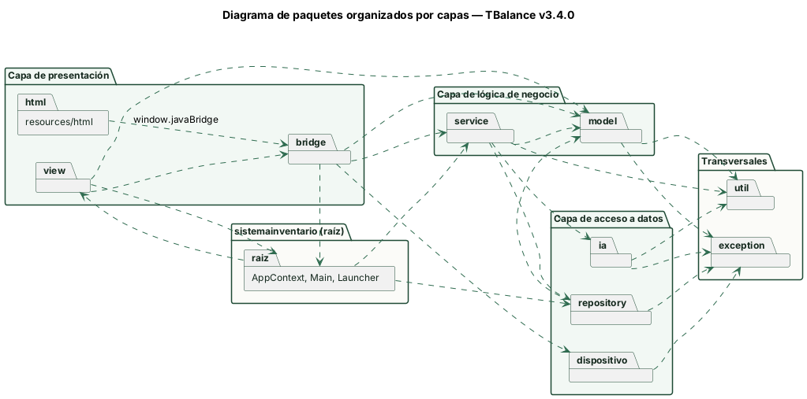
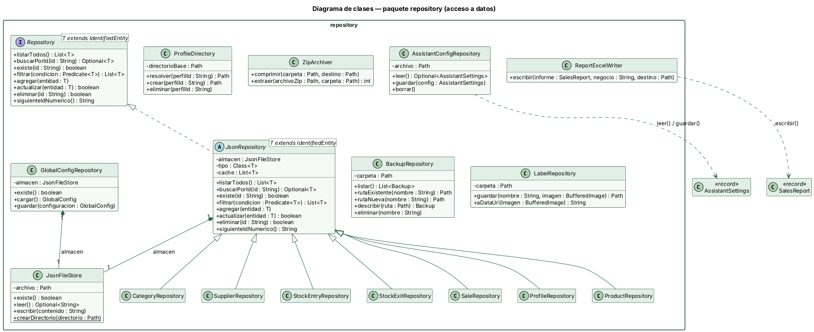
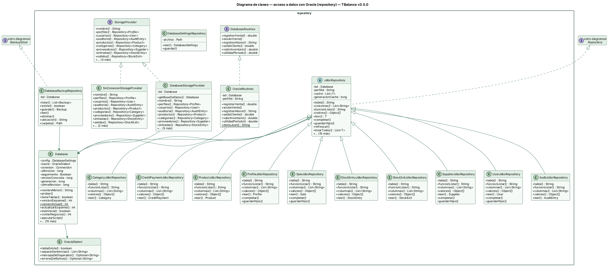
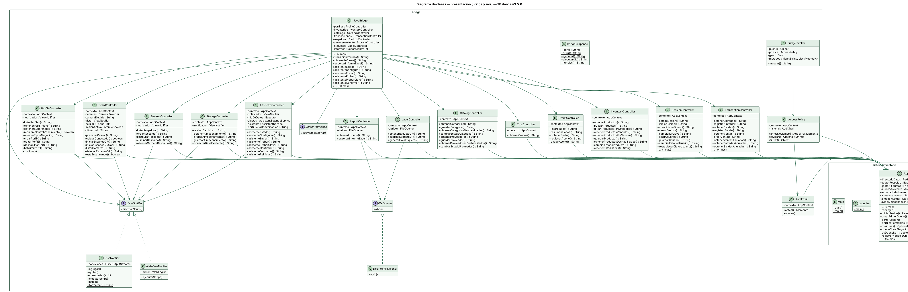
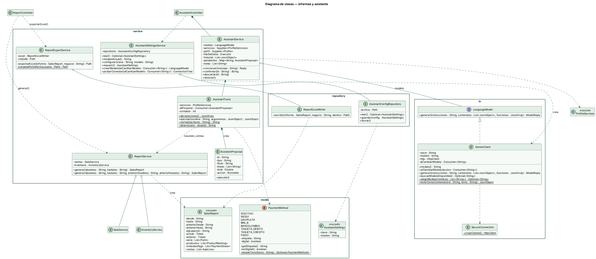

# Fase 4 — Documentación técnica

Universidad Popular del Cesar · Programación de Computadores III (SS462) · Docente: Ing. Esp. Alfredo Bautista 
Integrantes: Kevin Jhosep Mercado · Reinaldo Padilla Pedroza · Dair José Quintero

[README](../README.md) · [Fase 1](FASE1_Especificacion.md) · [Fase 2](FASE2_Arquitectura_y_Diseno.md) · [Fase 3](FASE3_Desarrollo.md) · [Fase 4](FASE4_Documentacion_Tecnica.md) · [Trazabilidad](TRAZABILIDAD.md)

---

## 1. Arquitectura y capas

TBalance usa una arquitectura en tres capas más una capa transversal:

| Capa | Paquetes | Depende de |
|---|---|---|
| Presentación | `resources/html`, `view`, `bridge` | Lógica de negocio (`service`, `model`), `dispositivo`, `util`, `exception` y la raíz (`AppContext`) |
| Lógica de negocio | `service`, `model` | Acceso a datos (`repository`, `ia`), `util`, `exception` |
| Acceso a datos | `repository`, `ia`, `dispositivo` | `model`, `util`, `exception` |
| Transversal | `util`, `exception` | — |

`AppContext` (Singleton) es la raíz de composición: crea los repositorios concretos, los pasa por constructor a los servicios y reemplaza los servicios del perfil activo cuando el usuario cambia de perfil o restaura una copia.

## 2. Diagrama de paquetes final

## 3. Diagrama de clases final y descripción de cada clase

Las seis vistas del diagrama de clases final (95 clases):

La descripción de cada clase (tipo, responsabilidad, atributos y métodos) está en la [Fase 2, sección Descripción de cada clase](FASE2_Arquitectura_y_Diseno.md#descripción-de-cada-clase); se generó a partir del código final de la versión v3.4.0.

## 4. Modelo de datos

### 4.1 Modelo entidad-relación

Las tablas son las mismas en PostgreSQL y en Oracle (scripts `src/main/resources/sql/*/01_tablas.sql`).

- Un **perfil** (negocio) tiene sus propias categorías, proveedores, productos, entradas, salidas, ventas y ajustes. Por eso la llave de esas tablas es **(PERFIL_ID, ID)**: el producto "1001" de una ferretería y el "1001" de una droguería son distintos. Al borrar un perfil, la base borra sus datos (`ON DELETE CASCADE`).
- Un **producto** puede tener una categoría y un proveedor (llaves foráneas compuestas, opcionales). Al borrar una categoría o un proveedor, sus productos quedan sin ella.
- Una **venta** tiene uno o más renglones en **DETALLE_VENTA** (llave foránea con `ON DELETE CASCADE`). Cada renglón guarda el nombre y el costo del producto al vender.
- **ENTRADA**, **SALIDA** y **DETALLE_VENTA** guardan `PRODUCTO_ID` sin llave foránea a PRODUCTO: son historial y se conservan aunque el producto se elimine.
- **HISTORIAL_PRECIO** la llena el disparador `TRG_PRODUCTO_HISTORIAL_PRECIO`.

En modo de archivos, cada tabla corresponde a un archivo JSON con los mismos campos: `perfiles.json` y, por negocio, `perfiles/<ID>/categorias.json`, `proveedores.json`, `productos.json`, `entradas.json`, `salidas.json` y `ventas.json` (con los ítems dentro de cada venta).

### 4.2 Diccionario de datos

#### `PERFIL` — Negocio (perfil). Cada negocio tiene sus propios datos.

Clase Java: `Profile`. Llave primaria: (ID).

| Columna | Oracle | PostgreSQL | Nulo | Llave | Descripción |
|---|---|---|---|---|---|
| `ID` | `VARCHAR2(20 CHAR)` | `VARCHAR(20)` | No | PK | Identificador del negocio |
| `NOMBRE` | `VARCHAR2(100 CHAR)` | `VARCHAR(100)` | No | — | Nombre del negocio |
| `DESCRIPCION` | `VARCHAR2(500 CHAR)` | `VARCHAR(500)` | Sí | — | Descripción opcional |
| `COLOR` | `VARCHAR2(9 CHAR)` | `VARCHAR(9)` | Sí | — | Color de acento elegido (hex) |
| `TIPO_NEGOCIO` | `VARCHAR2(20 CHAR)` | `VARCHAR(20)` | Sí | — | Clave de BusinessType (FERRETERIA, FARMACIA...) |
| `FECHA_CREACION` | `DATE` | `DATE` | Sí | — | Fecha en que se creó |

#### `PERFIL_CONFIGURACION` — Ajustes clave-valor de cada negocio.

Clase Java: `Profile.configuracion`. Llave primaria: (PERFIL_ID, CLAVE).

| Columna | Oracle | PostgreSQL | Nulo | Llave | Descripción |
|---|---|---|---|---|---|
| `PERFIL_ID` | `VARCHAR2(20 CHAR)` | `VARCHAR(20)` | No | PK FK → PERFIL | Negocio |
| `CLAVE` | `VARCHAR2(50 CHAR)` | `VARCHAR(50)` | No | PK | Nombre del ajuste (moneda, stockMin...) |
| `VALOR` | `VARCHAR2(200 CHAR)` | `VARCHAR(200)` | Sí | — | Valor del ajuste |

#### `CATEGORIA` — Categorías de productos de un negocio.

Clase Java: `Category`. Llave primaria: (PERFIL_ID, ID).

| Columna | Oracle | PostgreSQL | Nulo | Llave | Descripción |
|---|---|---|---|---|---|
| `PERFIL_ID` | `VARCHAR2(20 CHAR)` | `VARCHAR(20)` | No | PK FK → PERFIL | Negocio dueño |
| `ID` | `VARCHAR2(30 CHAR)` | `VARCHAR(30)` | No | PK | Identificador de la categoría |
| `NOMBRE` | `VARCHAR2(100 CHAR)` | `VARCHAR(100)` | No | — | Nombre |
| `DESCRIPCION` | `VARCHAR2(500 CHAR)` | `VARCHAR(500)` | Sí | — | Descripción opcional |

#### `PROVEEDOR` — Proveedores de un negocio.

Clase Java: `Supplier`. Llave primaria: (PERFIL_ID, ID).

| Columna | Oracle | PostgreSQL | Nulo | Llave | Descripción |
|---|---|---|---|---|---|
| `PERFIL_ID` | `VARCHAR2(20 CHAR)` | `VARCHAR(20)` | No | PK FK → PERFIL | Negocio dueño |
| `ID` | `VARCHAR2(30 CHAR)` | `VARCHAR(30)` | No | PK | Identificador del proveedor |
| `NOMBRE` | `VARCHAR2(100 CHAR)` | `VARCHAR(100)` | No | — | Nombre o razón social |
| `CONTACTO` | `VARCHAR2(100 CHAR)` | `VARCHAR(100)` | Sí | — | Persona de contacto |
| `TELEFONO` | `VARCHAR2(30 CHAR)` | `VARCHAR(30)` | Sí | — | Teléfono |
| `EMAIL` | `VARCHAR2(100 CHAR)` | `VARCHAR(100)` | Sí | — | Correo |
| `DIRECCION` | `VARCHAR2(200 CHAR)` | `VARCHAR(200)` | Sí | — | Dirección |
| `CATEGORIA` | `VARCHAR2(100 CHAR)` | `VARCHAR(100)` | Sí | — | Tipo de productos que surte |
| `ACTIVO` | `NUMBER(1)` | `SMALLINT` | No | — | 1 activo, 0 inactivo. Por defecto 1. |

Restricciones CHECK: `ACTIVO IN (0, 1)`.

#### `PRODUCTO` — Productos del inventario de un negocio.

Clase Java: `Product`. Llave primaria: (PERFIL_ID, ID).

| Columna | Oracle | PostgreSQL | Nulo | Llave | Descripción |
|---|---|---|---|---|---|
| `PERFIL_ID` | `VARCHAR2(20 CHAR)` | `VARCHAR(20)` | No | PK FK → CATEGORIA, PERFIL, PROVEEDOR | Negocio dueño |
| `ID` | `VARCHAR2(30 CHAR)` | `VARCHAR(30)` | No | PK | Identificador del producto |
| `NOMBRE` | `VARCHAR2(150 CHAR)` | `VARCHAR(150)` | No | — | Nombre |
| `CODIGO` | `VARCHAR2(60 CHAR)` | `VARCHAR(60)` | Sí | — | Código de barras o interno |
| `DESCRIPCION` | `VARCHAR2(500 CHAR)` | `VARCHAR(500)` | Sí | — | Descripción opcional |
| `CATEGORIA` | `VARCHAR2(100 CHAR)` | `VARCHAR(100)` | Sí | — | Nombre de la categoría (texto) |
| `CATEGORIA_ID` | `VARCHAR2(30 CHAR)` | `VARCHAR(30)` | Sí | FK → CATEGORIA | Categoría (opcional) |
| `PROVEEDOR_ID` | `VARCHAR2(30 CHAR)` | `VARCHAR(30)` | Sí | FK → PROVEEDOR | Proveedor (opcional) |
| `PRECIO_COMPRA` | `NUMBER(14,2)` | `NUMERIC(14,2)` | No | — | Costo por unidad. Por defecto 0. |
| `PRECIO_VENTA` | `NUMBER(14,2)` | `NUMERIC(14,2)` | No | — | Precio de venta por unidad. Por defecto 0. |
| `STOCK` | `NUMBER(10)` | `INTEGER` | No | — | Unidades disponibles. Por defecto 0. |
| `STOCK_MIN` | `NUMBER(10)` | `INTEGER` | No | — | Stock mínimo antes de avisar. Por defecto 0. |
| `TIPO` | `VARCHAR2(60 CHAR)` | `VARCHAR(60)` | Sí | — | Presentación o tipo |
| `REQUIERE_VENCIMIENTO` | `NUMBER(1)` | `SMALLINT` | No | — | 1 si se controla vencimiento. Por defecto 0. |
| `FECHA_VENCIMIENTO` | `DATE` | `DATE` | Sí | — | Fecha de vencimiento |
| `FECHA_MODIFICACION` | `TIMESTAMP` | `TIMESTAMP` | Sí | — | Último cambio (la llena TRG_PRODUCTO_VALIDAR) |

Restricciones CHECK: `REQUIERE_VENCIMIENTO IN (0, 1)`.

#### `ENTRADA` — Entradas de inventario (compras, reposiciones).

Clase Java: `StockEntry`. Llave primaria: (PERFIL_ID, ID).

| Columna | Oracle | PostgreSQL | Nulo | Llave | Descripción |
|---|---|---|---|---|---|
| `PERFIL_ID` | `VARCHAR2(20 CHAR)` | `VARCHAR(20)` | No | PK FK → PERFIL | Negocio dueño |
| `ID` | `VARCHAR2(30 CHAR)` | `VARCHAR(30)` | No | PK | Identificador (ENT-...) |
| `PRODUCTO_ID` | `VARCHAR2(30 CHAR)` | `VARCHAR(30)` | No | — | Producto que entró (historial, sin FK) |
| `CANTIDAD` | `NUMBER(10)` | `INTEGER` | No | — | Unidades |
| `FECHA` | `TIMESTAMP` | `TIMESTAMP` | Sí | — | Fecha y hora |
| `PROVEEDOR_ID` | `VARCHAR2(30 CHAR)` | `VARCHAR(30)` | Sí | — | Proveedor que entregó |
| `PRECIO_UNITARIO` | `NUMBER(14,2)` | `NUMERIC(14,2)` | No | — | Costo por unidad en esa entrada. Por defecto 0. |
| `OBSERVACION` | `VARCHAR2(500 CHAR)` | `VARCHAR(500)` | Sí | — | Nota |

Restricciones CHECK: `CANTIDAD > 0`.

#### `SALIDA` — Salidas de inventario que no son ventas (daño, consumo...).

Clase Java: `StockExit`. Llave primaria: (PERFIL_ID, ID).

| Columna | Oracle | PostgreSQL | Nulo | Llave | Descripción |
|---|---|---|---|---|---|
| `PERFIL_ID` | `VARCHAR2(20 CHAR)` | `VARCHAR(20)` | No | PK FK → PERFIL | Negocio dueño |
| `ID` | `VARCHAR2(30 CHAR)` | `VARCHAR(30)` | No | PK | Identificador (SAL-...) |
| `PRODUCTO_ID` | `VARCHAR2(30 CHAR)` | `VARCHAR(30)` | No | — | Producto que salió (historial, sin FK) |
| `CANTIDAD` | `NUMBER(10)` | `INTEGER` | No | — | Unidades |
| `FECHA` | `TIMESTAMP` | `TIMESTAMP` | Sí | — | Fecha y hora |
| `MOTIVO` | `VARCHAR2(500 CHAR)` | `VARCHAR(500)` | Sí | — | Motivo |
| `TIPO` | `VARCHAR2(60 CHAR)` | `VARCHAR(60)` | Sí | — | Tipo de salida |

Restricciones CHECK: `CANTIDAD > 0`.

#### `VENTA` — Ventas de un negocio.

Clase Java: `Sale`. Llave primaria: (PERFIL_ID, ID).

| Columna | Oracle | PostgreSQL | Nulo | Llave | Descripción |
|---|---|---|---|---|---|
| `PERFIL_ID` | `VARCHAR2(20 CHAR)` | `VARCHAR(20)` | No | PK FK → PERFIL | Negocio dueño |
| `ID` | `VARCHAR2(30 CHAR)` | `VARCHAR(30)` | No | PK | Identificador (VTA-...) |
| `CLIENTE` | `VARCHAR2(150 CHAR)` | `VARCHAR(150)` | Sí | — | Nombre del cliente |
| `METODO_PAGO` | `VARCHAR2(40 CHAR)` | `VARCHAR(40)` | Sí | — | Efectivo, Nequi, Daviplata, Fiado... (PaymentMethod) |
| `OBSERVACION` | `VARCHAR2(500 CHAR)` | `VARCHAR(500)` | Sí | — | Nota |
| `REFERENCIA_PAGO` | `VARCHAR2(60 CHAR)` | `VARCHAR(60)` | Sí | — | Comprobante del pago digital |
| `FECHA` | `TIMESTAMP` | `TIMESTAMP` | Sí | — | Fecha y hora |
| `ESTADO` | `VARCHAR2(20 CHAR)` | `VARCHAR(20)` | Sí | — | COMPLETADA |
| `TOTAL` | `NUMBER(14,2)` | `NUMERIC(14,2)` | No | — | Suma de los subtotales. Por defecto 0. |

#### `DETALLE_VENTA` — Productos de cada venta.

Clase Java: `SaleItem`. Llave primaria: (PERFIL_ID, VENTA_ID, LINEA).

| Columna | Oracle | PostgreSQL | Nulo | Llave | Descripción |
|---|---|---|---|---|---|
| `PERFIL_ID` | `VARCHAR2(20 CHAR)` | `VARCHAR(20)` | No | PK FK → VENTA | Negocio dueño |
| `VENTA_ID` | `VARCHAR2(30 CHAR)` | `VARCHAR(30)` | No | PK FK → VENTA | Venta |
| `LINEA` | `NUMBER(4)` | `SMALLINT` | No | PK | Número de línea dentro de la venta |
| `PRODUCTO_ID` | `VARCHAR2(30 CHAR)` | `VARCHAR(30)` | No | — | Producto vendido (historial, sin FK) |
| `NOMBRE_PRODUCTO` | `VARCHAR2(150 CHAR)` | `VARCHAR(150)` | Sí | — | Nombre del producto al vender |
| `CANTIDAD` | `NUMBER(10)` | `INTEGER` | No | — | Unidades |
| `PRECIO_UNITARIO` | `NUMBER(14,2)` | `NUMERIC(14,2)` | No | — | Precio por unidad. Por defecto 0. |
| `SUBTOTAL` | `NUMBER(14,2)` | `NUMERIC(14,2)` | No | — | Cantidad × precio. Por defecto 0. |
| `COSTO_UNITARIO` | `NUMBER(14,2)` | `NUMERIC(14,2)` | No | — | Costo del producto al vender (para la utilidad). Por defecto 0. |

Restricciones CHECK: `CANTIDAD > 0`.

#### `HISTORIAL_PRECIO` — Cambios de precio de los productos. La llena el disparador TRG_PRODUCTO_HISTORIAL_PRECIO; TBalance no escribe en ella.

Clase Java: `— (solo base de datos)`. Llave primaria: (ID).

| Columna | Oracle | PostgreSQL | Nulo | Llave | Descripción |
|---|---|---|---|---|---|
| `ID` | `NUMBER GENERATED ALWAYS AS IDENTITY` | `BIGINT GENERATED ALWAYS AS IDENTITY` | No | PK | Consecutivo automático (identidad) |
| `PERFIL_ID` | `VARCHAR2(20 CHAR)` | `VARCHAR(20)` | No | FK → PERFIL | Negocio |
| `PRODUCTO_ID` | `VARCHAR2(30 CHAR)` | `VARCHAR(30)` | No | — | Producto que cambió |
| `PRECIO_COMPRA_ANTERIOR` | `NUMBER(14,2)` | `NUMERIC(14,2)` | Sí | — | Costo antes del cambio |
| `PRECIO_COMPRA_NUEVO` | `NUMBER(14,2)` | `NUMERIC(14,2)` | Sí | — | Costo después |
| `PRECIO_VENTA_ANTERIOR` | `NUMBER(14,2)` | `NUMERIC(14,2)` | Sí | — | Precio de venta antes |
| `PRECIO_VENTA_NUEVO` | `NUMBER(14,2)` | `NUMERIC(14,2)` | Sí | — | Precio de venta después |
| `FECHA_CAMBIO` | `TIMESTAMP` | `TIMESTAMP` | No | — | Momento del cambio. Por defecto SYSTIMESTAMP. |
| `USUARIO_BD` | `VARCHAR2(60 CHAR)` | `VARCHAR(60)` | Sí | — | Usuario de la base que hizo el cambio |

Otros archivos que genera el programa (no son tablas de datos): copias de seguridad `~/.inventariopro/respaldos/TBalance_<fecha>_<hora>.zip`, etiquetas `~/.inventariopro/etiquetas/*.png`, informes `Documentos/TBalance/Informe de ventas - <negocio> - <desde> a <hasta>.xlsx`, la configuración del asistente `~/.inventariopro/asistente.json` (`clave`, `modelo`; solo en ese computador), su registro de errores `asistente.log`, la configuración de la base de datos `~/.inventariopro/basedatos.json` (`motor`, `url`, `usuario`, `clave`; solo en ese computador) y el perfil de la ventana de Edge `~/.inventariopro/ventana/`.

## 5. Tabla consolidada de principios aplicados

| Principio | Dónde | Justificación | Código |
|---|---|---|---|
| GRASP — Creador | `Sale.agregarItem(Product, int, double)` | La venta contiene sus `SaleItem`, por eso es quien los crea. El constructor con datos de `SaleItem` tiene visibilidad de paquete. | [`Sale`](../src/main/java/sistemainventario/model/Sale.java), [`Product`](../src/main/java/sistemainventario/model/Product.java) |
| GRASP — Creador | `ProfileServicesFactory.crear(String)` | Tiene el dato para inicializarlos (la carpeta del perfil) y crea los repositorios y los cinco gestores del perfil. | [`ProfileServicesFactory`](../src/main/java/sistemainventario/service/ProfileServicesFactory.java) |
| GRASP — Creador | `CategoryService.crearPredefinidas(BusinessType)` | Administra las categorías del perfil y crea las predefinidas del tipo de negocio. | [`CategoryService`](../src/main/java/sistemainventario/service/CategoryService.java), [`BusinessType`](../src/main/java/sistemainventario/model/BusinessType.java) |
| GRASP — Creador | `AppContext (constructor)` | Raíz de composición: crea los repositorios y servicios globales y los conecta por constructor. | [`AppContext`](../src/main/java/sistemainventario/AppContext.java) |
| GRASP — Creador | `ReportService.generar` | Tiene las ventas y los costos del período, por eso crea el `SalesReport` con todas sus partes. | [`ReportService`](../src/main/java/sistemainventario/service/ReportService.java) |
| GRASP — Creador | `AssistantTools.proponer` | Las herramientas tienen los datos validados del cambio (productos, cantidades, precios), por eso crean el `AssistantProposal`. | [`AssistantTools`](../src/main/java/sistemainventario/service/AssistantTools.java) |
| GRASP — Controlador | `JavaBridge` | Controlador fachada: es el único objeto que recibe los eventos de la interfaz (`window.javaBridge`) y delega cada uno. | [`JavaBridge`](../src/main/java/sistemainventario/bridge/JavaBridge.java) |
| GRASP — Controlador | `ProfileController, InventoryController, CatalogController, TransactionController, BackupController, LabelController, ReportController, AssistantController, ScanController` | Controladores de caso de uso: cada uno atiende un grupo de operaciones y delega en los servicios. | [`ProfileController`](../src/main/java/sistemainventario/bridge/ProfileController.java), [`InventoryController`](../src/main/java/sistemainventario/bridge/InventoryController.java), [`CatalogController`](../src/main/java/sistemainventario/bridge/CatalogController.java), [`TransactionController`](../src/main/java/sistemainventario/bridge/TransactionController.java) |
| GRASP — Experto en información | `Product.getUtilidadUnitaria, getMargen, getUtilidadEstimadaStock` | El producto tiene el precio de compra, el de venta y el stock; por eso calcula su propia utilidad. `InventoryService.getUtilidadEstimadaInventario` solo suma lo que cada producto responde. | [`Product`](../src/main/java/sistemainventario/model/Product.java) |
| GRASP — Experto en información | `Product.disminuirStock, aumentarStock, verificarStockDisponible, getEstado, estaVencido, venceDentroDe` | El producto tiene el stock, el stock mínimo y la fecha de vencimiento; él decide su estado y si puede descontar unidades. | [`Product`](../src/main/java/sistemainventario/model/Product.java) |
| GRASP — Experto en información | `Sale.calcularTotal, cantidadesPorProducto / SaleItem.getSubtotal` | La venta conoce sus ítems y cada ítem su cantidad y precio. | [`Sale`](../src/main/java/sistemainventario/model/Sale.java), [`SaleItem`](../src/main/java/sistemainventario/model/SaleItem.java) |
| GRASP — Experto en información | `Product.contenidoEtiquetaQR, idDesdeEtiquetaQR` | El producto define el texto de su QR y, como conoce el formato, también lo interpreta. | [`Product`](../src/main/java/sistemainventario/model/Product.java) |
| GRASP — Experto en información | `GlobalConfig.getPerfilActivo, BackupRepository.listar` | Cada clase responde con la información que ella misma tiene. | [`GlobalConfig`](../src/main/java/sistemainventario/model/GlobalConfig.java), [`BackupRepository`](../src/main/java/sistemainventario/repository/BackupRepository.java) |
| GRASP — Experto en información | `SaleItem.utilidadCon, tieneCosto / Sale.normalizarPago` | El ítem guarda el costo con el que se vendió y calcula su utilidad; la venta valida su propio método de pago (un fiado necesita cliente). | [`SaleItem`](../src/main/java/sistemainventario/model/SaleItem.java), [`Sale`](../src/main/java/sistemainventario/model/Sale.java) |
| GRASP — Experto en información | `PaymentMethod.desdeTexto, esDigital` | El enum conoce los nombres de cada método y cuáles admiten comprobante. | [`PaymentMethod`](../src/main/java/sistemainventario/model/PaymentMethod.java) |
| GRASP — Bajo acoplamiento | `EntityService(Repository<T>), MovementService, SaleService` | Los servicios dependen de la interfaz `Repository<T>` y reciben sus dependencias por constructor. | [`EntityService`](../src/main/java/sistemainventario/service/EntityService.java), [`Repository`](../src/main/java/sistemainventario/repository/Repository.java), [`MovementService`](../src/main/java/sistemainventario/service/MovementService.java), [`SaleService`](../src/main/java/sistemainventario/service/SaleService.java) |
| GRASP — Bajo acoplamiento | `ViewNotifier, Camera, FileOpener` | Los controladores no dependen de `WebEngine`, de la librería de la cámara ni de `java.awt.Desktop`. | [`ViewNotifier`](../src/main/java/sistemainventario/bridge/ViewNotifier.java), [`Camera`](../src/main/java/sistemainventario/dispositivo/Camera.java), [`FileOpener`](../src/main/java/sistemainventario/bridge/FileOpener.java) |
| GRASP — Bajo acoplamiento | `QrGenerator, QrReader, WebcamCamera` | Solo estas clases importan ZXing o webcam-capture. | [`QrGenerator`](../src/main/java/sistemainventario/util/QrGenerator.java), [`QrReader`](../src/main/java/sistemainventario/util/QrReader.java), [`WebcamCamera`](../src/main/java/sistemainventario/dispositivo/WebcamCamera.java) |
| GRASP — Bajo acoplamiento | `AssistantService(LanguageModel)` | El asistente depende de la interfaz `LanguageModel`, no de Gemini; solo `GeminiClient` conoce la API de Google. | [`AssistantService`](../src/main/java/sistemainventario/service/AssistantService.java), [`LanguageModel`](../src/main/java/sistemainventario/ia/LanguageModel.java) |
| GRASP — Polimorfismo | `ViewNotifier: WebViewNotifier, SseNotifier` | Los controladores llaman `ejecutarScript` sin saber si la vista es el visor de JavaFX o la ventana de Edge. | [`ViewNotifier`](../src/main/java/sistemainventario/bridge/ViewNotifier.java), [`WebViewNotifier`](../src/main/java/sistemainventario/bridge/WebViewNotifier.java), [`SseNotifier`](../src/main/java/sistemainventario/bridge/SseNotifier.java) |
| GRASP — Variaciones protegidas | `LanguageModel, GeminiClient.buscarModeloDisponible` | El cambio de proveedor o de modelo queda dentro de `GeminiClient`; si Google retira el modelo, el cliente elige otro y el resto del sistema no cambia. | [`LanguageModel`](../src/main/java/sistemainventario/ia/LanguageModel.java), [`GeminiClient`](../src/main/java/sistemainventario/ia/GeminiClient.java) |
| GRASP — Fabricación pura | `BridgeInvoker, LocalWebServer, ReportExcelWriter` | Clases que no son del dominio, creadas para conectar la ventana de Edge con Java y para escribir el Excel, y así no cargar esas tareas al dominio ni a los controladores. | [`BridgeInvoker`](../src/main/java/sistemainventario/bridge/BridgeInvoker.java), [`LocalWebServer`](../src/main/java/sistemainventario/view/LocalWebServer.java), [`ReportExcelWriter`](../src/main/java/sistemainventario/repository/ReportExcelWriter.java) |
| GRASP — Alta cohesión | `Controladores del paquete bridge` | Cada controlador atiende un único grupo de casos de uso (en P2 un solo `JavaBridge` hacía todo). |  |
| GRASP — Alta cohesión | `JsonFileStore, ProfileDirectory, BridgeResponse, ZipArchiver` | Clases pequeñas con un solo propósito. | [`JsonFileStore`](../src/main/java/sistemainventario/repository/JsonFileStore.java), [`ProfileDirectory`](../src/main/java/sistemainventario/repository/ProfileDirectory.java), [`BridgeResponse`](../src/main/java/sistemainventario/bridge/BridgeResponse.java), [`ZipArchiver`](../src/main/java/sistemainventario/repository/ZipArchiver.java) |
| GRASP — Alta cohesión | `QrSaleScanner` | Solo coordina leer el QR, interpretar el texto y buscar el producto. | [`QrSaleScanner`](../src/main/java/sistemainventario/service/QrSaleScanner.java) |
| GRASP — Alta cohesión | `ReportService / ReportExportService / ReportExcelWriter` | Calcular el informe, decidir dónde se guarda y escribir el archivo están en clases distintas. | [`ReportService`](../src/main/java/sistemainventario/service/ReportService.java), [`ReportExportService`](../src/main/java/sistemainventario/service/ReportExportService.java), [`ReportExcelWriter`](../src/main/java/sistemainventario/repository/ReportExcelWriter.java) |
| SOLID — SRP | `JsonFileStore / JsonRepository<T> / Gestor*` | Tres razones de cambio separadas: cómo se escribe en disco, cómo se maneja la colección en memoria y qué reglas de negocio aplican. | [`JsonFileStore`](../src/main/java/sistemainventario/repository/JsonFileStore.java), [`JsonRepository`](../src/main/java/sistemainventario/repository/JsonRepository.java) |
| SOLID — SRP | `GlobalConfigService, ProfileDirectory` | Salieron de `ProfileService`: uno maneja `configuracion-global.json` y el otro las carpetas de los perfiles. | [`GlobalConfigService`](../src/main/java/sistemainventario/service/GlobalConfigService.java), [`ProfileDirectory`](../src/main/java/sistemainventario/repository/ProfileDirectory.java) |
| SOLID — SRP | `ZipArchiver / BackupRepository / BackupService` | Comprimir, administrar la carpeta de copias y coordinar el caso de uso están separados. | [`ZipArchiver`](../src/main/java/sistemainventario/repository/ZipArchiver.java), [`BackupRepository`](../src/main/java/sistemainventario/repository/BackupRepository.java), [`BackupService`](../src/main/java/sistemainventario/service/BackupService.java) |
| SOLID — SRP | `QrGenerator / LabelService / LabelRepository` | Generar el código, dibujar la etiqueta y guardar la imagen están separados. | [`QrGenerator`](../src/main/java/sistemainventario/util/QrGenerator.java), [`LabelService`](../src/main/java/sistemainventario/service/LabelService.java), [`LabelRepository`](../src/main/java/sistemainventario/repository/LabelRepository.java) |
| SOLID — SRP | `BridgeResponse.ejecutar(Supplier<String>)` | Un solo lugar traduce las excepciones a `ERROR: …`. | [`BridgeResponse`](../src/main/java/sistemainventario/bridge/BridgeResponse.java), [`Supplier`](../src/main/java/sistemainventario/model/Supplier.java) |
| SOLID — SRP | `ReportService / ReportExportService / ReportExcelWriter` | Calcular, nombrar y guardar, y escribir el formato `.xlsx` son tres razones de cambio separadas. | [`ReportService`](../src/main/java/sistemainventario/service/ReportService.java), [`ReportExportService`](../src/main/java/sistemainventario/service/ReportExportService.java), [`ReportExcelWriter`](../src/main/java/sistemainventario/repository/ReportExcelWriter.java) |
| SOLID — SRP | `AssistantSettingsService / AssistantService / AssistantTools` | Configurar la clave, conversar con el modelo y ejecutar las funciones del inventario están separados. | [`AssistantSettingsService`](../src/main/java/sistemainventario/service/AssistantSettingsService.java), [`AssistantService`](../src/main/java/sistemainventario/service/AssistantService.java), [`AssistantTools`](../src/main/java/sistemainventario/service/AssistantTools.java) |
| SOLID — OCP | `JsonRepository<T> y sus subclases` | Una entidad nueva se guarda creando una subclase corta, sin modificar la clase base. | [`JsonRepository`](../src/main/java/sistemainventario/repository/JsonRepository.java) |
| SOLID — OCP | `EntityService<T>.guardar(T) (final)` | El algoritmo de guardar está cerrado; cada gestor lo extiende con `validar()` y `generarId()`. | [`EntityService`](../src/main/java/sistemainventario/service/EntityService.java) |
| SOLID — OCP | `InventoryMovement.aplicarA(Product)` | `MovementService` trabaja con el tipo abstracto; un movimiento nuevo sería otra subclase. | [`InventoryMovement`](../src/main/java/sistemainventario/model/InventoryMovement.java), [`Product`](../src/main/java/sistemainventario/model/Product.java) |
| SOLID — OCP | `Repository<T>` | Una implementación con base de datos relacional se podrá agregar sin cambiar los servicios. | [`Repository`](../src/main/java/sistemainventario/repository/Repository.java) |
| SOLID — OCP | `ViewNotifier` | La ventana de Edge se agregó con una implementación nueva (`SseNotifier`) sin modificar los controladores. | [`ViewNotifier`](../src/main/java/sistemainventario/bridge/ViewNotifier.java) |
| SOLID — LSP | `StockEntry / StockExit` | Se pueden usar donde se espera `InventoryMovement`; ambas cumplen el contrato de `aplicarA`. | [`StockEntry`](../src/main/java/sistemainventario/model/StockEntry.java), [`StockExit`](../src/main/java/sistemainventario/model/StockExit.java) |
| SOLID — LSP | `WebViewNotifier / SseNotifier` | Cualquiera de las dos funciona donde se espera un `ViewNotifier`. | [`WebViewNotifier`](../src/main/java/sistemainventario/bridge/WebViewNotifier.java), [`SseNotifier`](../src/main/java/sistemainventario/bridge/SseNotifier.java) |
| SOLID — ISP | `Camera, ViewNotifier, FileOpener, LanguageModel, ScreenTransition` | Interfaces pequeñas: cada una tiene solo los métodos que su cliente necesita. | [`Camera`](../src/main/java/sistemainventario/dispositivo/Camera.java), [`ViewNotifier`](../src/main/java/sistemainventario/bridge/ViewNotifier.java), [`FileOpener`](../src/main/java/sistemainventario/bridge/FileOpener.java), [`LanguageModel`](../src/main/java/sistemainventario/ia/LanguageModel.java) |
| SOLID — DIP | `service → Repository<T>, LanguageModel; bridge → ViewNotifier, Camera, FileOpener, ScreenTransition` | Los módulos de alto nivel dependen de abstracciones; `AppContext`, `ProfileServicesFactory` y las ventanas eligen las implementaciones. | [`Repository`](../src/main/java/sistemainventario/repository/Repository.java), [`LanguageModel`](../src/main/java/sistemainventario/ia/LanguageModel.java), [`ViewNotifier`](../src/main/java/sistemainventario/bridge/ViewNotifier.java), [`Camera`](../src/main/java/sistemainventario/dispositivo/Camera.java) |
| Código limpio — Nombres significativos | disminuirStock, cantidadesPorProducto, registrarCambioDeStock, resolverPerfilInicial |  | [`Product`](../src/main/java/sistemainventario/model/Product.java), [`Sale`](../src/main/java/sistemainventario/model/Sale.java), [`InventoryService`](../src/main/java/sistemainventario/service/InventoryService.java), [`ProfileService`](../src/main/java/sistemainventario/service/ProfileService.java) |
| Código limpio — Métodos pequeños | SaleService.registrar delega en métodos privados para verificar y descontar el stock |  | [`SaleService`](../src/main/java/sistemainventario/service/SaleService.java) |
| Código limpio — Sin código muerto | Se eliminaron Usuario, UsuarioRepository y GestorUsuarios (sin uso) y métodos sin uso de P2 |  | [`IdGenerator`](../src/main/java/sistemainventario/util/IdGenerator.java) |
| Código limpio — Constantes | Sale.ESTADO_COMPLETADA, StockEntry.PREFIJO_ID, Profile.COLOR_POR_DEFECTO |  | [`Sale`](../src/main/java/sistemainventario/model/Sale.java), [`StockEntry`](../src/main/java/sistemainventario/model/StockEntry.java), [`Profile`](../src/main/java/sistemainventario/model/Profile.java) |
| Código limpio — Excepciones propias | ValidationException y PersistenceException; traducción única en BridgeResponse |  | [`ValidationException`](../src/main/java/sistemainventario/exception/ValidationException.java), [`PersistenceException`](../src/main/java/sistemainventario/exception/PersistenceException.java), [`BridgeResponse`](../src/main/java/sistemainventario/bridge/BridgeResponse.java) |
| Código limpio — Validación de entradas | Nombres .zip y .png válidos; protección zip slip; QR ajeno o de producto borrado muestra un aviso; método de pago y fiado validados en la venta; argumentos del modelo validados antes de proponer un cambio |  | [`BackupRepository`](../src/main/java/sistemainventario/repository/BackupRepository.java), [`LabelRepository`](../src/main/java/sistemainventario/repository/LabelRepository.java), [`ZipArchiver`](../src/main/java/sistemainventario/repository/ZipArchiver.java), [`QrSaleScanner`](../src/main/java/sistemainventario/service/QrSaleScanner.java) |
| Código limpio — Mensajes claros | Los errores del asistente se traducen a frases para el usuario (sin internet, clave inválida, límite gratuito, modelo retirado) |  | [`GeminiClient`](../src/main/java/sistemainventario/ia/GeminiClient.java), [`AssistantException`](../src/main/java/sistemainventario/exception/AssistantException.java) |
| Código limpio — Javadoc y convenciones | Javadoc en clases y métodos públicos; PascalCase, camelCase y UPPER_SNAKE_CASE |  |  |

## 6. Reporte final de Git

Historial hasta la etiqueta `v3.3.0`.

### 6.1 Commits por integrante

| Integrante | Commits | PR aprobados y fusionados |
|---|---|---|
| Kevin Jhosep Mercado (@kjhosepmercadom) | 17 | 5 |
| Reinaldo Padilla Pedroza (@rjpadillap) | 17 | 6 |
| Dair José Quintero (@djosequintero) | 17 | 6 |
| **Total** | **52** (+1 `Initial commit`) | **17** |

### 6.2 Versiones

| Etiqueta | Fecha | Commits acumulados | Contenido |
|---|---|---|---|
| `v3.0.0-avance1` | 2026-10-27 | 22 | Reestructuración en capas con GRASP y SOLID (avance 1) |
| `v3.1.0` | 2026-10-27 | 32 | Copias de seguridad |
| `v3.2.0` | 2026-10-28 | 43 | Etiquetas QR y venta por QR |
| `v3.3.0` | 2026-11-10 | 52 | Utilidad por producto, nombres de clases en inglés, interfaz rediseñada y documentación por fases |

### 6.3 Ramas creadas y fusionadas

| Rama | Autor | PR | Fusionada en |
|---|---|---|---|
| `feature/dair-modelo-dominio` | Dair Quintero | #1 | `dev` |
| `feature/reinaldo-persistencia-json` | Reinaldo Padilla | #2 | `dev` |
| `feature/kevin-servicios-bridge` | Kevin Mercado | #3 | `dev` |
| `dev` | Kevin Mercado (integración) | #4 | `main` |
| `feature/reinaldo-backup-storage` | Reinaldo Padilla | #5 | `dev` |
| `feature/kevin-backup-service` | Kevin Mercado | #6 | `dev` |
| `feature/dair-backup-ui` | Dair Quintero | #7 | `dev` |
| `feature/reinaldo-architecture-docs` | Reinaldo Padilla | #8 | `dev` |
| `dev` | Kevin Mercado (integración) | #9 | `main` |
| `feature/reinaldo-qr-reader-camera` | Reinaldo Padilla | #10 | `dev` |
| `feature/kevin-qr-sale-service` | Kevin Mercado | #11 | `dev` |
| `feature/dair-qr-sale-ui` | Dair Quintero | #12 | `dev` |
| `dev` | Kevin Mercado (integración) | #13 | `main` |
| `feature/kevin-english-names-profit` | Kevin Mercado | #14 | `dev` |
| `feature/dair-profit-ui-redesign` | Dair Quintero | #15 | `dev` |
| `feature/reinaldo-docs-v3.3.0` | Reinaldo Padilla | #16 | `dev` |
| `dev` | Kevin Mercado (integración) | #17 | `main` |

Se crearon y fusionaron **13 ramas `feature/*`** (borradas después de fusionarse) y la rama `dev` se fusionó en `main` en cada versión (4 veces). El detalle de cada commit está en la [Fase 3](FASE3_Desarrollo.md#62-evidencia-de-commits).
