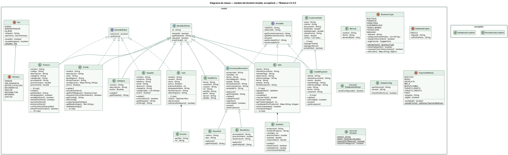
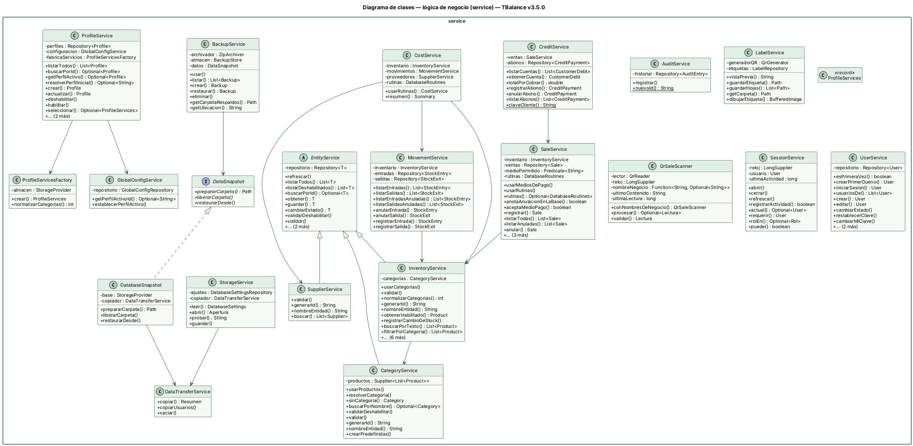
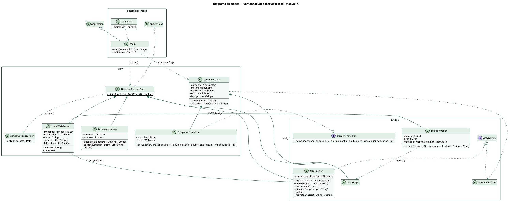
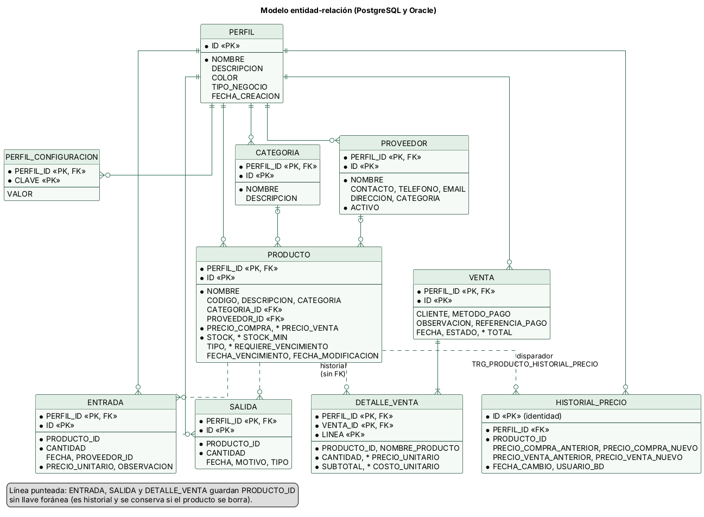

# Fase 4 — Documentación técnica

Universidad Popular del Cesar · Programación de Computadores III (SS462) · Docente: Ing. Esp. Alfredo Bautista 
Integrantes: Kevin Jhosep Mercado · Reinaldo Padilla Pedroza · Dair José Quintero

[README](../README.md) · [Fase 1](FASE1_Especificacion.md) · [Fase 2](FASE2_Arquitectura_y_Diseno.md) · [Fase 3](FASE3_Desarrollo.md) · [Fase 4](FASE4_Documentacion_Tecnica.md) · [Trazabilidad](TRAZABILIDAD.md)

---

## 1. Arquitectura y capas

TBalance está organizado en tres capas, más una de utilidades que usan todas:

| Capa | Paquetes | Qué hace | Usa a |
|---|---|---|---|
| Presentación | `resources/html`, `view`, `bridge` | Muestra las pantallas y recibe lo que hace el usuario. | Lógica de negocio |
| Lógica de negocio | `service`, `model` | Aplica las reglas del negocio. | Acceso a datos |
| Acceso a datos | `repository`, `ia`, `dispositivo` | Llama a las funciones y procedimientos de Oracle, habla con el asistente y usa la cámara. | Oracle |
| Transversal | `util`, `exception` | Fechas, textos, códigos QR, cifrado de contraseñas y errores. | — |

`AppContext` arma todo al arrancar: se conecta con Oracle (o, si no responde, pide los datos de conexión), crea los repositorios y los servicios y los cambia cuando se abre otro negocio, se restaura una copia o se cambia la conexión.

Recorrido de una venta: la página llama a `javaBridge.crearVenta(...)` → `AccessPolicy` revisa que la persona tenga sesión y permiso de vender → `TransactionController` pone quién vendió → `SaleService` revisa los datos y el medio de pago → `OracleRoutines` llama a `SP_REGISTRAR_VENTA`, que en Oracle revisa el stock, guarda en `VENTA` y `DETALLE_VENTA` y descuenta, en una sola transacción → `AuditTrail` anota la venta en el historial.

## 2. Diagrama de paquetes final

## 3. Diagrama de clases final y descripción de cada clase

El diagrama de clases final tiene 154 clases y está dividido en siete partes:

La descripción de cada clase (tipo, responsabilidad, atributos y métodos) está en la [Fase 2, Descripción de cada clase](FASE2_Arquitectura_y_Diseno.md#descripción-de-cada-clase). Se generó a partir del código final de la versión v3.5.0.

## 4. Modelo de datos

### 4.1 Modelo entidad-relación

La base de datos es Oracle. Los scripts `src/main/resources/sql/oracle/01_tablas.sql` y `02_disparadores.sql` crean la versión 1 del esquema; los cambios posteriores están en `cambios/` y TBalance los aplica solo al conectarse, una vez cada uno, anotándolos en `ESQUEMA_VERSION` (v2: borrado lógico, fecha de llegada, proveedor por tipo de producto y copias en la base; v3: vistas para informes; v4: usuarios y roles; v5: historial y cédula en los fiados; v6: abonos; v7: varios computadores; v8: procedimientos para vender, anular y abonar y funciones para los informes; v9: funciones de consulta y procedimientos para guardar). Así una base que ya tenía datos se actualiza sin perderlos.

- Un **perfil** (negocio) tiene sus propias categorías, proveedores, productos, entradas, salidas, ventas y ajustes. Por eso la llave de esas tablas es **(PERFIL_ID, ID)**: el producto "1001" de una ferretería y el "1001" de una droguería son distintos.
- **Borrado lógico:** la aplicación no borra filas con historial. Negocios, categorías, proveedores y productos se **deshabilitan** (`ACTIVO = 0`) y se pueden volver a habilitar; ventas, entradas y salidas se **anulan** (`ESTADO = 'ANULADA'`, con `FECHA_ANULACION` y `MOTIVO_ANULACION`) y su efecto en el stock se revierte. Los `ON DELETE CASCADE` quedan solo para limpiar una base de pruebas (`99_borrar_todo.sql`).
- Todo **producto** tiene una categoría (si no se elige, "Sin categoría") y puede tener un proveedor (llaves foráneas compuestas).
- Un **proveedor** surte uno o más tipos de producto: la tabla **PROVEEDOR_CATEGORIA** relaciona proveedores y categorías (muchos a muchos).
- En **ENTRADA** y **SALIDA**, `FECHA` es el día en que llegó o salió la mercancía (no puede ser futura) y `FECHA_REGISTRO` el momento en que se anotó.
- Una **venta** tiene uno o más renglones en **DETALLE_VENTA** (llave foránea con `ON DELETE CASCADE`). Cada renglón guarda el nombre y el costo del producto al vender.
- **ENTRADA**, **SALIDA** y **DETALLE_VENTA** guardan `PRODUCTO_ID` sin llave foránea a PRODUCTO: son historial y se conservan aunque el producto se elimine.
- **HISTORIAL_PRECIO** la llena el disparador `TRG_PRODUCTO_HISTORIAL_PRECIO` (por ejemplo, cuando una entrada trae un costo nuevo).
- **Historial (v5):** **AUDITORIA** anota quién hizo qué, cuándo y en qué negocio. No tiene llaves foráneas a propósito: guarda el nombre de la persona y del negocio como texto para que el registro se conserve tal cual aunque después cambien. **VENTA** suma `CLIENTE_DOCUMENTO`, la cédula de quien queda debiendo en una venta fiada.
- **Varios computadores (v7):** **CAMBIO_VERSION** tiene una sola fila (`TODO`) con un contador que sube en cada transacción. Cada computador lo consulta para saber si otro guardó algo y debe volver a leer los datos.
- **Funciones de consulta (v9):** TBalance lee los datos solo a través de estas funciones (`07_funciones_consulta.sql`). Las que devuelven filas devuelven un cursor (`SYS_REFCURSOR`). Las que reciben `P_PERFIL` devuelven solo los datos de ese negocio.

| Función | Recibe | Devuelve |
|---|---|---|
| `FN_LISTAR_PERFILES`, `FN_LISTAR_CONFIGURACION` | — | Los negocios y sus ajustes (medios de pago, cuentas) |
| `FN_LISTAR_USUARIOS`, `FN_LISTAR_ACCESOS` | — | Los usuarios y en qué negocio trabaja cada uno, con su rol |
| `FN_LISTAR_HISTORIAL` | — | El historial de acciones |
| `FN_LISTAR_CATEGORIAS`, `FN_LISTAR_PROVEEDORES`, `FN_LISTAR_PROVEEDOR_CATEGORIAS`, `FN_LISTAR_PRODUCTOS` | `P_PERFIL` | El catálogo del negocio |
| `FN_LISTAR_ENTRADAS`, `FN_LISTAR_SALIDAS`, `FN_LISTAR_VENTAS`, `FN_LISTAR_DETALLE_VENTAS`, `FN_LISTAR_ABONOS` | `P_PERFIL` | Los movimientos, las ventas con sus productos y los abonos |
| `FN_EXISTE_CATEGORIA`, `FN_EXISTE_PROVEEDOR` | `P_PERFIL`, `P_ID` | 1 si existe en ese negocio, 0 si no |
| `FN_CONTAR_NEGOCIOS` | — | Cuántos negocios hay |
| `FN_VERSION_CAMBIOS` | `P_CLAVE` | El contador de cambios |
| `FN_LISTAR_COPIAS`, `FN_EXISTE_COPIA`, `FN_LEER_COPIA` | `P_NOMBRE` (las dos últimas) | Las copias de seguridad guardadas en la base |

- **Procedimientos para guardar (v9):** TBalance guarda solo a través de estos procedimientos (`08_procedimientos_guardar.sql`). Ninguno hace `COMMIT`: TBalance confirma o deshace la transacción completa.

| Procedimiento | Qué hace |
|---|---|
| `SP_GUARDAR_<TABLA>` (PERFIL, USUARIO, AUDITORIA, CATEGORIA, PROVEEDOR, PRODUCTO, ENTRADA, SALIDA, VENTA, ABONO) | Con `P_NUEVO = 1` agrega la fila; con `P_NUEVO = 0` la cambia (si no existe, avisa con el error -20190). Recibe una columna por parámetro, con `%TYPE`. |
| `SP_BORRAR_<TABLA>` (las mismas tablas) | Borra una fila; se usa al restaurar una copia de seguridad. `SP_BORRAR_CATEGORIA` y `SP_BORRAR_PROVEEDOR` dejan antes sin categoría o sin proveedor a sus productos. |
| `SP_BORRAR_DETALLE_VENTA`, `SP_AGREGAR_DETALLE_VENTA` | Los productos de una venta. |
| `SP_BORRAR_TIPOS_PROVEEDOR`, `SP_AGREGAR_TIPO_PROVEEDOR` | Qué tipos de producto trae un proveedor. |
| `SP_BORRAR_ACCESOS`, `SP_AGREGAR_ACCESO` | A qué negocios entra una persona y con qué rol. |
| `SP_BORRAR_CONFIGURACION`, `SP_AGREGAR_CONFIGURACION` | Los ajustes de un negocio. |
| `SP_GUARDAR_COPIA`, `SP_BORRAR_COPIA` | Las copias de seguridad (el .zip en un BLOB). |
| `SP_ANOTAR_CAMBIO` | Sube el contador de `CAMBIO_VERSION` en cada transacción. |

- **Ventas, abonos e informes (v8):** operaciones que tocan varias tablas y cálculos para los informes (`04_funciones.sql` y `05_procedimientos.sql`).

| Nombre | Qué hace |
|---|---|
| `SP_REGISTRAR_VENTA` | Revisa el stock de todos los productos (bloquea sus filas con `FOR UPDATE`), guarda `VENTA` y `DETALLE_VENTA` con el costo de cada producto y descuenta el stock. Los productos llegan como texto JSON y se leen con `JSON_TABLE`. |
| `SP_ANULAR_VENTA` | Marca la venta como anulada con el motivo, devuelve las unidades al inventario y escribe la anulación en `AUDITORIA`. |
| `SP_REGISTRAR_ABONO` | Revisa con `FN_SALDO_CLIENTE` que el abono no pase de la deuda y lo guarda en `ABONO`. |
| `FN_SALDO_CLIENTE` | Lo que debe un cliente: ventas fiadas vigentes menos abonos vigentes. |
| `FN_VALOR_INVENTARIO` | Suma de stock × precio de compra. |
| `FN_UTILIDAD_PERIODO` | Ganancia de las ventas completadas entre dos fechas. |
| `FN_CLAVE_CLIENTE` | Cómo se reconoce a un cliente de fiado (su cédula o, en ventas viejas, su nombre). |
- **Fiados (v6):** **ABONO** guarda lo que paga cada cliente que compró fiado. Se relaciona con sus ventas fiadas por la cédula (`CLIENTE_DOCUMENTO`), sin llave foránea, porque un cliente no es una tabla aparte. Lo que debe se calcula: ventas fiadas vigentes menos abonos vigentes.
- **Usuarios y roles (v4):** una persona (**USUARIO**) entra a uno o varios negocios con un rol en cada uno (**NEGOCIO_USUARIO**, muchos a muchos con PERFIL): dueño, administrador o cajero. Las ventas guardan quién las registró y las anulaciones quién las hizo, como texto, porque son historial.
- **RESPALDO** guarda las copias de seguridad dentro de la base (el .zip completo en un BLOB).
- Vistas para informes (v3), que no cuentan lo anulado: `V_VENTAS_POR_DIA`, `V_UTILIDAD_POR_PRODUCTO`, `V_VALOR_INVENTARIO` (solo productos habilitados) y `V_COMPRAS_POR_MES`.

Dentro del .zip de una copia de seguridad, cada tabla va en un archivo JSON con los mismos campos (`perfiles.json` y, por negocio, `categorias.json`, `productos.json`, `ventas.json`...). Al restaurar, TBalance los vuelve a guardar en Oracle con los procedimientos.

### 4.2 Diccionario de datos

#### `PERFIL` — Negocio (perfil). Cada negocio tiene sus propios datos.

Clase Java: `Profile`. Llave primaria: (ID).

| Columna | Tipo en Oracle | Nulo | Llave | Descripción |
|---|---|---|---|---|
| `ID` | `VARCHAR2(20 CHAR)` | No | PK | Identificador del negocio |
| `NOMBRE` | `VARCHAR2(100 CHAR)` | No | — | Nombre del negocio |
| `DESCRIPCION` | `VARCHAR2(500 CHAR)` | Sí | — | Descripción opcional |
| `COLOR` | `VARCHAR2(9 CHAR)` | Sí | — | Color de acento elegido (hex) |
| `TIPO_NEGOCIO` | `VARCHAR2(20 CHAR)` | Sí | — | Clave de BusinessType (FERRETERIA, FARMACIA...) |
| `FECHA_CREACION` | `DATE` | Sí | — | Fecha en que se creó |
| `ACTIVO` | `NUMBER(1)` | No | — | 1 habilitado, 0 deshabilitado. Por defecto 1. (v2) |

Restricciones CHECK: `ACTIVO IN (0, 1)`.

#### `PERFIL_CONFIGURACION` — Ajustes clave-valor de cada negocio.

Clase Java: `Profile.configuracion`. Llave primaria: (PERFIL_ID, CLAVE).

| Columna | Tipo en Oracle | Nulo | Llave | Descripción |
|---|---|---|---|---|
| `PERFIL_ID` | `VARCHAR2(20 CHAR)` | No | PK FK → PERFIL | Negocio |
| `CLAVE` | `VARCHAR2(50 CHAR)` | No | PK | Nombre del ajuste (moneda, stockMin, mediosPago...) |
| `VALOR` | `VARCHAR2(200 CHAR)` | Sí | — | Valor del ajuste |

#### `CATEGORIA` — Categorías de productos de un negocio.

Clase Java: `Category`. Llave primaria: (PERFIL_ID, ID).

| Columna | Tipo en Oracle | Nulo | Llave | Descripción |
|---|---|---|---|---|
| `PERFIL_ID` | `VARCHAR2(20 CHAR)` | No | PK FK → PERFIL | Negocio dueño |
| `ID` | `VARCHAR2(30 CHAR)` | No | PK | Identificador de la categoría |
| `NOMBRE` | `VARCHAR2(100 CHAR)` | No | — | Nombre |
| `DESCRIPCION` | `VARCHAR2(500 CHAR)` | Sí | — | Descripción opcional |
| `ACTIVO` | `NUMBER(1)` | No | — | 1 habilitada, 0 deshabilitada. Por defecto 1. (v2) |

Restricciones CHECK: `ACTIVO IN (0, 1)`. La categoría `CAT-SIN` ("Sin categoría") la crea TBalance y no se puede deshabilitar.

#### `PROVEEDOR` — Proveedores de un negocio.

Clase Java: `Supplier`. Llave primaria: (PERFIL_ID, ID).

| Columna | Tipo en Oracle | Nulo | Llave | Descripción |
|---|---|---|---|---|
| `PERFIL_ID` | `VARCHAR2(20 CHAR)` | No | PK FK → PERFIL | Negocio dueño |
| `ID` | `VARCHAR2(30 CHAR)` | No | PK | Identificador del proveedor |
| `NOMBRE` | `VARCHAR2(100 CHAR)` | No | — | Nombre o razón social |
| `CONTACTO` | `VARCHAR2(100 CHAR)` | Sí | — | Persona de contacto |
| `TELEFONO` | `VARCHAR2(30 CHAR)` | Sí | — | Teléfono |
| `EMAIL` | `VARCHAR2(100 CHAR)` | Sí | — | Correo |
| `DIRECCION` | `VARCHAR2(200 CHAR)` | Sí | — | Dirección |
| `CATEGORIA` | `VARCHAR2(100 CHAR)` | Sí | — | Nombres de los tipos de producto que surte, como texto (el detalle está en PROVEEDOR_CATEGORIA) |
| `ACTIVO` | `NUMBER(1)` | No | — | 1 habilitado, 0 deshabilitado. Por defecto 1. |

Restricciones CHECK: `ACTIVO IN (0, 1)`.

#### `PRODUCTO` — Productos del inventario de un negocio.

Clase Java: `Product`. Llave primaria: (PERFIL_ID, ID).

| Columna | Tipo en Oracle | Nulo | Llave | Descripción |
|---|---|---|---|---|
| `PERFIL_ID` | `VARCHAR2(20 CHAR)` | No | PK FK → CATEGORIA, PERFIL, PROVEEDOR | Negocio dueño |
| `ID` | `VARCHAR2(30 CHAR)` | No | PK | Identificador del producto |
| `NOMBRE` | `VARCHAR2(150 CHAR)` | No | — | Nombre |
| `CODIGO` | `VARCHAR2(60 CHAR)` | Sí | — | Código de barras o interno |
| `DESCRIPCION` | `VARCHAR2(500 CHAR)` | Sí | — | Descripción opcional |
| `CATEGORIA` | `VARCHAR2(100 CHAR)` | Sí | — | Nombre de la categoría (texto) |
| `CATEGORIA_ID` | `VARCHAR2(30 CHAR)` | Sí | FK → CATEGORIA | Categoría (obligatoria en la aplicación; `CAT-SIN` si no se eligió) |
| `PROVEEDOR_ID` | `VARCHAR2(30 CHAR)` | Sí | FK → PROVEEDOR | Proveedor (opcional) |
| `PRECIO_COMPRA` | `NUMBER(14,2)` | No | — | Costo por unidad. Por defecto 0. |
| `PRECIO_VENTA` | `NUMBER(14,2)` | No | — | Precio de venta por unidad. Por defecto 0. |
| `STOCK` | `NUMBER(10)` | No | — | Unidades disponibles. Por defecto 0. |
| `STOCK_MIN` | `NUMBER(10)` | No | — | Stock mínimo antes de avisar. Por defecto 0. |
| `TIPO` | `VARCHAR2(60 CHAR)` | Sí | — | Presentación o tipo |
| `REQUIERE_VENCIMIENTO` | `NUMBER(1)` | No | — | 1 si se controla vencimiento. Por defecto 0. |
| `FECHA_VENCIMIENTO` | `DATE` | Sí | — | Fecha de vencimiento |
| `FECHA_MODIFICACION` | `TIMESTAMP` | Sí | — | Último cambio (la llena TRG_PRODUCTO_VALIDAR) |
| `ACTIVO` | `NUMBER(1)` | No | — | 1 habilitado, 0 deshabilitado. Por defecto 1. (v2) |

Restricciones CHECK: `REQUIERE_VENCIMIENTO IN (0, 1)`, `ACTIVO IN (0, 1)`.

#### `ENTRADA` — Entradas de inventario (compras, reposiciones).

Clase Java: `StockEntry`. Llave primaria: (PERFIL_ID, ID).

| Columna | Tipo en Oracle | Nulo | Llave | Descripción |
|---|---|---|---|---|
| `PERFIL_ID` | `VARCHAR2(20 CHAR)` | No | PK FK → PERFIL | Negocio dueño |
| `ID` | `VARCHAR2(30 CHAR)` | No | PK | Identificador (ENT-...) |
| `PRODUCTO_ID` | `VARCHAR2(30 CHAR)` | No | — | Producto que entró (historial, sin FK) |
| `CANTIDAD` | `NUMBER(10)` | No | — | Unidades |
| `FECHA` | `TIMESTAMP` | Sí | — | Fecha de llegada de la mercancía (no puede ser futura) |
| `PROVEEDOR_ID` | `VARCHAR2(30 CHAR)` | Sí | — | Proveedor que entregó |
| `PRECIO_UNITARIO` | `NUMBER(14,2)` | No | — | Costo por unidad en esa entrada; si cambia, actualiza el costo del producto. Por defecto 0. |
| `OBSERVACION` | `VARCHAR2(500 CHAR)` | Sí | — | Nota |
| `ESTADO` | `VARCHAR2(20 CHAR)` | No | — | COMPLETADA o ANULADA. Por defecto COMPLETADA. (v2) |
| `FECHA_REGISTRO` | `TIMESTAMP` | Sí | — | Momento en que se anotó en TBalance (v2) |
| `FECHA_ANULACION` | `TIMESTAMP` | Sí | — | Cuándo se anuló (v2) |
| `MOTIVO_ANULACION` | `VARCHAR2(300 CHAR)` | Sí | — | Por qué se anuló (v2) |
| `ANULADA_POR` | `VARCHAR2(100 CHAR)` | Sí | — | Nombre de quien anuló (v4) |

Restricciones CHECK: `CANTIDAD > 0`, `ESTADO IN ('COMPLETADA', 'ANULADA')`.

#### `SALIDA` — Salidas de inventario que no son ventas (daño, consumo...).

Clase Java: `StockExit`. Llave primaria: (PERFIL_ID, ID).

| Columna | Tipo en Oracle | Nulo | Llave | Descripción |
|---|---|---|---|---|
| `PERFIL_ID` | `VARCHAR2(20 CHAR)` | No | PK FK → PERFIL | Negocio dueño |
| `ID` | `VARCHAR2(30 CHAR)` | No | PK | Identificador (SAL-...) |
| `PRODUCTO_ID` | `VARCHAR2(30 CHAR)` | No | — | Producto que salió (historial, sin FK) |
| `CANTIDAD` | `NUMBER(10)` | No | — | Unidades |
| `FECHA` | `TIMESTAMP` | Sí | — | Fecha en que salió la mercancía (no puede ser futura) |
| `MOTIVO` | `VARCHAR2(500 CHAR)` | Sí | — | Motivo escrito por el usuario (obligatorio en la aplicación) |
| `TIPO` | `VARCHAR2(60 CHAR)` | Sí | — | Tipo de salida: DANADO, VENCIDO, CONSUMO_INTERNO, DEVOLUCION_PROVEEDOR, PERDIDA u OTRO |
| `ESTADO` | `VARCHAR2(20 CHAR)` | No | — | COMPLETADA o ANULADA. Por defecto COMPLETADA. (v2) |
| `FECHA_REGISTRO` | `TIMESTAMP` | Sí | — | Momento en que se anotó en TBalance (v2) |
| `FECHA_ANULACION` | `TIMESTAMP` | Sí | — | Cuándo se anuló (v2) |
| `MOTIVO_ANULACION` | `VARCHAR2(300 CHAR)` | Sí | — | Por qué se anuló (v2) |
| `ANULADA_POR` | `VARCHAR2(100 CHAR)` | Sí | — | Nombre de quien anuló (v4) |

Restricciones CHECK: `CANTIDAD > 0`, `ESTADO IN ('COMPLETADA', 'ANULADA')`.

#### `VENTA` — Ventas de un negocio.

Clase Java: `Sale`. Llave primaria: (PERFIL_ID, ID).

| Columna | Tipo en Oracle | Nulo | Llave | Descripción |
|---|---|---|---|---|
| `PERFIL_ID` | `VARCHAR2(20 CHAR)` | No | PK FK → PERFIL | Negocio dueño |
| `ID` | `VARCHAR2(30 CHAR)` | No | PK | Identificador (VTA-...) |
| `CLIENTE` | `VARCHAR2(150 CHAR)` | Sí | — | Nombre del cliente |
| `METODO_PAGO` | `VARCHAR2(40 CHAR)` | Sí | — | Efectivo, Nequi, Daviplata, Fiado... (PaymentMethod) |
| `OBSERVACION` | `VARCHAR2(500 CHAR)` | Sí | — | Nota |
| `REFERENCIA_PAGO` | `VARCHAR2(60 CHAR)` | Sí | — | Comprobante del pago digital |
| `FECHA` | `TIMESTAMP` | Sí | — | Fecha y hora |
| `ESTADO` | `VARCHAR2(20 CHAR)` | Sí | — | COMPLETADA o ANULADA |
| `TOTAL` | `NUMBER(14,2)` | No | — | Suma de los subtotales. Por defecto 0. |
| `FECHA_ANULACION` | `TIMESTAMP` | Sí | — | Cuándo se anuló (v2) |
| `MOTIVO_ANULACION` | `VARCHAR2(300 CHAR)` | Sí | — | Por qué se anuló (v2) |
| `ANULADA_POR` | `VARCHAR2(100 CHAR)` | Sí | — | Nombre de quien anuló (v4) |
| `USUARIO_ID` | `VARCHAR2(30 CHAR)` | Sí | — | Quién vendió (sin llave foránea: es historial). El cajero solo anula sus propias ventas (v4) |
| `VENDEDOR` | `VARCHAR2(100 CHAR)` | Sí | — | Nombre de quien vendió (v4) |
| `FECHA_REGISTRO` | `TIMESTAMP` | Sí | — | Momento exacto en que se registró; cuenta los 10 minutos del cajero (v4) |
| `CLIENTE_DOCUMENTO` | `VARCHAR2(20 CHAR)` | Sí | — | Cédula del cliente; obligatoria si la venta es fiada (v5) |

#### `DETALLE_VENTA` — Productos de cada venta.

Clase Java: `SaleItem`. Llave primaria: (PERFIL_ID, VENTA_ID, LINEA).

| Columna | Tipo en Oracle | Nulo | Llave | Descripción |
|---|---|---|---|---|
| `PERFIL_ID` | `VARCHAR2(20 CHAR)` | No | PK FK → VENTA | Negocio dueño |
| `VENTA_ID` | `VARCHAR2(30 CHAR)` | No | PK FK → VENTA | Venta |
| `LINEA` | `NUMBER(4)` | No | PK | Número de línea dentro de la venta |
| `PRODUCTO_ID` | `VARCHAR2(30 CHAR)` | No | — | Producto vendido (historial, sin FK) |
| `NOMBRE_PRODUCTO` | `VARCHAR2(150 CHAR)` | Sí | — | Nombre del producto al vender |
| `CANTIDAD` | `NUMBER(10)` | No | — | Unidades |
| `PRECIO_UNITARIO` | `NUMBER(14,2)` | No | — | Precio por unidad. Por defecto 0. |
| `SUBTOTAL` | `NUMBER(14,2)` | No | — | Cantidad × precio. Por defecto 0. |
| `COSTO_UNITARIO` | `NUMBER(14,2)` | No | — | Costo del producto al vender (para la utilidad). Por defecto 0. |

Restricciones CHECK: `CANTIDAD > 0`.

#### `HISTORIAL_PRECIO` — Cambios de precio de los productos. La llena el disparador TRG_PRODUCTO_HISTORIAL_PRECIO; TBalance no escribe en ella.

Clase Java: `— (solo base de datos)`. Llave primaria: (ID).

| Columna | Tipo en Oracle | Nulo | Llave | Descripción |
|---|---|---|---|---|
| `ID` | `NUMBER GENERATED ALWAYS AS IDENTITY` | No | PK | Consecutivo automático (identidad) |
| `PERFIL_ID` | `VARCHAR2(20 CHAR)` | No | FK → PERFIL | Negocio |
| `PRODUCTO_ID` | `VARCHAR2(30 CHAR)` | No | — | Producto que cambió |
| `PRECIO_COMPRA_ANTERIOR` | `NUMBER(14,2)` | Sí | — | Costo antes del cambio |
| `PRECIO_COMPRA_NUEVO` | `NUMBER(14,2)` | Sí | — | Costo después |
| `PRECIO_VENTA_ANTERIOR` | `NUMBER(14,2)` | Sí | — | Precio de venta antes |
| `PRECIO_VENTA_NUEVO` | `NUMBER(14,2)` | Sí | — | Precio de venta después |
| `FECHA_CAMBIO` | `TIMESTAMP` | No | — | Momento del cambio. Por defecto SYSTIMESTAMP. |
| `USUARIO_BD` | `VARCHAR2(60 CHAR)` | Sí | — | Usuario de la base que hizo el cambio |

#### `USUARIO` — Personas que usan TBalance. (v4)

Clase Java: `User`. Llave primaria: (ID). Una persona puede entrar a varios negocios, por eso la tabla no tiene PERFIL_ID.

| Columna | Tipo en Oracle | Nulo | Llave | Descripción |
|---|---|---|---|---|
| `ID` | `VARCHAR2(30 CHAR)` | No | PK | `USR-<marca de tiempo>` |
| `NOMBRE` | `VARCHAR2(100 CHAR)` | No | — | Nombre de la persona |
| `USUARIO` | `VARCHAR2(30 CHAR)` | No | UNIQUE | Nombre para iniciar sesión, en minúsculas |
| `CLAVE` | `VARCHAR2(200 CHAR)` | No | — | Resumen PBKDF2-HMAC-SHA256 con sal (`pbkdf2_sha256$iteraciones$sal$resumen`); la contraseña nunca se guarda |
| `ACTIVO` | `NUMBER(1)` | No | — | 1 habilitada, 0 deshabilitada. Por defecto 1. |
| `INTENTOS_FALLIDOS` | `NUMBER(3)` | No | — | Contraseñas equivocadas seguidas. Por defecto 0. |
| `BLOQUEADO_HASTA` | `TIMESTAMP` | Sí | — | Tras 5 intentos fallidos no puede entrar hasta esta hora (5 minutos) |
| `FECHA_CREACION` | `TIMESTAMP` | Sí | — | Cuándo se creó |
| `ULTIMO_INGRESO` | `TIMESTAMP` | Sí | — | Último inicio de sesión |

Restricciones CHECK: `ACTIVO IN (0, 1)`, `INTENTOS_FALLIDOS >= 0`.

#### `AUDITORIA` — Historial de acciones: quién hizo qué y cuándo. (v5)

Clase Java: `AuditEntry` (`AuditJdbcRepository`). Llave primaria: ID. Índices por FECHA y por (PERFIL_ID, FECHA).

| Columna | Tipo en Oracle | Nulo | Llave | Descripción |
|---|---|---|---|---|
| `ID` | `VARCHAR2(40 CHAR)` | No | PK | Identificador (H-…) |
| `FECHA` | `TIMESTAMP` | No | — | Cuándo pasó |
| `USUARIO_ID` | `VARCHAR2(30 CHAR)` | Sí | — | Quién lo hizo (vacío en un ingreso fallido) |
| `USUARIO` | `VARCHAR2(100 CHAR)` | Sí | — | Nombre de la persona en ese momento |
| `ROL` | `VARCHAR2(20 CHAR)` | Sí | — | Su rol en ese negocio |
| `PERFIL_ID` | `VARCHAR2(20 CHAR)` | Sí | — | Negocio (vacío si fue general: ingresos, copias de seguridad) |
| `PERFIL` | `VARCHAR2(100 CHAR)` | Sí | — | Nombre del negocio en ese momento |
| `ACCION` | `VARCHAR2(60 CHAR)` | No | — | Qué hizo, por ejemplo "Anuló una venta" |
| `DETALLE` | `VARCHAR2(500 CHAR)` | Sí | — | Datos de la acción (nunca contraseñas) |

#### `CAMBIO_VERSION` — Contador de cambios para varios computadores. (v7)

No tiene clase Java propia: la usa `Database`. Llave primaria: CLAVE.

| Columna | Tipo en Oracle | Nulo | Llave | Descripción |
|---|---|---|---|---|
| `CLAVE` | `VARCHAR2(20 CHAR)` | No | PK | Siempre `TODO` |
| `VERSION` | `NUMBER(19)` | No | — | Sube en 1 con cada transacción. Por defecto 0. |

#### `ABONO` — Abonos de los clientes que compraron fiado. (v6)

Clase Java: `CreditPayment` (`CreditPaymentJdbcRepository`). Llave primaria: (PERFIL_ID, ID). Índice por (PERFIL_ID, CLIENTE_DOCUMENTO).

| Columna | Tipo en Oracle | Nulo | Llave | Descripción |
|---|---|---|---|---|
| `PERFIL_ID` | `VARCHAR2(20 CHAR)` | No | PK FK → PERFIL | Negocio |
| `ID` | `VARCHAR2(30 CHAR)` | No | PK | Identificador (ABO-...) |
| `CLIENTE_DOCUMENTO` | `VARCHAR2(160 CHAR)` | No | — | Cédula del cliente (la misma de sus ventas fiadas) |
| `CLIENTE` | `VARCHAR2(150 CHAR)` | Sí | — | Nombre del cliente |
| `MONTO` | `NUMBER(14,2)` | No | — | Valor abonado (mayor que 0) |
| `METODO_PAGO` | `VARCHAR2(40 CHAR)` | No | — | Cómo pagó el abono (nunca Fiado) |
| `REFERENCIA_PAGO` | `VARCHAR2(60 CHAR)` | Sí | — | Comprobante o voucher |
| `NOTA` | `VARCHAR2(300 CHAR)` | Sí | — | Nota opcional |
| `FECHA` | `TIMESTAMP` | No | — | Cuándo se recibió |
| `USUARIO_ID` | `VARCHAR2(30 CHAR)` | Sí | — | Quién lo recibió |
| `REGISTRADO_POR` | `VARCHAR2(100 CHAR)` | Sí | — | Nombre de quien lo recibió |
| `ESTADO` | `VARCHAR2(20 CHAR)` | No | — | COMPLETADA o ANULADA. Por defecto COMPLETADA. |
| `FECHA_ANULACION` | `TIMESTAMP` | Sí | — | Cuándo se anuló |
| `MOTIVO_ANULACION` | `VARCHAR2(300 CHAR)` | Sí | — | Por qué se anuló |
| `ANULADA_POR` | `VARCHAR2(100 CHAR)` | Sí | — | Quién lo anuló |

Restricciones CHECK: `MONTO > 0`, `ESTADO IN ('COMPLETADA', 'ANULADA')`.

#### `NEGOCIO_USUARIO` — A qué negocios entra cada persona y con qué rol. (v4)

Clase Java: `Acceso` (lista `User.accesos`). Llave primaria: (USUARIO_ID, PERFIL_ID).

| Columna | Tipo en Oracle | Nulo | Llave | Descripción |
|---|---|---|---|---|
| `USUARIO_ID` | `VARCHAR2(30 CHAR)` | No | PK FK → USUARIO | Persona |
| `PERFIL_ID` | `VARCHAR2(20 CHAR)` | No | PK FK → PERFIL | Negocio |
| `ROL` | `VARCHAR2(20 CHAR)` | No | — | DUENO, ADMINISTRADOR o CAJERO |

Restricciones CHECK: `ROL IN ('DUENO', 'ADMINISTRADOR', 'CAJERO')`.

#### `PROVEEDOR_CATEGORIA` — Tipos de producto (categorías) que surte cada proveedor. (v2)

Clase Java: `Supplier.categoriaIds`. Llave primaria: (PERFIL_ID, PROVEEDOR_ID, CATEGORIA_ID).

| Columna | Tipo en Oracle | Nulo | Llave | Descripción |
|---|---|---|---|---|
| `PERFIL_ID` | `VARCHAR2(20 CHAR)` | No | PK FK → PROVEEDOR, CATEGORIA | Negocio |
| `PROVEEDOR_ID` | `VARCHAR2(30 CHAR)` | No | PK FK → PROVEEDOR | Proveedor |
| `CATEGORIA_ID` | `VARCHAR2(30 CHAR)` | No | PK FK → CATEGORIA | Tipo de producto que surte |

#### `RESPALDO` — Copias de seguridad guardadas en la base. (v2)

Clase Java: `Backup` (la escribe `DatabaseBackupRepository`). Llave primaria: (NOMBRE).

| Columna | Tipo en Oracle | Nulo | Llave | Descripción |
|---|---|---|---|---|
| `NOMBRE` | `VARCHAR2(120 CHAR)` | No | PK | Nombre de la copia (`TBalance_<fecha>_<hora>.zip`) |
| `FECHA` | `TIMESTAMP` | No | — | Cuándo se hizo. Por defecto la hora actual. |
| `TAMANO` | `NUMBER(12)` | No | — | Tamaño en bytes |
| `CONTENIDO` | `BLOB` | No | — | El .zip con todos los datos |

#### `ESQUEMA_VERSION` — Cambios del esquema ya aplicados. (v2)

Clase Java: `— (la usa Database.actualizarEsquema)`. Llave primaria: (VERSION).

| Columna | Tipo en Oracle | Nulo | Llave | Descripción |
|---|---|---|---|---|
| `VERSION` | `NUMBER(4)` | No | PK | Número de la versión aplicada (2, 3...) |
| `FECHA` | `TIMESTAMP` | No | — | Cuándo se aplicó |

#### Vistas (v3)

| Vista | Qué muestra |
|---|---|
| `V_VENTAS_POR_DIA` | Por negocio y día: número de ventas y total vendido |
| `V_UTILIDAD_POR_PRODUCTO` | Por producto: unidades vendidas, lo vendido, el costo y la utilidad |
| `V_VALOR_INVENTARIO` | Por negocio: productos habilitados, unidades, costo del inventario y valor a precio de venta |
| `V_COMPRAS_POR_MES` | Por negocio y mes: entradas con costo y total comprado |

Las vistas no cuentan ventas ni entradas anuladas.

Otros archivos que genera el programa (no son tablas de datos): etiquetas `~/.inventariopro/etiquetas/*.png`, informes `Documentos/TBalance/Informe de ventas - <negocio> - <desde> a <hasta>.xlsx`, la configuración del asistente `~/.inventariopro/asistente.json` (`clave`, `modelo`; solo en ese computador), su registro de errores `asistente.log`, la configuración de la base de datos `~/.inventariopro/basedatos.json` (`motor`, `url`, `usuario`, `clave`; solo en ese computador) y el perfil de la ventana de Edge `~/.inventariopro/ventana/`.

## 5. Tabla consolidada de principios aplicados

| Tipo | Principio o práctica | Dónde | Cómo se aplica |
|---|---|---|---|
| GRASP | Creador | [`Sale.agregarItem`](../src/main/java/sistemainventario/model/Sale.java) | La venta crea sus renglones (`SaleItem`). |
| GRASP | Creador | [`ProfileServicesFactory`](../src/main/java/sistemainventario/service/ProfileServicesFactory.java) | Crea los servicios de cada negocio con los repositorios del almacenamiento en uso. |
| GRASP | Controlador | [`JavaBridge`](../src/main/java/sistemainventario/bridge/JavaBridge.java) y controladores de `bridge` | Reciben lo que hace el usuario y llaman a los servicios. |
| GRASP | Experto en información | [`Product`](../src/main/java/sistemainventario/model/Product.java) | Decide su estado (agotado, por vencer) y si alcanza el stock. |
| GRASP | Experto en información | [`CustomerDebt`](../src/main/java/sistemainventario/model/CustomerDebt.java) | Calcula cuánto debe un cliente con lo fiado y lo abonado. |
| GRASP | Bajo acoplamiento | [`Repository<T>`](../src/main/java/sistemainventario/repository/Repository.java) | Los servicios no saben cómo se guardan los datos: el acceso a Oracle está en los repositorios. |
| GRASP | Alta cohesión | [`AccessPolicy`](../src/main/java/sistemainventario/bridge/AccessPolicy.java), [`AuditTrail`](../src/main/java/sistemainventario/bridge/AuditTrail.java) | Uno solo revisa permisos; el otro solo anota el historial. |
| SOLID | SRP | `Product` / `InventoryService` / `ProductRepository` | Reglas, caso de uso y guardado están en clases distintas. |
| SOLID | SRP | `UserService` / `SessionService` / [`PasswordHasher`](../src/main/java/sistemainventario/util/PasswordHasher.java) | Usuarios, sesión y cifrado de contraseñas separados. |
| SOLID | OCP | [`JdbcRepository<T>`](../src/main/java/sistemainventario/repository/JdbcRepository.java) | La base de datos se agregó con clases nuevas, sin cambiar los servicios. |
| SOLID | OCP | [`Camera`](../src/main/java/sistemainventario/dispositivo/Camera.java) | El celular como lector se agregó con `PhoneCamera`, sin cambiar la venta por QR. |
| Código limpio | Nombres que dicen lo que hacen | `disminuirStock`, `registrarAbono`, `aceptaMedioPago` | Se entiende qué hace el método sin leerlo. |
| Código limpio | Un solo lugar para los errores | [`BridgeResponse`](../src/main/java/sistemainventario/bridge/BridgeResponse.java) | Convierte cualquier error en un mensaje para el usuario. |
| Código limpio | Constantes en lugar de valores sueltos | `Sale.PREFIJO_ID`, `Rol.MINUTOS_ANULAR_PROPIA` | Los valores fijos tienen nombre. |
| Código limpio | Javadoc | Todas las clases | Cada clase y método público explica qué hace. |

La tabla completa está en [TRAZABILIDAD.md](TRAZABILIDAD.md).

## 6. Reporte final de Git

### 6.1 Commits por integrante

| Integrante | Usuario GitHub | Commits | Pull Requests que aprobó y fusionó |
|---|---|---|---|
| Kevin Jhosep Mercado | @kjhosepmercadom | 27 | 7 |
| Dair José Quintero | @djosequintero | 24 | 10 |
| Reinaldo Padilla Pedroza | @rjpadillap | 23 | 8 |

Además está el commit `Initial commit` con el que GitHub creó el repositorio.

### 6.2 Versiones

| Etiqueta | Contenido |
|---|---|
| `v3.0.0-avance1` | Código de Programación II organizado en capas, con repositorios, servicios y controladores. |
| `v3.1.0` | Copias de seguridad. |
| `v3.2.0` | Etiquetas QR y venta por QR con la cámara. |
| `v3.3.0` | Nombres de clases en inglés, precio de compra y ganancia por producto, documentación por fases. |
| `v3.4.0` | Medios de pago, informes con Excel y PDF, asistente con IA, ventana de Edge y diseño nuevo. |
| `v3.5.0` | PostgreSQL y Oracle (también en la nube, desde varios computadores), borrado lógico, copias en la base, usuarios con roles, historial, fiados con abonos, cobro por cuenta con QR de Bre-B, celular como lector QR e interfaz en vidrio. |

### 6.3 Ramas creadas y fusionadas

| PR | Rama | Destino | Fecha | Aprobó y fusionó |
|---|---|---|---|---|
| #1 | `feature/dair-modelo-dominio` | `dev` | 2026-10-27 | @rjpadillap |
| #2 | `feature/reinaldo-persistencia-json` | `dev` | 2026-10-27 | @kjhosepmercadom |
| #3 | `feature/kevin-servicios-bridge` | `dev` | 2026-10-27 | @rjpadillap |
| #4 | `dev` | `main` | 2026-10-27 | @rjpadillap |
| #5 | `feature/reinaldo-backup-storage` | `dev` | 2026-10-27 | @kjhosepmercadom |
| #6 | `feature/kevin-backup-service` | `dev` | 2026-10-27 | @djosequintero |
| #7 | `feature/dair-backup-ui` | `dev` | 2026-10-27 | @rjpadillap |
| #8 | `feature/reinaldo-architecture-docs` | `dev` | 2026-10-27 | @kjhosepmercadom |
| #9 | `dev` | `main` | 2026-10-27 | @djosequintero |
| #10 | `feature/reinaldo-qr-reader-camera` | `dev` | 2026-10-28 | @kjhosepmercadom |
| #11 | `feature/kevin-qr-sale-service` | `dev` | 2026-10-28 | @djosequintero |
| #12 | `feature/dair-qr-sale-ui` | `dev` | 2026-10-28 | @rjpadillap |
| #13 | `dev` | `main` | 2026-10-28 | @djosequintero |
| #14 | `feature/kevin-english-names-profit` | `dev` | 2026-11-10 | @djosequintero |
| #15 | `feature/dair-profit-ui-redesign` | `dev` | 2026-11-10 | @rjpadillap |
| #16 | `feature/reinaldo-docs-v3.3.0` | `dev` | 2026-11-10 | @kjhosepmercadom |
| #17 | `dev` | `main` | 2026-11-10 | @djosequintero |
| #18 | `feature/kevin-payments-reports-assistant` | `dev` | 2026-11-16 | @djosequintero |
| #19 | `feature/dair-edge-window-new-ui` | `dev` | 2026-11-16 | @rjpadillap |
| #20 | `feature/reinaldo-docs-v3.4.0` | `dev` | 2026-11-16 | @kjhosepmercadom |
| #21 | `dev` | `main` | 2026-11-16 | @djosequintero |
| #22 | `feature/kevin-database-history-credit` | `dev` | 2026-11-22 | @djosequintero |
| #23 | `feature/dair-glass-ui-phone-reader` | `dev` | 2026-11-22 | @rjpadillap |
| #24 | `feature/reinaldo-roles-docs-v3.5.0` | `dev` | 2026-11-22 | @kjhosepmercadom |
| #25 | `dev` | `main` | 2026-11-22 | @djosequintero |

Todas las ramas `feature/*` se fusionaron en `dev` con un Pull Request aprobado por otro integrante y luego se borraron; `dev` se fusionó en `main` en cada versión.
